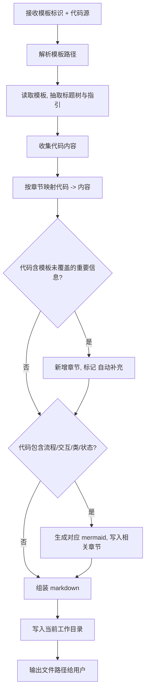

# Code to Template

把一段/一组代码按指定中文模板填写成完整文档。

> **与增量维护的分工**：日常维护走 `sop-maintenance.mdc` + `incremental-design-doc` / `incremental-sop-doc`；**仅当用户明确要求全量重新生成**时使用本 skill。

> **代码源默认起点**：用户未指定路径时，从**当前工作区根目录**（工程 Open Folder 目录）读取；**不要**从文档目录的父级（如 `docs/../`）推断，以免漏读与文档目录同级的其它源码树。

## 何时使用

用户给出：
- **模板**：模板文件名关键词（如 "设计方案"）、模板完整文件名（如 `设计方案模板.md`）、或任意路径的模板 `.md`
- **代码源**：直接粘贴的代码片段、单个文件路径、文件夹路径，或以上几种的混合

并要求按该模板输出文档时使用此 skill。

## 执行流程



## 步骤详解

### 1. 解析模板路径

用户给出模板标识后，按以下优先级解析：

1. 若是绝对路径或相对路径且 `.md` 后缀 → 直接使用
2. 若是完整模板文件名（如 `设计方案模板.md`）→ 在 `D:/Downloads/模板/` 查找
3. 若是关键词（如 "设计方案"、"bug"）→ 在 `D:/Downloads/模板/` 模糊匹配 `*<关键词>*模板.md`，排除 `*示例.md`
4. 若多个匹配 → 用 AskUserQuestion 列出让用户选
5. 若无匹配 → 列出 `D:/Downloads/模板/` 下所有 `*模板.md` 让用户选

**注意**：永远不要使用 `*示例.md` 作为模板。

### 2. 读取模板，抽取标题树

用 Read 读取模板全文，按 markdown 标题层级（`#`、`##`、`###`）解析出章节树。每个章节保留：
- 标题文本
- 层级
- 标题下原有的占位/说明文字（作为"写作指引"，告诉自己这一节该写什么）

### 3. 收集代码内容

按用户给出的源逐项处理：

| 源类型 | 处理 |
|--------|------|
| 直接粘贴的代码片段 | 直接采用 |
| 单文件路径 | Read |
| 文件夹路径 | Glob 主流代码扩展名（`.py .js .ts .tsx .jsx .vue .go .java .rs .cpp .c .h .cs .kt .swift .rb .php .sql .sh .ps1`），并包含 `.md` 配置说明，逐个 Read |
| 多个混合 | 依次处理后合并 |

**大规模兜底**：若文件夹下命中 > 50 个文件或单文件 > 2000 行，先汇报规模再询问用户是否继续 / 缩小范围。

### 4. 章节映射

对模板的每个章节，结合"写作指引"，从代码内容中抽取或归纳出对应文字：

- 名称/概述类章节 → 从代码顶部注释、README、package.json/pyproject.toml 等元数据归纳
- 功能描述类章节 → 从函数/类的命名、docstring、关键逻辑归纳
- 接口/参数类章节 → 列出函数签名、参数、返回值（建议用表格）
- 依赖/环境类章节 → 从 import / require / 配置文件归纳
- 风险/边界类章节 → 从 try/except、错误处理、边界判断归纳

**章节内容必须基于代码事实**，不要编造代码中没有的内容。代码确实没有的信息，章节内容写"代码中未体现"或基于代码合理推断并明确标注（如"推断："）。

### 5. 自动补充章节

若代码中存在重要信息（如关键算法、状态机、特殊配置、对外接口），但模板中没有任何章节能容纳，则：

1. 在最相近的章节后面新增一个 `##` 章节
2. 标题在原标题文字后追加 ` <!-- 自动补充 -->`
3. 例如：
   ```markdown
   ## 缓存策略 <!-- 自动补充 -->
   ```

### 6. 自动生成 mermaid

根据代码特征触发，按表对应：

| 代码特征 | mermaid 类型 | 归属章节 |
|----------|--------------|----------|
| 多分支控制流 / 多步骤业务逻辑 | `flowchart TD` | 模板中含"流程"/"逻辑"/"步骤"的章节；否则新增 `## 处理流程 <!-- 自动补充 -->` |
| 跨模块/服务/API 调用 | `sequenceDiagram` | 含"时序"/"交互"/"调用"的章节；否则新增 `## 调用时序 <!-- 自动补充 -->` |
| 类继承 / 数据模型关系 | `classDiagram` | 含"架构"/"结构"/"模型"/"设计"的章节；否则新增 `## 数据结构 <!-- 自动补充 -->` |
| 显式状态切换 | `stateDiagram-v2` | 含"状态"的章节；否则新增 `## 状态机 <!-- 自动补充 -->` |

同一份代码可同时触发多种图。所有 mermaid 用三反引号 + `mermaid` 语言标记包裹。

**mermaid 节点文字注意事项**：
- 节点 ID 用英文/数字
- 节点文字含特殊字符（`()`、`:`、`,`）时用双引号包裹，如 `A["处理(批量)"]`
- 避免在 sequenceDiagram 中使用未声明的 participant

### 7. 组装并写文件

- 输出文件路径：**当前工作目录**下，文件名 `<模板名去掉"模板"二字>-<源名称或时间戳>.md`
  - 模板 `设计方案模板.md` + 源 `src/` → `设计方案-src.md`
  - 多源或片段 → 用时间戳 `设计方案-20260525.md`
  - 若文件已存在，在末尾加 `-2`、`-3`…
- 写入后用一句话告诉用户：`已生成: <绝对路径>`

## 边界处理

| 情况 | 行为 |
|------|------|
| 模板关键词无任何匹配 | 列出 `D:/Downloads/模板/` 下所有 `*模板.md` 让用户选 |
| 模板路径不存在 | 报错并询问正确路径 |
| 代码源路径不存在 | 报错并列出工作目录辅助用户排查 |
| 代码源为空 | 拒绝执行，提示用户提供有效代码 |
| 文件夹命中文件 > 50 或单文件 > 2000 行 | 先报告规模，询问用户是否继续/缩小范围 |
| 模板无任何 markdown 标题 | 把整份模板当作单章节处理，全部代码归纳塞入 |
| 章节在代码中无对应内容 | 该章节写"代码中未体现"，不留空 |

## 红线

- ❌ 不要把 `*示例.md` 当模板用
- ❌ 不要编造代码中不存在的功能、接口、参数
- ❌ 不要省略模板原有章节（即使代码中没对应内容，也保留标题）
- ❌ 不要把 mermaid 写在错误的章节里（如把类图塞进"流程"章节）
- ✅ 自动新增的章节必须带 `<!-- 自动补充 -->` 标记
- ✅ 推断性内容必须显式标注"推断："
