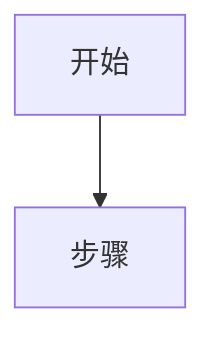

## {模块名称}（{代码路径}） <!-- 自动补充 -->

### 概述

{一句话说明模块职责}

### 关键类 / 接口

| **类/文件** | **职责** |
| --- | --- |
| {ClassName} | {说明} |

### 配置 / 数据

| **字段/键** | **说明** |
| --- | --- |
| {field} | {说明} |

### 流程（可选）

### 与 UI / SOP 的关联

- UI：{页面或 Action}
- SOP：见 `plugins/aoi/docs/AOI 检测软件 软件操作SOP.md` §{x.x}
