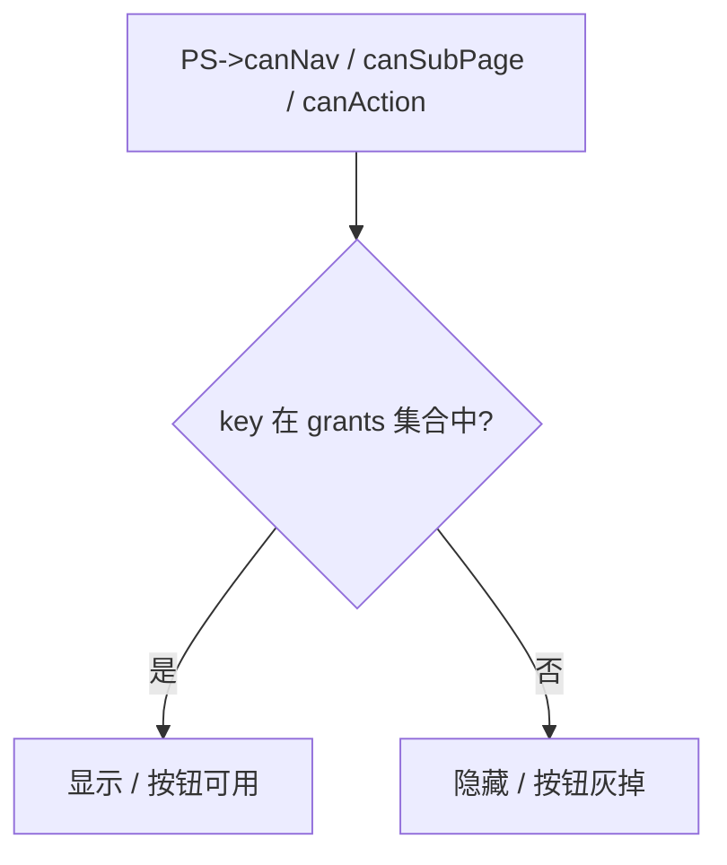

# 权限插件使用与接入指南

> 面向**业务插件开发者**、**实施/运维人员**与**架构评审**。本文自洽描述 RBAC 设计、接入步骤、管理端配置、数据库机制、审计写法与**全部开发约定**；不依赖其它过程文档。  
> 与 `代码总结.md` 配对：前者偏「怎么用、怎么接」，后者偏「做了什么、改在哪」。

---

## 目录

1. [设计思想：我们为什么这样做](#1-设计思想我们为什么这样做)
2. [核心概念速查](#2-核心概念速查)
3. [运行时怎么工作](#3-运行时怎么工作)
4. [业务插件接入：写代码](#4-业务插件接入写代码)
5. [管理界面配置：让控制生效](#5-管理界面配置让控制生效)
6. [数据库设计与实现细节](#6-数据库设计与实现细节)（含 [§6.8 Catalog Reconcile](#68-catalog-reconcile与-owner_plugin运维说明)）
7. [审计日志：怎么写才能记上](#7-审计日志怎么写才能记上)
8. [端到端示例：新增一个业务功能](#8-端到端示例新增一个业务功能)
9. [账号、角色与验收路径](#9-账号角色与验收路径)
10. [常见问题](#10-常见问题)
11. [开发约定总表（必读）](#11-开发约定总表必读)

---

## 1. 设计思想：我们为什么这样做

### 1.1 RBAC 在本项目中的含义

我们采用经典的 **RBAC（Role-Based Access Control，基于角色的访问控制）**：

- **用户**绑定**一个角色**（当前约定：单用户单角色，简化会话与 grants 加载）。
- **角色**拥有一组**权限资源**的授予关系。
- **运行时**不做「每个按钮写 if-else」，而是统一问：`当前有效身份的角色，是否 grants 了某个资源 key？`

这样做的好处：

| 好处 | 说明 |
|------|------|
| 配置与代码分离 | 谁能看到什么、能点什么，主要在**角色管理**里勾选，不必改代码发版 |
| 可审计 | 谁授予了哪些能力、谁执行了哪些操作，可落到 `perm_audit_log` |
| 可扩展 | 新插件只需注册页面 + 声明资源 key + 绑定 Command，即可纳入同一套体系 |
| 默认安全 | **不在 grants 里 = 不显示 / 不可用**（Fail-Closed 显隐策略） |

### 1.2 三级资源模型（nav / sub_page / action）

我们不把「模块 / 页面 / 按钮」混在一个扁平列表里，而是分成三级：

```
nav（导航页）          ← 顶栏有没有这个入口
  ├─ action           ← 挂在导航页上的按钮（无 Tab 的场景）
  └─ sub_page（子页面） ← 容器里的 Tab / 侧栏项
       └─ action      ← 子页面里的按钮
```

**为什么分三级？**

- **nav** 控制「用户能不能进入这一块业务」——对应主窗口顶栏容器。
- **sub_page** 控制「进了容器后，哪些 Tab 可见」——对应 `PageWithSubNav` 子项。
- **action** 控制「页面里哪些操作可点」——对应 `Command` / 按钮。

配置期的父子联动（normalize）保证：**没勾 nav，就不可能勾上其下的 sub/action**，避免数据库里出现逻辑上不可能的授权组合。

### 1.3 全局唯一 key：一套标识贯穿全链路

**运行时只认 `perm_permission.key`**，不再维护「页面 id → 权限 id」映射表。

| 层级 | key 示例 | 代码里哪里用 |
|------|----------|--------------|
| nav | `nav.permission` | `addContainerPage(..., "nav.permission", ...)` 的 titleKey |
| sub_page | `sub.perm.users` | `addSubPage(..., "sub.perm.users", ...)` 的 titleKey |
| action | `perm.users.create` | `Command::setName("perm.users.create")` |

**为什么？** 注册页面、Command 命名、数据库资源、角色勾选、运行时判定——全部用同一个字符串，减少错位。

### 1.4 有效身份：未登录不是「无权限」

| 状态 | 有效身份 | grants 来源 |
|------|----------|-------------|
| 冷启动 / 未登录 | 最小用户 `minimal` | 角色 `minimal` 的授权 |
| 普通用户登录 | 当前用户 | 其角色的授权 |
| 超级用户 `admin` 登录 | 超级管理员角色 | 库内全量授权 + 运行时等效全放行 |
| 登出 / 空闲超时 | 回到最小用户 | 同未登录 |

**为什么要有最小用户？** 产线设备常需要「不登录也能看部分界面」，但不能给写操作；最小角色 grants 可编辑，比写死在代码里灵活。

### 1.5 历史说明（已移除的旧 Demo）

2026-06 起已删除 `PermissionManager`、`MenuConfigManager`、`config/menu.json`、`config/roles.json` 及 Settings 权限演示页。导航门控与 Command 权限统一使用 `PermService`；角色与 grants 由 Permission 插件 + DB 管理。

| 旧方式（已删除） | 现方式 |
|--------|--------|
| `roles.json` 三角色 Demo | DB 角色 + 种子 `super_admin` / `minimal` |
| `menu.json` 静态可见性 | 插件 `registerNav` + `PS->canNav` |
| 未纳管默认显示 | **不在 grants 即不显示** |
| 登录改 PM 角色名 | `reloadForUser(userId)` 从 DB 加载 grants |

---

## 2. 核心概念速查

| 术语 | 含义 |
|------|------|
| **资源 (Permission Resource)** | `perm_permission` 表中的一行，带 `resource_type` 与 `key` |
| **授予 (Grant)** | `perm_role_permission` 中角色与资源 id 的关联 |
| **grants 集合** | 运行时加载到 `PermService` 内的 key 集合（含祖先展开） |
| **PermService (`PS`)** | `common/ui/uibase/permservice.h` 全局单例 |
| **PermKeys** | `plugins/permission/service/perm_action_keys.h` 常量，避免魔法字符串 |
| **normalize** | 保存授权前剔除非法父子组合、`enabled=0` 项 |
| **Command** | MVVM 用户操作封装；`run()` 经权限门控与审计中间件 |

---

## 3. 运行时怎么工作

### 3.1 判定流程



- **导航**：`MainWindow` 在 `finalizeNavigation` / `onPermissionsChanged` 里对每个 nav titleKey 调 `PS->canNav()`，控制顶栏显隐。
- **子页**：对每个 `addSubPage` 的 titleKey 调 `PS->canSubPage()`，控制侧栏/Tab 显隐。
- **操作**：`FunctionalCommand::canExecute()` 若设置了 `name()`，则要求 `PS->can(name())` 为 true；`DataBinding::bindCommand` 在 `permissionsChanged` 时刷新按钮。

### 3.2 何时刷新权限

| 事件 | 代码行为 |
|------|----------|
| 应用启动 | `reloadAsMinimalUser()` |
| 登录成功 | `reloadForUser(userId)` + `permissionsChanged` |
| 主动登出 | `logout()` → 清会话 + `reloadAsMinimalUser()` |
| 空闲超时（30 分钟） | 清会话 + `logout()` + 提示 |
| 角色授权变更 | 需**重新登录**或触发 reload 后才会影响当前会话（管理端改的是库内数据） |

### 3.3 祖先展开

角色授权表里通常只存**显式勾选**的资源 id。`PermPermissionBackend::expandGrantKeys` 会把父级 nav/sub 的 key **补充进 grants**，保证：

- 勾了 `sub.perm.users` 但没勾 `nav.permission` 时，保存前 normalize 会拦掉；
- 若合法保存了子页，运行时 grants 集合仍包含祖先 key，`canNav` 不会因缺父级而误判。

---

## 4. 业务插件接入：写代码

接入分三步：**注册页面 → 声明资源（库/SQL）→ 绑定 Command 或显隐**。

### 4.1 注册导航与子页（与 key 对齐）

在业务插件的 `*plugin.cpp` 的 `initialize` 中：

```cpp
// 伪代码：与 perm_permission 中 nav / sub_page 的 key 一致
PageWithSubNav *container = svc->addContainerPage(
    "my_module",           // 内部注册 id（稳定即可）
    "nav.my_module",       // titleKey = 权限 key = DB 中 nav 的 key
    sortOrder);

container->addSubPage(
    "my_sub_list",         // 内部注册 id
    "sub.my_module.list",  // titleKey = sub_page 的 key
    new MyListView());
```

**规则：**

- 第二个参数 **titleKey 必须等于** `perm_permission.key`。
- 不要用翻译文案或随意字符串；key 一旦上线，改名等于迁移数据。

### 4.2 定义 action 并在 ViewModel 绑定 Command

```cpp
// 1. 在插件内定义 key 常量（或集中放在 perm_action_keys.h 的扩展区）
static const QString kSave = QStringLiteral("my.module.save");

// 2. ViewModel 中
m_saveCommand = new FunctionalCommand([this]() { doSave(); },
                                      [this]() { return canEdit(); }, this);
m_saveCommand->setName(kSave);   // 关键：name = 权限 key

// 3. View 中
DataBinding::bindCommand(m_viewModel->saveCommand(), m_btnSave);
```

**机制说明：**

- 按钮点击走 `Command::run()`，不是直接 `execute()`。
- `canExecute()` 会先查 `PS->can(name())`；无权限则按钮灰掉，**且不会触发审计**。
- 登录、纯 UI 类操作（如关闭对话框）**不应**乱设 name，否则会误被权限门控。

### 4.3 非 Command 按钮

若个别按钮未封装 Command，在 `permissionsChanged` 或初始化时：

```cpp
m_btnExport->setEnabled(PS->canAction(QStringLiteral("my.module.export")));
connect(PS, &PermService::permissionsChanged, this, [this]() {
    m_btnExport->setEnabled(PS->canAction(QStringLiteral("my.module.export")));
});
```

**推荐仍改为 Command**，这样自动享受审计中间件。

### 4.4 在数据库中新增资源

资源必须存在于 `perm_permission`，运行时才能判定。两种方式：

| 方式 | 适用 |
|------|------|
| **权限资源管理页** | 实施阶段手工录入、联调 |
| **SQL 种子 / 迁移脚本** | 正式发布、CI 初始化空库 |

新增 action 最小字段：

- `resource_type = 'action'`
- `parent_id` = 所属 sub_page（或 nav）的 id
- `key` = 与 `Command::setName` 完全一致
- `page_key` = 父资源的 key（便于配置期筛选）
- `enabled = 1`

### 4.5 接入检查清单

- [ ] `addContainerPage` / `addSubPage` 的 titleKey 与 DB `key` 一致
- [ ] 每个需要控权的写操作 Command 已 `setName`
- [ ] name 与 `perm_permission.key` 一致（大小写、前缀统一）
- [ ] 查询/翻页类 Command 使用 `.query` / `.prevPage` 等后缀（审计默认跳过，避免日志爆炸）
- [ ] 插件链接了 `uibase`（使用 `PS`）与 `mvvm`（使用 Command）
- [ ] 在角色管理里给测试角色勾选后，用该角色用户登录验证

### 4.6 当前项目状态说明

- **Permission 插件自身**：已完成上述全套接入（33 条资源，见 `perm_action_keys.h`）；种子 `owner_plugin='Permission'`。
- **AOI / Lighten / Motion / MotionControl**：已在 `initialize` 使用 `PermCatalogScope` + `*_plugin_name.h`；AOI 首页/配方 `onLoad` action 延迟注册已接 `aoi::pluginName()`。
- **Catalog Reconcile（Phase 1）**：启动后自动对齐未部署插件的目录；见 [§6.8](#68-catalog-reconcile与-owner_plugin运维说明)。
- **其它业务插件**：按 §4.1 与 §6.8.6 补齐注册与 owner 即可纳入同一套体系。

---

## 5. 管理界面配置：让控制生效

代码接好只完成一半；**角色授权**才决定用户实际能做什么。

### 5.1 推荐配置顺序


### 5.2 权限资源页

路径：**权限管理 → 权限资源**

用途：

- 查看 nav / sub_page / action 树是否覆盖你的插件注册项
- 新增缺失的 nav、sub_page、action（与代码 titleKey / setName 对齐）
- 调整 `display_name`、`sort_order`、`enabled`
- `enabled = 0` 的资源不可被授予，保存时 normalize 会剔除

**注意：** 资源页的「保存」类操作本身也受 `perm.resources.*` action 控制。

### 5.3 角色管理页

路径：**权限管理 → 角色管理**

界面结构：

- 左侧：角色列表
- 右侧：权限卡片
  - **蓝色「导航可见」**：对应 `nav`
  - **绿色「子页面 / 操作」**：对应 `sub_page` 与其下 `action`

联动规则（与代码 normalize 一致）：

| 操作 | 效果 |
|------|------|
| 取消 nav | 其下 sub_page、action 全部取消且灰掉 |
| 勾选 sub_page | 不自动勾选 action；但要求 nav 已勾选 |
| 勾选 action | 要求父链已勾选 |
| 保存 | 经 normalize 后写入 `perm_role_permission` |

**超级管理员角色**不在列表中；**最小权限角色**可编辑 grants，但不可删除。

给新业务角色授权的典型做法：

1. 用户管理 → 新建角色（或使用已有角色）
2. 角色管理 → 选中角色 → 勾选 `nav.xxx` → 勾选需要的 `sub.xxx` → 勾选 `xxx.save` 等 action
3. 保存权限

### 5.4 用户管理页

路径：**权限管理 → 用户管理**

- 新建用户 → 分配**一个**角色
- `admin`、`minimal` 为种子账号；`admin` 不在列表（`is_hidden`）
- 批量启用/禁用、重置密码等受对应 `perm.users.*` action 控制

### 5.5 验证是否生效

| 检查项 | 预期 |
|--------|------|
| 未登录 | 仅 minimal 角色 grants 内的 nav/sub 可见 |
| minimal 登录 | 无 `perm.roles.save` 时，角色权限区只读、保存按钮灰 |
| 新角色登录 | 仅勾选的 nav/sub/action 可用 |
| admin 登录 | 权限管理全功能；业务上等效全放行 |
| 登出 | 回到 minimal 显隐 |

改角色授权后，**当前已登录用户**需登出再登录（或实现热 reload）才会加载新 grants。

---

## 6. 数据库设计与实现细节

### 6.1 表结构总览

| 表 | 作用 |
|----|------|
| `perm_user` | 账号、密码哈希、状态、`is_hidden` |
| `perm_role` | 角色码、`is_system`、`is_hidden` |
| `perm_permission` | 资源树：`resource_type`、`key`、`page_key`、`enabled` |
| `perm_user_role` | 用户–角色，`is_primary`（当前约定单用户单角色） |
| `perm_role_permission` | 角色–资源授予 |
| `perm_audit_log` | 操作审计 |

**SQL 真源位置**（开发与运行共用逻辑）：

| 路径 | 说明 |
|------|------|
| 仓库内 `config/sql/sqlite/`、`config/sql/mysql/` | 权威 DDL 与种子脚本 |
| 构建产物 `{exe}/config/sql/` | CMake POST_BUILD 从仓库复制 |
| Debug 解析顺序 | 优先从 exe 向上查找项目根 `config/sql`（`permission_sql_paths.cpp`） |

脚本文件：

| 文件 | 内容 |
|------|------|
| `001_schema.sql` | 六张表 DDL |
| `002_seed_users.sql` | `super_admin` + `minimal` 角色与用户、关联 |
| `003_seed_permissions.sql` | 33 条权限插件资源 + 两角色初始授权 |

### 6.2 关键字段考量

**`perm_permission.key`**

- 全局 UNIQUE，**运行时唯一判定依据**
- 命名约定见 [§11.1](#111-资源-key-命名约定)

**`page_key`**

- 仅配置期使用：标识资源挂在哪个页面节点
- nav 根节点固定填 `root`（常量 `kPermPageKeyRoot`）
- sub_page 的 `page_key` 通常填其父 nav 的 key（如 `nav.permission`）
- **不参与** `PS->can()` 判定

**`is_hidden`**

- `super_admin` 角色、`admin` 用户：`is_hidden=1`，管理列表默认不可见
- Repository `list` 默认 `includeHidden=false`（`UserQueryFilter` / `RoleQueryFilter`）

**密码**

- 存 `password_hash`（MD5 十六进制，与 `UserModel::hashPassword` 一致；种子中 `admin`→`21232f29...`，`123456`→`e10adc39...`）
- 审计 **禁止** 写明文密码进 `detail_json`

### 6.3 存储后端切换

| 后端 | 配置位置 | 数据位置 |
|------|----------|----------|
| **SQLite（默认验收）** | `permissionplugin.cpp`：`kUseMysqlStorage = false` | `{exe}/data/permission.db` |
| **MySQL** | 同文件 `kUseMysqlStorage = true` + 连接参数 | 库名 `ess_permission` |
| **Mock** | `StorageConfig::mock()` | 内存；含全应用压测 nav，**不作正式验收真源** |

`StorageConfig` 字段（`repository/storageconfig.h`）：

- `createSchemaOnOpen = true`：首次 open 执行 `001_schema.sql`
- `seedUsersOnEmpty = true`：按条件执行 `002_seed_users.sql`
- `seedPermissionsOnEmpty = true`：按条件执行 `003_seed_permissions.sql`

### 6.4 种子幂等机制（DataSeeder）

种子**不会**在每次启动时重复 INSERT，而是「完成度检测 → 跳过或整包执行」。

#### 6.4.1 用户/角色包（`002_seed_users.sql`）

**视为已完成**（跳过）当且仅当同时满足：

| 检测项 | 条件 |
|--------|------|
| 角色存在 | `perm_role.code = super_admin` 且 `minimal` |
| 用户存在 | `perm_user.username = admin` 且 `minimal` |

**拒绝执行**（返回错误）当：上述未完成，但 `perm_role` / `perm_user` / `perm_user_role` **已有任意数据**（半拉子状态）。  
此时日志提示：`Inconsistent seed state for 002_seed_users.sql; clear related tables and retry.`

**执行方式**：单事务内跑完整 SQL 脚本。

#### 6.4.2 权限资源包（`003_seed_permissions.sql`）

**视为已完成**（跳过）当且仅当同时满足：

| 检测项 | 条件 |
|--------|------|
| 锚点资源 | 存在 `perm_permission.key = nav.permission` |
| 种子角色授权 | `super_admin` 与 `minimal` 在 `perm_role_permission` 中**均有**授权行 |

**拒绝执行**：未完成但 `perm_permission` 或 `perm_role_permission` 已有数据（不一致状态）。

#### 6.4.3 固定 id 约定

种子 SQL 使用**固定 id**（角色 1/2、用户 1/2、权限 1～33），便于脚本引用与 `sqlite_sequence` 校正。  
**手工改 id 后**需自行维护一致性，不建议。

### 6.5 超级管理员授权自动同步

**问题**：管理员在「权限资源」页新增 action 后，若 `super_admin` 未自动拥有，超级用户可能缺新能力。

**机制**：`OrmDataStore::open()` 在种子完成后调用 `syncSuperAdminGrantsFromCatalog()`（`model/role_model.cpp`）：

1. 查找 `code = super_admin` 的角色
2. 读取 catalog 中**全部** `perm_permission`（含 `enabled=0` 的条目）
3. `assignPermissions` 覆盖写入该角色授权

**触发时机**：

- 每次 SQLite/MySQL **open 成功**后
- 权限资源增删改/启用禁用后（`permission_resource_model.cpp` 内多处显式调用）

**与种子的关系**：`003_seed_permissions.sql` 已为 `super_admin` INSERT 全表；同步保证**后续新增资源**也能进入超级角色 grants。

**失败处理**：若 catalog 非空但同步失败，`open()` **失败**并阻止插件继续（避免超级用户缺权运行）。

### 6.6 minimal 角色初始授权（种子默认值）

`minimal` 的 grants **可在角色管理里改**；种子默认 **11 条**（能进权限模块、偏只读浏览）：

| permission_id | key | 能力 |
|---------------|-----|------|
| 1 | `nav.permission` | 顶栏入口 |
| 2～5 | `sub.perm.users` / `roles` / `resources` / `audit` | 四个子页签 |
| 6 | `perm.users.query` | 用户列表查询 |
| 9 | `perm.users.resetFilter` | 用户筛选重置 |
| 28 | `perm.audit.query` | 审计列表查询 |
| 29 | `perm.audit.resetFilter` | 审计筛选重置 |
| 31 | `perm.audit.prevPage` | 审计上一页 |
| 32 | `perm.audit.nextPage` | 审计下一页 |

**故意未授予**（需 admin 或自行勾选）：`perm.roles.save`、用户增删改、资源保存、审计导出/详情等写操作。

### 6.7 授权保存 pipeline

```
UI 勾选 id 集合
  → PermissionGrantService::normalize(全树, 勾选集)   // 见 §11.4
  → 合法 id 集合
  → RoleRepository::assignPermissions
  → perm_role_permission 持久化
```

加载回显时同样 normalize，避免历史脏数据在 UI 上显示为非法勾选。

### 6.8 Catalog Reconcile 与 owner_plugin（运维说明）

> 设计详情：`plugins/aoi/docs/AOI 检测软件 设计方案.md` §异常与安全 · 权限资源目录对齐。  
> 注册约定：`plugins/aoi/docs/knowledge-base/i18n/权限资源与翻译约定.md` §9。

#### 6.8.1 背景

业务插件在 `initialize()` 经 `PermService` → `PermCatalogRegistrar` 幂等写入 `perm_permission`（`source='plugin'`）。插件从**部署包中移除**（`plugins/` 下无对应 DLL）后，库内仍会残留 nav/sub/action 与 `perm_role_permission` 行。

#### 6.8.2 触发时机

`PermissionPlugin::extensionsInitialized()` 内 `QTimer::singleShot(0, …)`，待全部插件完成目录注册（含 `MotionControl::registerMotionPages`）后执行 `reconcilePermissionCatalog()`。

#### 6.8.3 `owner_plugin` 列

| 值来源 | 说明 |
|--------|------|
| 种子 `003` | `owner_plugin='Permission'`，`source='seed'`，**不参与** Reconcile |
| 业务注册 | 与 `PluginSpec::name()` / `*plugin.json` 的 `Name` 一致（如 `Aoi`） |
| 写入方式 | `PermCatalogScope` RAII + 各插件 `setPluginName(pluginSpec()->name())` / `pluginName()` |

**注意**：key 已存在时 Registrar **跳过 insert**，不会回填空的 `owner_plugin`；需删库重建或手工改表。

#### 6.8.4 Reconcile 规则（Phase 1）

实现：`service/perm_catalog_reconcile.cpp` + `PluginAvailabilityFromManager`。

| 条件 | 行为 |
|------|------|
| `owner_plugin` ∉ **deployedPluginNames**（目录未扫描到该插件 DLL） | **硬删**该 owner 下全部 `source=plugin` 且 `owner_plugin` 非空资源；`perm_role_permission` 外键级联删除 |
| `owner_plugin` ∈ deployed 且 ∉ **activePluginNames**（DLL 在但本次未 Running，如初始化失败） | **保留**资源与角色授权，不改 `enabled` |
| `owner_plugin` ∈ active 且 ∈ disabled（Phase 2 预留） | 软下线 `enabled=false`（当前 `disabled` 恒为空） |
| `owner_plugin` ∈ active 且未 disabled | 将 `enabled=false` 的条目恢复为 `enabled=true` |

仅处理 `source='plugin'` 且 `owner_plugin` 非空的行。

#### 6.8.5 现场与发布注意

| 场景 | 预期 |
|------|------|
| 更新包**移除**某业务插件 DLL | 下次启动 Reconcile 清理该插件权限资源 |
| 插件 DLL 仍在，仅本次启动失败 | **不删**权限；修复后无需重配角色 |
| 增量更新目录里**残留**旧 DLL | 仍视为已部署，**不会**清权限（与「插件仍在」一致） |
| 权限 schema / owner 列变更 | 删 `permission.db` 或 MySQL 整库后重建（无 ALTER 迁移） |

日志关键字：`[CatalogReconcile] removed … resources for undeployed plugin`。

#### 6.8.6 业务插件接入补充

在 §4.1 注册导航之外，须在插件入口包一层 `PermCatalogScope`，并使用 `plugin_name_slot`（见 `common/core/extensionsystem/plugin_name_slot.h`）：

```cpp
aoi::setPluginName(pluginSpec()->name());
const PermCatalogScope scope(aoi::pluginName());
// registerNav / registerSubPage / registerAction …
```

`onLoad` 内 ViewModel 再注册 action 时，同样 `PermCatalogScope(aoi::pluginName())`。

---

## 7. 审计日志：怎么写才能记上

### 7.1 设计原则

| 原则 | 说明 |
|------|------|
| 统一入口 | 走 `Command::run()` 的写操作，由全局 `AuditCommandMiddleware` 在 post 阶段落库 |
| 不阻断业务 | `append` 失败只 `qWarning`，不影响 Command 或登出流程 |
| 少记读操作 | 固定 **6 类后缀** 的 Command **不落库**（见 §7.2） |
| 非 Command 手动记 | 登录、登出、超时等无 Command 或不应走权限门控的路径 |
| 无插件静默 | 未注册 `AuditLogRegistry` 回调时，中间件跳过，应用照常运行 |

落库真源：`perm_audit_log` 表，经 `DataStore::auditLogs().append()`。

### 7.2 Command 审计过滤规则（当前实现）

实现位置：`service/audit_log_writer.cpp` → `shouldSkipCommand()`。

#### 7.2.1 一律跳过的情况

| 条件 | 说明 |
|------|------|
| `commandName` 为空或全空白 | 未 `setName` 的 Command **既不门控也不审计**（登录 Command 即此类） |
| 命令名以下列后缀结尾（**不区分大小写**） | 见下表 |

#### 7.2.2 当前过滤的 6 个后缀

| 后缀 | 用途 | Permission 插件对应用例 |
|------|------|-------------------------|
| `.query` | 列表/条件查询 | `perm.users.query`、`perm.audit.query` |
| `.prevPage` | 上一页 | `perm.audit.prevPage` |
| `.nextPage` | 下一页 | `perm.audit.nextPage` |
| `.resetFilter` | 重置筛选条件 | `perm.users.resetFilter`、`perm.audit.resetFilter` |
| `.selectAll` | 批量全选（非持久化写） | `perm.roles.selectAll` |
| `.clear` | 批量清空勾选（非持久化写） | `perm.roles.clear` |

**匹配规则**：`commandName.endsWith(suffix, Qt::CaseInsensitive)`。  
例如 `perm.users.query` 以 `.query` 结尾 → **跳过，不写审计**。

#### 7.2.3 不在过滤列表中、会落库的 Command 示例

| action key | 说明 |
|------------|------|
| `perm.users.create` | 新增用户 |
| `perm.users.bulkEnable` / `bulkDisable` / `bulkAssignRoles` | 用户批量操作 |
| `perm.roles.save` | 保存角色权限 |
| `perm.roles.create` / `perm.roles.edit` | 角色弹窗保存 |
| `perm.roles.reset` | 重置权限勾选（**会审计**，后缀不是 `.resetFilter`） |
| `perm.audit.export` | 导出 |

#### 7.2.4 权限资源页的已知缺口（接入时勿模仿）

`PermissionResourceViewModel` 的保存/重置 Command **未调用 `setName()`**，仅在 `canExecute` 里手查 `PS->canAction()`。  
因此 **`perm.resources.save` / `perm.resources.reset` 当前不会产生 Command 审计**。  
新业务应：**写操作务必 `setName`**，与 `perm_action_keys.h` 对齐。

#### 7.2.5 新增 action 的命名建议

- **只读/高频操作**：刻意使用上表后缀，如 `recipe.query`、`recipe.prevPage`
- **写操作**：使用 `.save`、`.create`、`.delete`、`.edit`、`.export` 等**不在过滤表**中的后缀
- **不要**把持久化写操作命名为 `*.resetFilter`（会与「重置筛选」语义混淆）；重置表单用 `*.reset`（会审计）

### 7.3 自动记录（Command 路径）写法

**你需要做的：**

1. `DataBinding::bindCommand(command, button)` — 点击走 `Command::run()`，不是 `execute()`
2. 写操作：`command->setName("与 perm_permission.key 一致的 action key")`
3. 确保 Permission 插件已 `initialize` 且 `AuditLogWriter::registerCallbacks()` 已执行

**框架执行链：**

```
Command::run()
  → AuditCommandMiddleware（计时）
  → execute()
  → post：CommandAuditEvent → AuditLogWriter::appendCommandAudit
       → shouldSkipCommand? 是则 return
       → fillOperator(AuthService 当前会话)
       → perm_audit_log.append
```

**落库字段（Command 路径）：**

| 字段 | 赋值 |
|------|------|
| `action_type` | `command` |
| `action_name` | `Command::name()` |
| `user_id` / `username` / `role_names` | `AuthService::currentSession()`；未登录会话用 `minimal` |
| `target` | 当前为 ViewModel 类名（如 `RoleManagementViewModel`） |
| `result` | `ctx.cancelled ? cancelled : success` |
| `module_code` | 命令名第一个 `.` 前的前缀（如 `perm.roles.save` → `perm`） |
| `detail_json` | `{"source":"command","elapsedMs":N,"viewModel":"..."}` |

**`result` 局限（未落地 P6）：** 仅表示「中间件是否取消 / execute 是否被调用」，**不表示** `OperationResult.ok`、校验失败、数据库错误。业务失败仍可能记 `success`。

**不记审计的情况：**

- 按钮灰掉（`canExecute()==false`）时用户点不到，**不会** `run()`
- 过滤后缀命中（§7.2）
- `DataStore` 未 open → `qWarning` 后跳过

### 7.4 手动记录（非 Command 路径）

不走 `Command::run()` 的场景，在业务点调用：

- Permission 插件内：`AuditLogWriter::appendManualAudit` / `appendLoginSuccess` / `appendLoginFailure`
- 其它模块（已 link `mvvm`）：`AuditLogRegistry::emitManualAudit`

```cpp
// 伪代码：登出
ManualAuditEvent e;
e.actionType  = "auth";
e.actionName  = "logout";
e.target      = "user:" + username;
e.moduleCode  = "auth";
AuditLogRegistry::emitManualAudit(e);
```

**已实现的手动场景：**

| 场景 | action_type | action_name | result | 落点 |
|------|-------------|-------------|--------|------|
| 登录成功 | `auth` | `login` | `success` | `login_view_model.cpp` |
| 登录失败 | `auth` | `login_failed` | `failure` | 同上，`detail_json.reason` 为错误码 |
| 主动登出 | `auth` | `logout` | `success` | `mainwindow.cpp` |
| 空闲超时 | `auth` | `idle_timeout_logout` | `success` | `permissionplugin.cpp` |

**安全约定：** `detail_json` **禁止**写入密码、token、`password_hash`。

### 7.5 查看审计

路径：**权限管理 → 审计日志**

- 筛选、分页受 `perm.audit.query` / `perm.audit.resetFilter` / 翻页 action 控制（翻页本身不写审计）
- 双击详情需 `perm.audit.view`；导出需 `perm.audit.export`
- `model/audit_log_detail_text.cpp` 可按 `action_type` 格式化 `detail_json`

### 7.6 后续增强（未落地）

若需要「保存配方展示数据」「业务失败记 failure」：扩展 `CommandContext` 增加 `success` / `target` / `detailJson`，在 `execute()` 内写回，中间件 post 时读出；或对关键操作单独 `appendManualAudit` 补 diff。

---

## 8. 端到端示例：新增一个业务功能

假设在「配方」插件增加「保存配方」按钮。

### Step 1：注册页面（若尚无 nav）

```cpp
svc->addContainerPage("recipe", "nav.recipe", 40);
container->addSubPage("recipe_edit", "sub.recipe.edit", new RecipeEditView());
```

### Step 2：数据库增加资源

在权限资源页新增，或写入 SQL：

| key | resource_type | parent |
|-----|---------------|--------|
| `nav.recipe` | nav | 0 |
| `sub.recipe.edit` | sub_page | nav.recipe |
| `recipe.save` | action | sub.recipe.edit |

### Step 3：ViewModel 绑定

```cpp
m_saveCommand = new FunctionalCommand([this]() { saveRecipe(); }, ...);
m_saveCommand->setName(QStringLiteral("recipe.save"));
```

### Step 4：角色管理勾选

为「工艺员」角色勾选：`nav.recipe` → `sub.recipe.edit` → `recipe.save`

### Step 5：用户管理

将测试用户角色设为「工艺员」

### Step 6：验证

| 用户 | 预期 |
|------|------|
| minimal | 无 nav.recipe → 顶栏无入口 |
| 工艺员 | 可见可保存；`perm_audit_log` 有 `recipe.save` command 记录 |
| admin | 全部可用 |

---

## 9. 账号、角色与验收路径

### 9.1 种子账号（SQLite）

| 用户名 | 密码 | 角色 | 说明 |
|--------|------|------|------|
| `admin` | `admin` | `super_admin`（隐藏） | 超级会话，管理端全功能 |
| `minimal` | `123456` | `minimal` | 未登录时有效身份；偏只读浏览 |

### 9.2 建议验收步骤

1. **未登录**：观察顶栏仅 minimal grants 内的 nav
2. **minimal 登录**：进入权限四子页；确认写按钮与 admin 列表不可见/灰掉
3. **admin 登录**：角色授权可改；保存后查库 `perm_role_permission`
4. **自建角色+用户**：验证 grants 与 UI 一致
5. **登出 / 等待超时**：回到 minimal 显隐
6. **审计**：执行保存、登录、登出；在审计页能查到对应记录

---

## 10. 常见问题

### Q1：按钮一直灰，但角色里已勾选？

排查顺序：

1. `Command::setName` 是否与 DB `key` **完全一致**
2. 用户是否已**重新登录**加载新 grants
3. 父级 nav/sub 是否已授予（normalize 是否剔除了子项）
4. 资源 `enabled` 是否为 1

### Q2：顶栏有入口，子页没有？

- 检查是否只勾了 `nav` 没勾 `sub_page`
- `addSubPage` 的 titleKey 是否与 `sub.*` key 一致

### Q3：配置了权限但 Command 仍能执行？

- 确认按钮绑定的是 `run()` 而不是直接 `execute()`
- 确认 `setName` 非空（空 name 不走 PermService 门控）

### Q4：操作成功但审计没有？

按顺序排查：

1. Command 名是否命中 [§7.2.2 六个过滤后缀](#722-当前过滤的-6-个后缀)
2. 是否 `setName`（空 name 跳过审计）
3. 按钮是否走 `bindCommand` → `run()`（直接 `execute()` 无中间件）
4. 是否资源页 save/reset 等**未 setName 的特例**
5. `DataStore` 未 open → 日志 `[AuditLogWriter] Data store not open, skip audit`

### Q5：Mock 和 SQLite 数据不一致？

- **验收以 SQLite + `config/sql` 种子为准**
- Mock 含全应用压测 nav，仅开发对照用

### Q6：为什么要单用户单角色？

简化 `reloadForUser` 与 UI 展示；多角色需扩展 `perm_user_role` 策略与会话模型。

---

## 11. 开发约定总表（必读）

本章汇总实现过程中形成的**硬约定**；新业务接入应默认遵守，特殊场景需在评审中说明。

### 11.1 资源 key 命名约定

| resource_type | 命名模式 | 示例 | 用于 |
|---------------|----------|------|------|
| `nav` | `nav.{模块}` | `nav.permission` | `addContainerPage` 的 **titleKey**（第二参数） |
| `sub_page` | `sub.{模块}.{页面}` | `sub.perm.users` | `addSubPage` 的 **titleKey** |
| `action` | `{模块}.{页面或功能}.{动词}` | `perm.users.create` | `Command::setName`、资源表 `key` |

**统一规则：**

- 全库 **唯一**，与 `perm_permission.key` 一一对应
- **不再使用** 旧版 `act:` 前缀、`module|page|action` 三段 kind、独立 `module` 资源类型
- action 的 `parent_id` 必须指向其所属 `nav` 或 `sub_page` 的 id，**禁止** `parent_id=0`
- 常量集中维护：Permission 插件用 `service/perm_action_keys.h` 的 `PermKeys::*`
- 业务插件目录注册须 `PermCatalogScope` + `owner_plugin`（见 [§6.8](#68-catalog-reconcile与-owner_plugin运维说明)）

### 11.2 页面注册约定

```cpp
addContainerPage(内部id, titleKey, sortOrder);
addSubPage(内部id, titleKey, view);
```

| 参数 | 约定 |
|------|------|
| **内部 id**（第一参数） | 仅用于框架内部注册，如 `permission`、`perm_users`；**可与 key 不同** |
| **titleKey**（第二参数） | **必须等于** `perm_permission.key`；运行时 `canNav` / `canSubPage` 只认它 |
| Permission 插件实例 | 容器 `permission` + titleKey `nav.permission`；子页 `perm_users` + `sub.perm.users` 等 |

### 11.3 Command 与 PermService 约定

| 约定 | 说明 |
|------|------|
| UI 绑定 | `DataBinding::bindCommand` → 点击触发 `run()`，不是 `execute()` |
| 权限门控 | `FunctionalCommand` 若 `setName` 非空：`canExecute()` 先 `PS->can(name())`，再执行可选 `canExecuteFunc` |
| 无 name 的 Command | **不**走 PermService 门控；**不**写 Command 审计（登录 Command 故意不设 name） |
| 权限变更刷新 | `bindCommand` 已连接 `PermService::permissionsChanged` → `updateCanExecute()` |
| 行内按钮 / 树按钮 | 可直接 `PS->canAction(PermKeys::*)` 控制 enabled；仍建议写操作改为 Command + setName |
| 资源页特例 | `perm.resources.save/reset` 在 ViewModel 手查权限但未 `setName`——**不推荐复制** |

**超级用户：** `admin` 绑定 `super_admin`；库内 grants 经同步为全量，运行时 `PS->can()` 对超级角色等效全部可用。

### 11.4 授权 normalize 约定（保存前强制执行）

实现：`PermissionGrantService::normalize()`。以下勾选在落库前会被**剔除**：

| 规则 | 行为 |
|------|------|
| 未知 id / `enabled=0` | 剔除 |
| `sub_page` / `action` 的根 `nav` 未授予 | 剔除 |
| `action` 的**直接** `parent`（nav 或 sub_page）未授予 | 剔除 |
| `sub_page` 的 parent 不是 `nav` | 剔除 |
| 仅 UI 层 | 取消 nav → 子树禁用；取消 sub_page → 其 action 禁用 |

**不自动全选**：勾选 nav **不会**自动勾选其下 sub/action；减少误授权。

### 11.5 内置实体保护约定

实现：`service/perm_entity_guard.h` + Model/View 校验。

| 实体 | 列表可见 | 可删 | 可禁 | 可改 grants | 可改名称/说明 |
|------|----------|------|------|-------------|---------------|
| `super_admin` 角色 | 否 | 否 | 否 | 自动全量同步 | 否 |
| `admin` 用户 | 否 | 否 | 否 | — | — |
| `minimal` 角色 | 是 | 否 | 否 | **是** | 否 |
| `minimal` 用户 | 是 | 否 | 否 | — | 是（除删禁） |
| 其它 | 是 | 按规则 | 是 | 是 | 是 |

**会话：**

- 单用户单角色；`AuthSession.roleId` / `primaryRoleCode` 来自 `perm_user_role.is_primary`
- 空闲超时 **30 分钟**（`kSessionIdleTimeoutMs`，写死，后续可配置）
- 未登录 / 登出 / 超时：有效身份均为 **minimal 用户** 的 grants

### 11.6 审计约定摘要

见 [第七章](#7-审计日志怎么写才能记上)。核心：

- 过滤后缀仅 6 个：`.query`、`.prevPage`、`.nextPage`、`.resetFilter`、`.selectAll`、`.clear`
- 写操作命名避开上述后缀；空 `setName` 不审计
- 登录走手动 `auth/login`；登出/超时走手动 `auth/*`

### 11.7 数据库与种子约定摘要

见 [第六章](#6-数据库设计与实现细节)。核心：

- SQL 真源在 `config/sql/`；种子幂等靠「完成度检测」非 `INSERT OR IGNORE` 每次重插
- 半拉子库会**拒绝**继续种子，需清表重试
- 每次 open 同步 `super_admin` 与 catalog 一致
- 密码只存 hash；Mock 仅开发对照
- **Catalog Reconcile**（Phase 1）：见 [§6.8](#68-catalog-reconcile与-owner_plugin运维说明)

### 11.8 运行时策略约定（一句话）

**插件永远在控；未登录或过期等于 minimal 用户 grants；登录后等于该用户唯一角色 grants；超级用户全放行；不在 grants 里的 nav/sub/action 一律不显示、不可用。**

**明确不做：** Command Middleware 二次鉴权双保险（权限仅在 `canExecute` + 显隐层保证）。

---

## 附录 A：Permission 插件 33 条资源与 PermKeys 对照

**nav（1）**

| id | key | PermKeys |
|----|-----|----------|
| 1 | `nav.permission` | `PermKeys::NavPerm` |

**sub_page（4）**

| id | key | PermKeys |
|----|-----|----------|
| 2 | `sub.perm.users` | `SubPermUsers` |
| 3 | `sub.perm.roles` | `SubPermRoles` |
| 4 | `sub.perm.resources` | `SubPermResources` |
| 5 | `sub.perm.audit` | `SubPermAudit` |

**action — 用户管理（9）**

| key | PermKeys | 审计 |
|-----|----------|------|
| `perm.users.query` | `UsersQuery` | 跳过 |
| `perm.users.resetFilter` | `UsersResetFilter` | 跳过 |
| `perm.users.create` | `UsersCreate` | 落库 |
| `perm.users.edit` | `UsersEdit` | 落库（弹窗保存） |
| `perm.users.resetPassword` | `UsersResetPassword` | 行内按钮，无 Command setName |
| `perm.users.toggleStatus` | `UsersToggleStatus` | 行内按钮 |
| `perm.users.bulkEnable` | `UsersBulkEnable` | 落库 |
| `perm.users.bulkDisable` | `UsersBulkDisable` | 落库 |
| `perm.users.bulkAssignRoles` | `UsersBulkAssignRoles` | 落库 |

**action — 角色管理（6）**

| key | PermKeys | 审计 |
|-----|----------|------|
| `perm.roles.save` | `RolesSave` | 落库 |
| `perm.roles.create` | `RolesCreate` | 落库 |
| `perm.roles.edit` | `RolesEdit` | 落库 |
| `perm.roles.reset` | `RolesReset` | 落库 |
| `perm.roles.selectAll` | `RolesSelectAll` | 跳过 |
| `perm.roles.clear` | `RolesClear` | 跳过 |

**action — 权限资源（7）**

| key | PermKeys | 审计 |
|-----|----------|------|
| `perm.resources.createNav` | `ResourcesCreateNav` | 树按钮，View 层 canAction |
| `perm.resources.createSubPage` | `ResourcesCreateSubPage` | 同上 |
| `perm.resources.createAction` | `ResourcesCreateAction` | 同上 |
| `perm.resources.toggleEnabled` | `ResourcesToggleEnabled` | 同上 |
| `perm.resources.save` | `ResourcesSave` | **当前未 setName，无 Command 审计** |
| `perm.resources.reset` | `ResourcesReset` | **同上** |
| `perm.resources.delete` | `ResourcesDelete` | 同上 |

**action — 审计日志（6）**

| key | PermKeys | 审计 |
|-----|----------|------|
| `perm.audit.query` | `AuditQuery` | 跳过 |
| `perm.audit.resetFilter` | `AuditResetFilter` | 跳过 |
| `perm.audit.prevPage` | `AuditPrevPage` | 跳过 |
| `perm.audit.nextPage` | `AuditNextPage` | 跳过 |
| `perm.audit.export` | `AuditExport` | 落库 |
| `perm.audit.view` | `AuditView` | 双击详情，非 Command |

---

## 附录 B：相关源码速查

| 用途 | 路径 |
|------|------|
| 插件入口 | `permissionplugin.cpp` |
| 权限 key 常量 | `service/perm_action_keys.h` |
| 运行时服务 | `common/ui/uibase/permservice.h` |
| 后端实现 | `service/perm_permission_backend.cpp` |
| 授权归一化 | `model/permission_grant_service.cpp` |
| Command 门控 | `common/ui/mvvm/command.cpp` |
| 审计落库 | `service/audit_log_writer.cpp` |
| 导航显隐 | `plugins/core/mainwindow.cpp` |
| SQL 种子 | `config/sql/sqlite/*.sql` |

---

*文档版本：2026-06-05（第二版：补全开发约定、审计过滤明细、数据库幂等与超级管理员同步）。代码冲突时以 `config/sql`、`perm_action_keys.h`、`audit_log_writer.cpp` 为准。*
