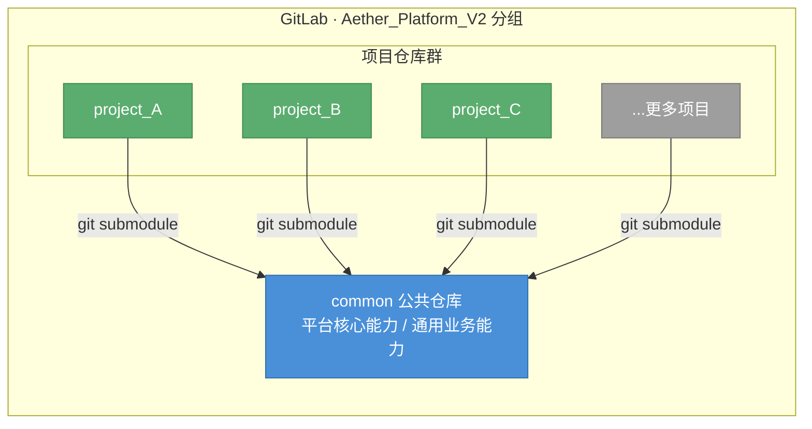
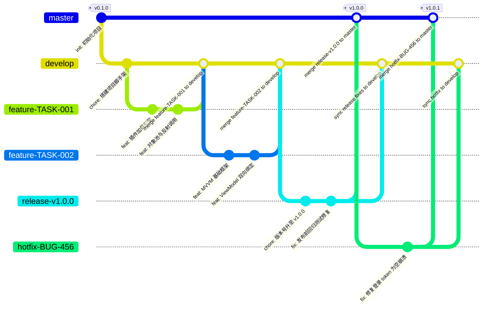
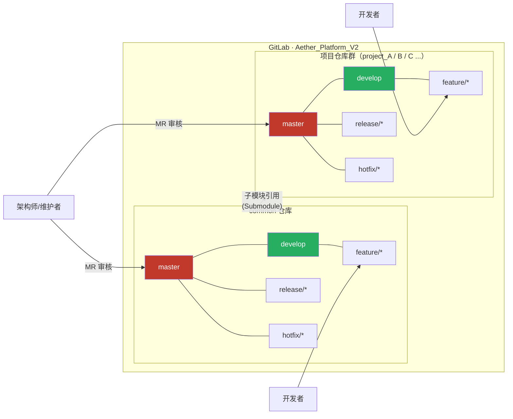

# Aether 平台 Git 仓库管理与分支策略规范

> **文档版本**：v1.0.0 · **制定日期**：2026-03-10 · **适用范围**：Aether_Platform_V2 分组下所有仓库

---

## 目录

1. [背景与平台规划](#1-背景与平台规划)
2. [仓库结构总览](#2-仓库结构总览)
3. [仓库管理规范](#3-仓库管理规范)
   - 3.1 [仓库命名规范](#31-仓库命名规范)
   - 3.2 [仓库配置规范](#32-仓库配置规范)
   - 3.3 [子模块（Submodule）管理规范](#33-子模块submodule管理规范)
4. [Git Flow 分支策略](#4-git-flow-分支策略)
   - 4.1 [分支类型说明](#41-分支类型说明)
   - 4.2 [分支命名规范](#42-分支命名规范)
   - 4.3 [分支生命周期与工作流](#43-分支生命周期与工作流)
   - 4.4 [分支操作流程图](#44-分支操作流程图)
5. [分支权限管理](#5-分支权限管理)
   - 5.1 [角色定义](#51-角色定义)
   - 5.2 [分支权限矩阵](#52-分支权限矩阵)
   - 5.3 [合并请求（MR）审核规则](#53-合并请求mr审核规则)
6. [提交规范](#6-提交规范)
7. [common 子模块协作规范](#7-common-子模块协作规范)
8. [附录：快速参考卡](#8-附录快速参考卡)

---

## 1. 背景与平台规划

### 1.1 平台背景

**Aether 平台**（Aether Platform）是公司面向工业控制与智能设备领域的新一代桌面端软件平台，基于 **Qt + CMake** 插件化架构体系构建，旨在通过统一的平台化能力：

- 📐 **统一开发标准** — 规范插件接口、MVVM 架构、中间件管道等核心规约
- ⚡ **提升开发效率** — 沉淀通用业务模块，杜绝重复造轮子
- 🔧 **降低维护成本** — 公共能力集中管理，一处升级、多项目受益
- 🚀 **支撑快速交付** — 新项目基于模板快速启动，聚焦业务差异化开发

### 1.2 仓库分组规划

所有Aether 平台 相关仓库统一归属于 GitLab **`Aether_Platform_V2`** 分组下，形成"1个公共仓库 + N个项目仓库"的仓库群体系：

```
Aether_Platform_V2/                        ← GitLab 分组（Group）
├── common/                             ← 公共仓库（平台化公共能力沉淀）
├── project_A/                          ← 项目仓库 A（引入 common 子模块）
├── project_B/                          ← 项目仓库 B（引入 common 子模块）
├── project_C/                          ← 项目仓库 C（引入 common 子模块）
└── ...                                 ← 更多项目仓库
```



---

## 2. 仓库结构总览

### 2.1 common 公共仓库

`common` 仓库是平台化建设的核心资产仓库，由**平台架构组**统一维护，内容分为两大类：

| 分类 | 目录 | 内容说明 |
|------|------|----------|
| **平台技术能力** | `core/extensionsystem/` | 插件加载引擎、对象池、反射调用 |
| | `core/communication/` | 通信协议（串口、TCP/IP、Modbus 等） |
| | `core/device/` | 设备管理框架 |
| | `ui/mvvm/` | MVVM 基础库 |
| | `ui/uibase/` | UI 基础组件库 |
| **通用业务能力** | `plugins/` | 平台级通用插件（权限、主题、语言等） |
| | `ui/resources/` | 公共资源（图标、样式表、翻译文件） |
| | `utility/` | 通用工具类 |
| **构建支撑** | `cmake/` | CMake 辅助模块（FZ2Helpers.cmake 等） |
| | `3rdparty/` | 第三方依赖库 |

### 2.2 项目仓库结构（参考模板）

每个项目仓库以 `project-template` 为模板创建，通过 Git Submodule 机制引入 `common`：

```
project_xxx/
├── app/                    # 应用程序入口（主窗口启动）
├── common/                 # ← Git Submodule，指向 Aether_Platform_V2/common
│   ├── 3rdparty/
│   ├── cmake/
│   ├── core/
│   ├── ui/
│   └── utility/
├── plugins/                # 项目业务插件（项目差异化内容）
├── config/                 # 项目配置文件
├── docs/                   # 项目文档
├── scripts/                # 构建脚本
├── tests/                  # 单元测试
├── .gitmodules             # 子模块配置
└── CMakeLists.txt
```

---

## 3. 仓库管理规范

### 3.1 仓库命名规范

| 仓库类型 | 命名格式 | 示例 |
|----------|----------|------|
| 公共仓库 | `common` | `Aether_Platform_V2/common` |
| 项目仓库 | `项目代号_功能描述`（小写+下划线） | `Aether_Platform_V2/nms_monitor` |

> **命名要求**：
> - 全部使用小写字母，单词间以下划线 `_` 分隔
> - 禁止使用中文、空格、特殊字符
> - 名称应简洁且具有业务语义，控制在 30 字符以内

### 3.2 仓库配置规范

新建仓库时，须完成以下基础配置：

| 配置项 | 要求 |
|--------|------|
| **仓库描述** | 必填，简要说明仓库用途（中英文均可） |
| **可见性** | 设置为 `Private`（私有） |
| **默认分支** | 设置为 `develop` |
| **标签** | 按项目类型添加适当标签，如 `platform`、`project` |
| **Protected Branches** | 按本文 [第5节](#5-分支权限管理) 配置受保护分支 |
| **MR 审核人数** | `master`/`release` 分支至少 2 人审核 |
| `.gitignore` | 必须包含，推荐使用平台标准模板 |
| `README.md` | 必须包含，说明仓库用途、构建方式、目录结构 |

### 3.3 子模块（Submodule）管理规范

#### 3.3.1 初始化与引入

```bash
# 在项目仓库根目录执行
git submodule add https://gitlab.xxx.com/Aether_Platform_V2/common.git common

# 初始化并拉取子模块内容
git submodule update --init --recursive
```

#### 3.3.2 子模块版本锁定原则

- 项目仓库中记录的是 `common` 的**特定 Commit SHA**，不是分支名
- 正式发布时，项目仓库必须将 `common` 子模块锁定到 **`common` 的某个 Tag 版本**
- 开发阶段，子模块追踪 `common` 的 `develop` 分支最新提交

```bash
# 将子模块切换到指定 tag
cd common
git checkout v1.2.0
cd ..
git add common
git commit -m "chore: bump common to v1.2.0"
```

#### 3.3.3 子模块更新流程

```bash
# 拉取 common 最新变更
git submodule update --remote --merge

# 提交子模块引用更新
git add common
git commit -m "chore: update common submodule to latest"
```

#### 3.3.4 注意事项

> ⚠️ **禁止** 在项目仓库中直接修改 `common/` 目录内的文件；  
> ✅ 对 `common` 的修改须在 **`Aether_Platform_V2/common`** 仓库中进行，经审核合并后，再由项目仓库更新子模块引用。

---

## 4. Git Flow 分支策略

本平台采用 **Git Flow** 作为标准协同工作流模型，通过明确定义各类分支的职责与生命周期，保障代码质量和发布稳定性。

### 4.1 分支类型说明

Git Flow 共定义以下 **5 类分支**：

```
┌─────────────────────────────────────────────────────────────────┐
│                       Git Flow 分支体系                          │
├────────────────┬──────────────────────────────────────────────  │
│  主干分支      │  master    — 生产发布分支，永久存在             │
│  (长期分支)    │  develop   — 集成开发分支，永久存在             │
├────────────────┼──────────────────────────────────────────────  │
│  辅助分支      │  feature/* — 功能开发分支，开发完成后删除       │
│  (临时分支)    │  release/* — 发布准备分支，发布完成后删除       │
│                │  hotfix/*  — 紧急修复分支，修复完成后删除       │
└────────────────┴──────────────────────────────────────────────  │
```

#### 🔵 master 分支

- **唯一来源**：只能由 `release/*` 或 `hotfix/*` 分支合并
- **职责**：存放**生产就绪**的代码，每次合并均打上版本 Tag
- **原则**：禁止直接 push；所有变更必须经过 MR + 审核

#### 🟢 develop 分支

- **基于**：初始从 `master` 分支创建
- **职责**：作为所有功能开发的集成分支，始终保持最新的开发状态
- **原则**：禁止直接 push；`feature` 分支通过 MR 合并进来

#### 🟡 feature/* 分支

- **基于**：从 `develop` 分支切出
- **职责**：独立开发某个功能模块，开发完成后合并回 `develop`
- **生命周期**：MR 合并后删除
- **原则**：一个功能/任务对应一个 `feature` 分支

#### 🟠 release/* 分支

- **基于**：从 `develop` 分支切出
- **职责**：版本发布前的最终准备（Bug修复、版本号更新、文档更新）
- **生命周期**：同时合并回 `master` 和 `develop` 后删除
- **原则**：该阶段禁止新功能开发，只允许 Bug 修复

#### 🔴 hotfix/* 分支

- **基于**：从 `master` 分支切出
- **职责**：线上紧急 Bug 修复
- **生命周期**：同时合并回 `master` 和 `develop`（或当前 `release`）后删除
- **原则**：修复内容必须最小化，禁止引入新功能

### 4.2 分支命名规范

| 分支类型 | 命名格式 | 示例 |
|----------|----------|------|
| 主干分支 | `master` | `master` |
| 开发分支 | `develop` | `develop` |
| 功能分支 | `feature/<任务ID>-<简短描述>` | `feature/TASK-123-user-login` |
| 发布分支 | `release/<版本号>` | `release/v1.2.0` |
| 修复分支 | `hotfix/<问题ID>-<简短描述>` | `hotfix/BUG-456-login-crash` |

> **命名要求**：
> - 全部小写，单词间以 `-` 连字符分隔
> - 描述部分使用英文，简洁表达分支目的
> - 功能/修复分支需关联任务/问题编号（如 Jira、GitLab Issue ID）

### 4.3 分支生命周期与工作流

#### 🟡 功能开发流程（Feature Flow）

```
                  ① 从 develop 切出                ③ MR 审核合并回 develop
                        │                                    │
develop  ───────────────┼────────────────────────────────────┼──────────────►
                        │                                    ↑
                        └──► feature/TASK-xxx ──[开发提交]──►┘
                                                             ②
                                                      (MR通过后删除分支)
```

**操作步骤：**

```bash
# 1. 从 develop 切出 feature 分支
git checkout develop
git pull origin develop
git checkout -b feature/TASK-123-user-login

# 2. 开发功能，提交代码
git add .
git commit -m "feat(login): implement user login with JWT"

# 3. 推送并发起 MR（Merge Request）
git push origin feature/TASK-123-user-login

# 4. MR 审核通过后，合并到 develop（由 GitLab 执行）
# 5. 合并后删除 feature 分支（GitLab 可配置自动删除）
```

#### 🟠 版本发布流程（Release Flow）

```
                ① 从 develop 切出               ④ MR 合并到 master（打 Tag）
                      │                                     │
master  ──────────────│─────────────────────────────────────●──────────────►
                      │                                  ↗  │ Tag:vX.X.X
                      │                         ③ MR合并    │
                      │                        ╱            │ ⑤ 同步回 develop
                      ↓                       ╱             ↓
develop ──────────────┼──────────────────────┼──────────────┼──────────────►
                      │                      ↑              │
                      └──► release/vX.X.X ───┘              │
                              ② Bug修复 / 版本号更新          │
                           (禁止新增功能，仅允许修复)         (MR通过后删除分支)
```

**操作步骤：**

```bash
# 1. 从 develop 切出 release 分支
git checkout develop
git pull origin develop
git checkout -b release/v1.2.0

# 2. 版本准备工作（修改版本号、更新 CHANGELOG 等）
# 修改 CMakeLists.txt 版本号
git commit -m "chore: bump version to v1.2.0"

# 3. 测试期间只允许 Bug 修复提交
git commit -m "fix(ui): fix layout issue on settings page"

# 4. 准备就绪后：① 合并到 master 并打 Tag
git checkout master
git merge --no-ff release/v1.2.0
git tag -a v1.2.0 -m "Release v1.2.0"
git push origin master --tags

# 5. ② 将修复同步回 develop
git checkout develop
git merge --no-ff release/v1.2.0
git push origin develop

# 6. 删除 release 分支
git branch -d release/v1.2.0
git push origin --delete release/v1.2.0
```

#### 🔴 紧急修复流程（Hotfix Flow）

```
         ① 从 master 切出                     ③ MR 合并回 master（打 Tag）
               │                                          │
master  ────────┼──────────────────────────────────────────●──────────────►
                │                                        ↗  │ Tag:vX.X.X+1
                └──► hotfix/BUG-xxx ──[紧急修复提交]──►╱   │
                              ②                             │ ④ 同步回 develop
                                                            ↓
develop ────────────────────────────────────────────────────┼──────────────►
                                                            │
                                                  (MR通过后删除分支)
```

**操作步骤：**

```bash
# 1. 从 master 切出 hotfix 分支
git checkout master
git pull origin master
git checkout -b hotfix/BUG-456-login-crash

# 2. 修复 Bug，提交代码
git commit -m "fix(login): prevent crash when token is null"

# 3. 合并到 master 并打 Tag
git checkout master
git merge --no-ff hotfix/BUG-456-login-crash
git tag -a v1.2.1 -m "Hotfix v1.2.1"
git push origin master --tags

# 4. 同步修复到 develop
git checkout develop
git merge --no-ff hotfix/BUG-456-login-crash
git push origin develop

# 5. 删除 hotfix 分支
git branch -d hotfix/BUG-456-login-crash
git push origin --delete hotfix/BUG-456-login-crash
```

### 4.4 分支操作流程图

#### 完整 Git Flow 时间线视图




---

## 5. 分支权限管理

### 5.1 角色定义

| 角色 | 说明 | 对应 GitLab 权限 |
|------|------|-----------------|
| **Owner（仓库所有者）** | 平台负责人，拥有最高权限，负责仓库配置与整体管理 | `Owner` |
| **Maintainer（维护者）** | 技术负责人 / 架构师，负责 MR 最终审批与分支管理 | `Maintainer` |
| **Developer（开发者）** | 功能开发人员，可创建分支、提交代码、发起 MR | `Developer` |
| **Reporter（观察者）** | 产品、测试、文档等人员，只读访问，可查阅代码和 Issue | `Reporter` |

### 5.2 分支权限矩阵

> 图例：✅ 允许 | ❌ 禁止 | 🔒 保护（需MR审核）

| 操作 | master | develop | release/* | feature/* | hotfix/* |
|------|:------:|:-------:|:---------:|:---------:|:--------:|
| **直接 Push** | ❌ | ❌ | ❌ | ✅ Developer | ✅ Developer |
| **Force Push** | ❌ | ❌ | ❌ | ❌ | ❌ |
| **创建分支** | ❌ | ❌ | ✅ Maintainer | ✅ Developer | ✅ Maintainer |
| **发起 MR 合并至** | 🔒 | 🔒 | 🔒 | ✅ Developer | ✅ Developer |
| **MR 审核通过（Approve）** | Maintainer ×2 | Maintainer ×1 | Maintainer ×1 | Developer ×1 | Maintainer ×1 |
| **删除分支** | ❌ | ❌ | ✅ Maintainer | ✅ MR后自动 | ✅ MR后自动 |
| **打 Tag** | ✅ Maintainer | ❌ | ❌ | ❌ | ❌ |

#### 受保护分支（Protected Branches）配置

在 GitLab 仓库的 **Settings → Repository → Protected Branches** 中配置：

| 分支 | Allowed to merge | Allowed to push | Allowed to force push |
|------|-----------------|-----------------|----------------------|
| `master` | Maintainers | No one（仅限MR） | ❌ 关闭 |
| `develop` | Maintainers | No one（仅限MR） | ❌ 关闭 |
| `release/*` | Maintainers | Maintainers | ❌ 关闭 |

```
╔══════════════════════════════════════════════════════════════════════╗
║                        分支权限层级示意图                             ║
╠══════════════════════════════════════════════════════════════════════╣
║                                                                      ║
║  🔵 master ◄─────────── 受最高保护 ─────── 仅 Maintainer 可审批合并  ║
║      ▲                                                               ║
║      │  ← release/* MR → 需 Maintainer × 2 审核通过方可合并          ║
║      │  ← hotfix/*  MR → 需 Maintainer × 1 审核通过方可合并          ║
║      │                                                               ║
║  🟠 release/* ◄─────── 受保护 ─── Maintainer 负责创建与管理          ║
║      ▲                                                               ║
║      │  ← develop MR → 需 Maintainer × 1 审核通过方可创建            ║
║      │                                                               ║
║  🟢 develop ◄──────────── 受保护 ──────── 仅 Maintainer 可审批合并   ║
║      ▲                                                               ║
║      │  ← feature/* MR → 需 Developer × 1 或 Maintainer 审核         ║
║      │  ← hotfix/*  MR → 需 Maintainer × 1 审核（同步修复）           ║
║      │                                                               ║
║  🟡 feature/* ──────── 开放 ──────────── Developer 可直接 Push       ║
║  🔴 hotfix/*  ──────── 开放 ──────────── Developer 可直接 Push       ║
║                                                                      ║
╚══════════════════════════════════════════════════════════════════════╝
```

### 5.3 合并请求（MR）审核规则

#### MR 提交要求

发起 MR 时，提交人须确保：

- [ ] 分支基于**最新**的目标分支创建（无冲突或已解决冲突）
- [ ] 代码已通过**本地编译**和**单元测试**
- [ ] MR 标题符合 [提交规范](#6-提交规范)（含类型前缀）
- [ ] MR 描述包含：变更背景、改动内容、测试说明
- [ ] 关联对应的 **Issue / 任务编号**
- [ ] 指定合适的 **Reviewer（审核人）**

#### MR 审核要求

审核人须检查：

- [ ] 代码逻辑正确性，无明显 Bug
- [ ] 符合平台编码规范（命名、注释、架构分层）
- [ ] 无冗余代码、调试代码（如 `qDebug() << "test"`）
- [ ] 敏感信息未被提交（账号、密码、密钥等）
- [ ] 涉及 `common` 子模块的修改，须额外经过**平台架构组**审核

---

## 6. 提交规范

本平台采用 **Conventional Commits** 规范，提交信息格式如下：

```
<type>(<scope>): <subject>

[body]

[footer]
```

### 6.1 Type 类型说明

| Type | 含义 | 示例 |
|------|------|------|
| `feat` | 新功能 | `feat(login): add JWT authentication` |
| `fix` | Bug 修复 | `fix(plugin): fix crash on unload` |
| `refactor` | 代码重构（非新功能、非修复） | `refactor(mvvm): simplify binding logic` |
| `perf` | 性能优化 | `perf(render): reduce redundant repaints` |
| `style` | 代码格式调整（不影响逻辑） | `style: fix indentation` |
| `docs` | 文档更新 | `docs: update API reference` |
| `test` | 添加或修改测试 | `test(container): add IoC resolution tests` |
| `chore` | 构建、工具链、依赖等杂项 | `chore: bump common to v1.2.0` |
| `ci` | CI/CD 相关 | `ci: add build pipeline for release` |
| `revert` | 回滚提交 | `revert: revert feat(login)` |

### 6.2 Scope 范围说明

`scope` 应对应仓库中的模块或目录，例如：

- `common` — `core`、`mvvm`、`uibase`、`plugin`
- 项目仓库 — `home`、`settings`、`features`、`middleware`

### 6.3 提交示例

```
feat(extensionsystem): implement lazy initialization for plugins

延迟初始化机制减少启动时间，插件在首次使用时才触发 initialize()。

Closes #TASK-123
```

---

## 7. common 子模块协作规范

### 7.1 common 仓库分支策略

`common` 仓库**同样遵循 Git Flow 分支策略**，与项目仓库保持一致。但由于 `common` 是多项目共享的基础库，有以下额外约束：

| 约束项 | 说明 |
|--------|------|
| **变更发起** | 需提交 Issue 说明变更原因和影响范围 |
| **Breaking Change** | 必须在 MR 描述中标注 `BREAKING CHANGE`，并提前通知各项目组 |
| **版本 Tag** | 遵循语义化版本（SemVer）：`vMAJOR.MINOR.PATCH` |
| **向后兼容** | 新功能开发应尽量保持向后兼容；不兼容变更须升级主版本号 |
| **接口变更** | 公共接口变更须更新对应文档，并在 CHANGELOG 中记录 |

### 7.2 common 版本发布流程

```
common develop ──► release/v1.x.x ──► common master (Tag v1.x.x)
                                           │
                                           ▼
                               各项目仓库更新子模块引用
                               git submodule update --remote
                               git commit -m "chore: bump common to v1.x.x"
```

### 7.3 common 分支权限（额外限制）

相较项目仓库，`common` 仓库对 `develop` 分支的合并审核要求更高：

| 分支 | 审核要求 |
|------|----------|
| `master` | Maintainer × 2（必须含平台架构负责人） |
| `develop` | Maintainer × 2 |
| `release/*` | Maintainer × 1 |

---

## 8. 附录：快速参考卡

### 8.1 日常开发速查

```bash
# ── 开始新功能开发 ──────────────────────────────────────
git checkout develop && git pull origin develop
git checkout -b feature/TASK-XXX-描述

# ── 提交代码 ─────────────────────────────────────────────
git add .
git commit -m "feat(scope): 描述"
git push origin feature/TASK-XXX-描述

# ── 发起 MR（GitLab UI 操作）─────────────────────────────
# 在 GitLab 中：feature/xxx → develop，指定 Reviewer

# ── 更新子模块（在项目仓库中）────────────────────────────
git submodule update --init --recursive     # 首次克隆后初始化
git submodule update --remote --merge       # 拉取 common 最新
```

### 8.2 分支命名速查

```
master                            ← 生产分支（永久）
develop                           ← 开发集成分支（永久）
feature/TASK-123-user-login       ← 功能分支
feature/TASK-456-plugin-manager   ← 功能分支
release/v1.2.0                    ← 发布准备分支
hotfix/BUG-789-crash-on-startup   ← 紧急修复分支
```

### 8.3 版本号规则（SemVer）

```
v MAJOR . MINOR . PATCH
  │        │       │
  │        │       └─ 修订号：Bug修复、向后兼容（hotfix）
  │        └───────── 次版本号：新功能、向后兼容（feature → release）
  └────────────────── 主版本号：破坏性变更（不向后兼容）
```

### 8.4 平台仓库全景图



---

> 📌 **文档维护**：本规范由平台架构组负责维护，如有疑问或建议，请在 GitLab 中提交 Issue 或联系平台负责人。  
> 📅 **最后更新**：2026-03-10 · **版本**：v1.0.0
