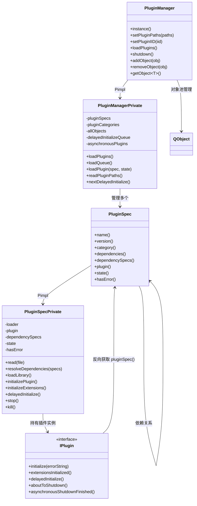
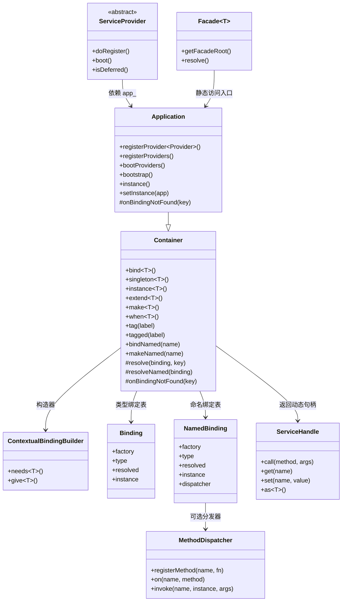
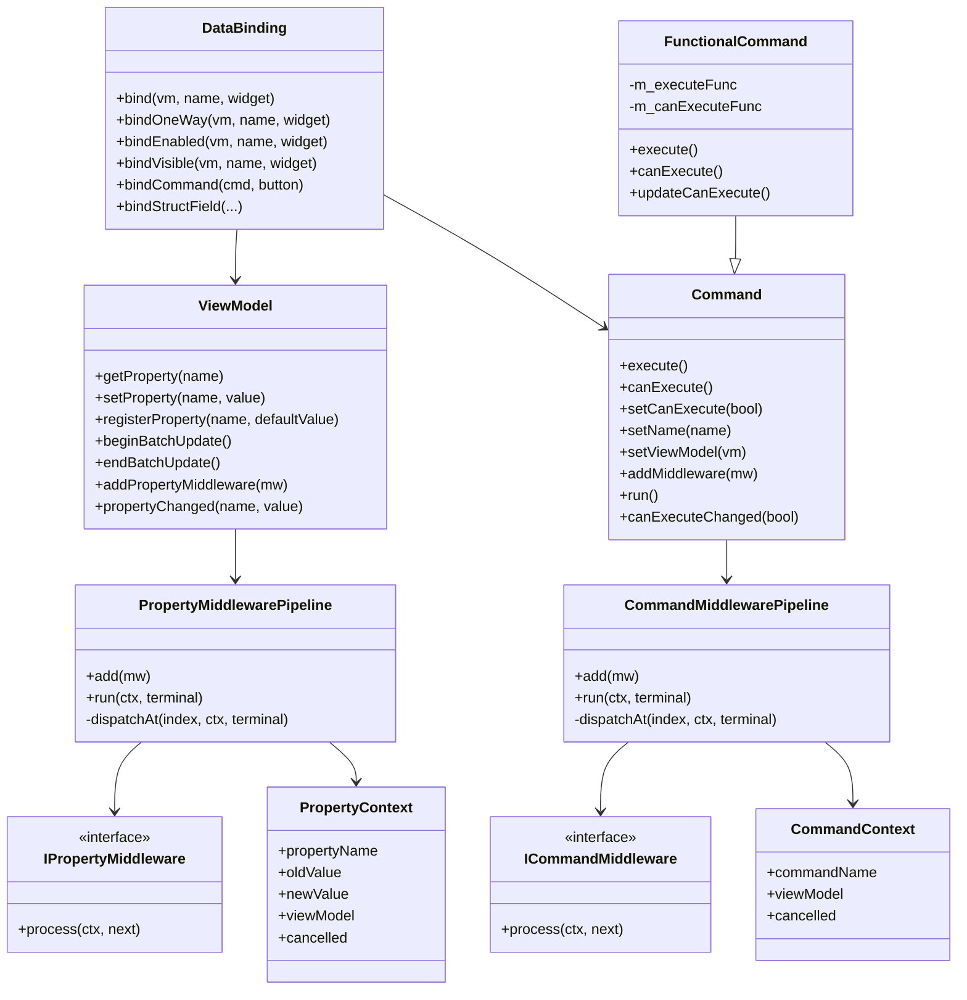
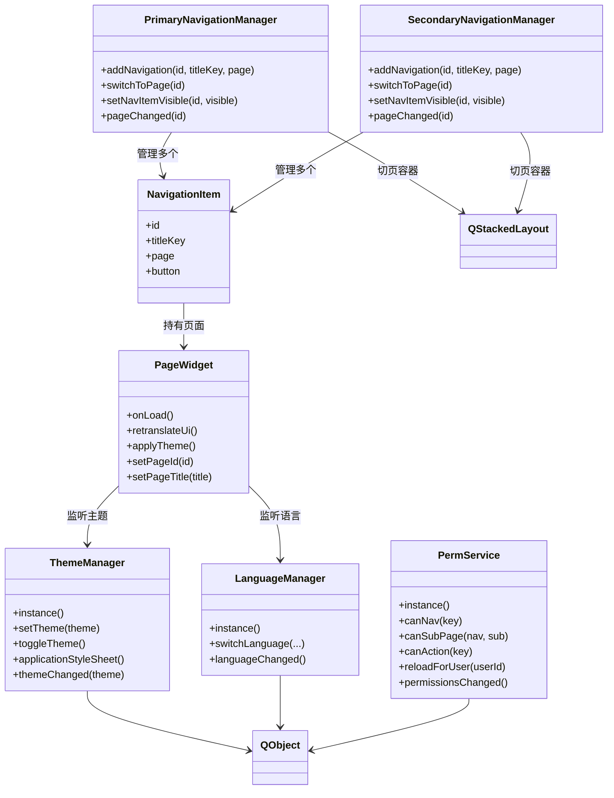
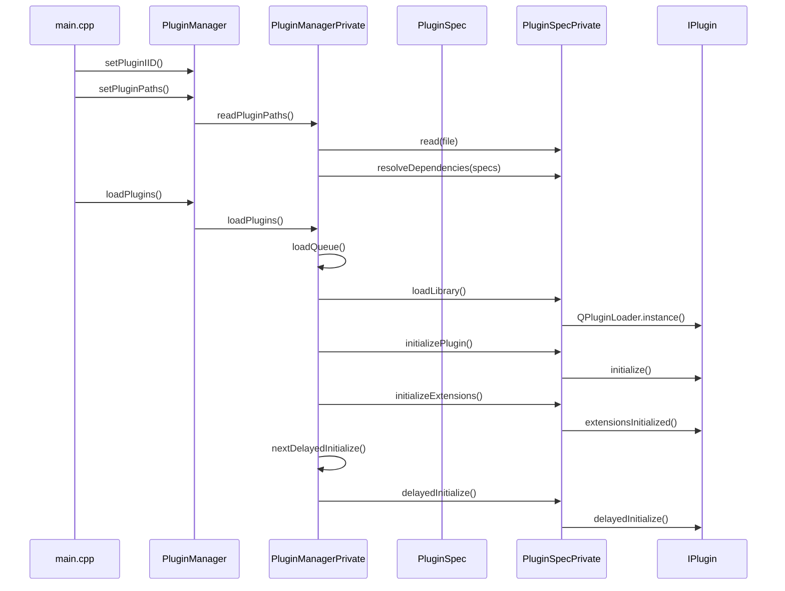
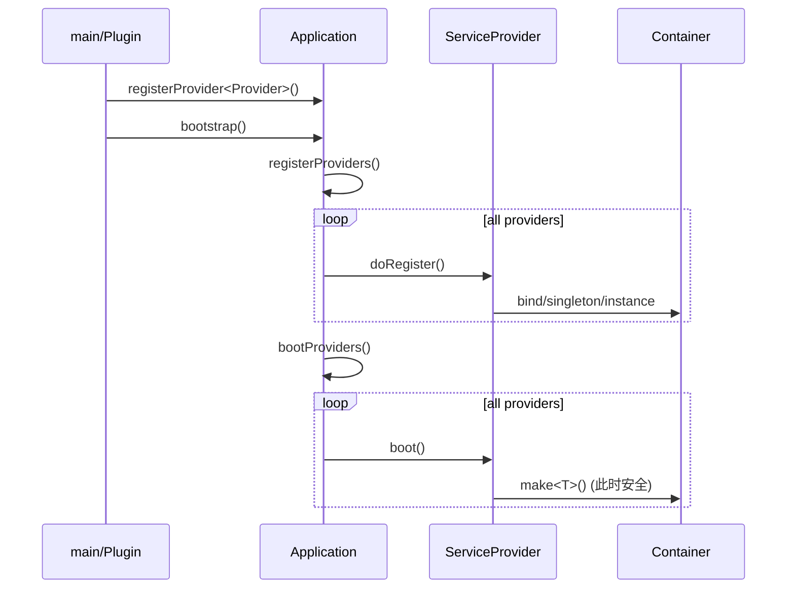
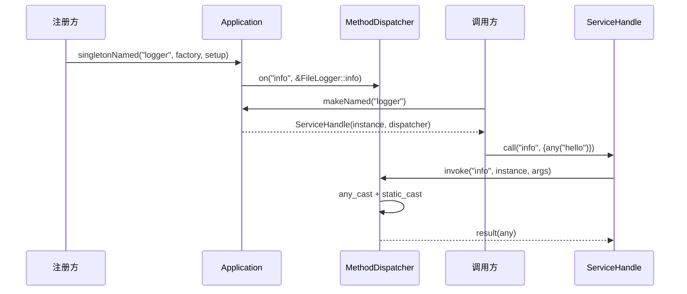
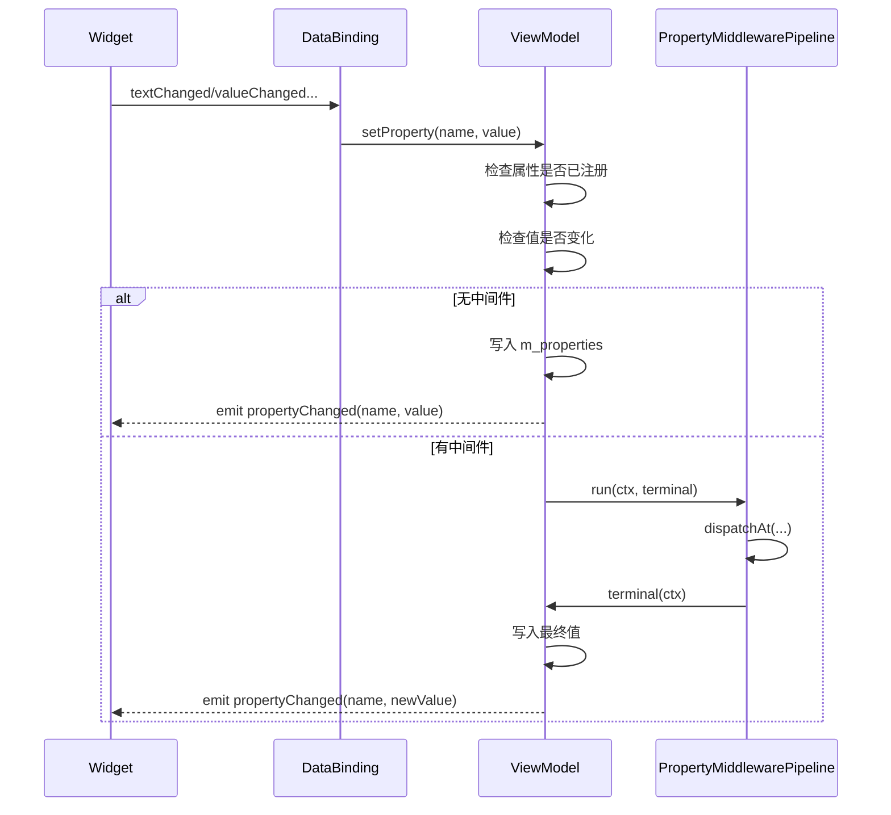

# fz2_project_template 框架源码分析

> **深度剖析 Qt + CMake 插件化桌面应用开发框架的设计思想与实现原理**  
> 版本：1.0.0 · C++17 · Qt 5.15 / Qt6

---

## 目录

1. [整体架构概览](#1-整体架构概览)
   - 1.1 [分层架构图](#11-分层架构图)
   - 1.2 [模块依赖关系](#12-模块依赖关系)
   - 1.3 [核心设计原则](#13-核心设计原则)
2. [插件系统 — ExtensionSystem](#2-插件系统--extensionsystem)
   - 2.1 [设计思想](#21-设计思想)
   - 2.2 [模块类图关系](#22-模块类图关系)
   - 2.3 [核心数据模型](#23-核心数据模型)
   - 2.4 [插件加载流程源码分析](#24-插件加载流程源码分析)
   - 2.5 [依赖解析算法](#25-依赖解析算法)
   - 2.6 [对象池机制](#26-对象池机制)
   - 2.7 [延迟初始化机制](#27-延迟初始化机制)
   - 2.8 [Invoker 反射调用机制](#28-invoker-反射调用机制)
3. [IoC 服务容器 — Container](#3-ioc-服务容器--container)
   - 3.1 [设计思想](#31-设计思想)
   - 3.2 [模块类图关系](#32-模块类图关系)
   - 3.3 [核心数据模型 Binding](#33-核心数据模型-binding)
   - 3.4 [Container 类型解析源码分析](#34-container-类型解析源码分析)
   - 3.5 [Singleton 双重检查加锁](#35-singleton-双重检查加锁)
   - 3.6 [循环依赖检测](#36-循环依赖检测)
   - 3.7 [上下文绑定实现](#37-上下文绑定实现)
   - 3.8 [extend() 装饰器模式](#38-extend-装饰器模式)
   - 3.9 [tag() 标签系统](#39-tag-标签系统)
   - 3.10 [Application 与 ServiceProvider 协作](#310-application-与-serviceprovider-协作)
   - 3.11 [Facade 外观模式实现](#311-facade-外观模式实现)
   - 3.12 [动态命名绑定与反射调用](#312-动态命名绑定与反射调用)
4. [MVVM 架构 — mvvm](#4-mvvm-架构--mvvm)
   - 4.1 [设计思想](#41-设计思想)
   - 4.2 [模块类图关系](#42-模块类图关系)
   - 4.3 [ViewModel 源码分析](#43-viewmodel-源码分析)
   - 4.4 [属性宏展开分析](#44-属性宏展开分析)
   - 4.5 [中间件管道实现原理](#45-中间件管道实现原理)
   - 4.6 [Command 命令模式实现](#46-command-命令模式实现)
   - 4.7 [DataBinding 双向绑定实现](#47-databinding-双向绑定实现)
5. [UI 基础设施 — uibase](#5-ui-基础设施--uibase)
   - 5.1 [设计思想](#51-设计思想)
   - 5.2 [模块类图关系](#52-模块类图关系)
   - 5.3 [导航管理器源码分析](#53-导航管理器源码分析)
   - 5.4 [ThemeManager 主题管理](#54-thememanager-主题管理)
   - 5.5 [LanguageManager 国际化](#55-languagemanager-国际化)
   - 5.6 [PermService 权限运行时](#56-permservice-权限运行时)
   - 5.7 [PageWidget 懒加载页面](#57-pagewidget-懒加载页面)
   - 5.8 [CFramelessWindow 无边框窗口](#58-cframelesswindow-无边框窗口)
   - 5.9 [IMainWindowService 主窗口服务接口](#59-imainwindowservice-主窗口服务接口)
6. [执行链路全景分析](#6-执行链路全景分析)
   - 6.1 [应用程序启动全链路](#61-应用程序启动全链路)
   - 6.2 [容器启动与 Provider 引导链路](#62-容器启动与-provider-引导链路)
   - 6.3 [服务解析执行链路 make\<T\>()](#63-服务解析执行链路-maket)
   - 6.4 [Named Binding 动态调用链路](#64-named-binding-动态调用链路)
   - 6.5 [MVVM 页面加载链路](#65-mvvm-页面加载链路)
   - 6.6 [ViewModel 属性变更链路](#66-viewmodel-属性变更链路)
   - 6.7 [属性变更执行链路 setProperty()](#67-属性变更执行链路-setproperty)
   - 6.8 [命令执行链路 Command::run()](#68-命令执行链路-commandrun)
   - 6.9 [主题切换执行链路](#69-主题切换执行链路)
   - 6.10 [导航切换执行链路](#610-导航切换执行链路)
   - 6.11 [DataBinding 双向数据流链路](#611-databinding-双向数据流链路)
   - 6.12 [权限变更与导航联动链路](#612-权限变更与导航联动链路)
7. [关键设计模式总结](#7-关键设计模式总结)
   - 7.1 [全局使用的设计模式](#71-全局使用的设计模式)
   - 7.2 [线程安全策略对比](#72-线程安全策略对比)
   - 7.3 [C++17 特性运用](#73-c17-特性运用)
   - 7.4 [扩展性设计要点](#74-扩展性设计要点)

---

## 1. 整体架构概览

### 1.1 分层架构图

```
┌─────────────────────────────────────────────────────────────┐
│                        应用层 (app/)                         │
│            main.cpp — 初始化 QApplication + PluginManager    │
└────────────────────────────┬────────────────────────────────┘
                             │ 加载插件
┌────────────────────────────▼────────────────────────────────┐
│                       插件层 (plugins/)                      │
│  core/    mvvm/    container/    middleware/    invoker/      │
│  各插件实现具体业务，通过 IPlugin 接口注入框架                  │
└────────────────────────────┬────────────────────────────────┘
                             │ 依赖
┌────────────────────────────▼────────────────────────────────┐
│                    公共基础层 (common/)                       │
│  ┌───────────────────────────────────────────────────────┐  │
│  │  core/extensionsystem  — 插件加载 / 对象池 / 依赖管理   │  │
│  │  core/container        — IoC 容器 / ServiceProvider    │  │
│  ├───────────────────────────────────────────────────────┤  │
│  │  ui/mvvm               — ViewModel / DataBinding / Cmd │  │
│  │  ui/uibase             — 主题 / 导航 / 权限 / 国际化    │  │
│  └───────────────────────────────────────────────────────┘  │
└─────────────────────────────────────────────────────────────┘
```

### 1.2 模块依赖关系

```
app
 └─ ExtensionSystem (pluginmanager)
      └─ PluginSpec / IPlugin
           └─ 各业务插件 (core, mvvm, container...)
                ├─ container (Application / ServiceProvider / Facade)
                │    └─ Container / Binding / NamedBinding / MethodDispatcher / ServiceHandle
                └─ mvvm (ViewModel / DataBinding / Command)
                     ├─ middlewarepipeline (PropertyMiddlewarePipeline / CommandMiddlewarePipeline)
                     └─ uibase (ThemeManager / NavigationManager / PermService...)
```

### 1.3 核心设计原则

| 原则 | 实现方式 |
|---|---|
| **关注点分离** | 插件系统 / IoC 容器 / MVVM / UI 基础设施各自独立 |
| **依赖倒置** | 高层模块依赖抽象接口（`IPlugin`、`ILogger` 等） |
| **开闭原则** | 插件机制让功能扩展无需修改核心 |
| **单一职责** | 每个类只有一个明确职责（`PluginSpec` 只描述插件元数据） |
| **面向接口编程** | 服务通过接口注册，调用方不依赖具体实现类 |

---

## 2. 插件系统 — ExtensionSystem

### 2.1 设计思想

插件系统 `ExtensionSystem`，核心思想是**将应用功能以 DLL 插件形式动态加载**，通过 JSON 元数据描述插件信息，通过 `IPlugin` 接口规范插件生命周期。

**三大核心问题：**
1. **如何发现插件？** — 扫描指定目录下的动态库，读取 Qt 插件元数据中的 IID 和 JSON 信息
2. **如何排序加载？** — 拓扑排序（DFS）解析依赖关系，先依赖后主体
3. **如何管理生命周期？** — 状态机模型，8 个状态严格单向流转

### 2.2 模块类图关系



#### 关系解读

- `PluginManager` 是公共入口，`PluginManagerPrivate` 负责真正的扫描、排序、加载、关闭。
- `PluginSpec` 是“插件描述符”，不是插件本身；真正插件实例是 `IPlugin` 子类对象。
- `PluginSpecPrivate` 负责把“文件系统中的 DLL”转成“内存中的 IPlugin 实例”。
- `PluginManager` 同时承担 **对象池管理器** 角色，因此它不仅管插件，也管跨插件共享对象。


### 2.3 核心数据模型

**`PluginSpec` — 插件描述符（状态机）：**

```
Invalid → Read → Resolved → Loaded → Initialized → Running → Stopped → Deleted
```

每个状态对应一项操作：

| 状态迁移 | 触发操作 | 核心函数 |
|---|---|---|
| `Invalid → Read` | 读取 DLL 元数据 | `PluginSpecPrivate::read()` |
| `Read → Resolved` | 解析依赖引用 | `PluginSpecPrivate::resolveDependencies()` |
| `Resolved → Loaded` | 加载动态库 | `PluginSpecPrivate::loadLibrary()` |
| `Loaded → Initialized` | 调用 `initialize()` | `PluginSpecPrivate::initializePlugin()` |
| `Initialized → Running` | 调用 `extensionsInitialized()` | `PluginSpecPrivate::initializeExtensions()` |
| `Running → Stopped` | 调用 `aboutToShutdown()` | `PluginSpecPrivate::stop()` |
| `Stopped → Deleted` | `delete plugin` | `PluginSpecPrivate::kill()` |

**`PluginManagerPrivate` — 管理器私有实现（Pimpl 模式）：**

```cpp
// common/core/extensionsystem/pluginmanager_p.h
class PluginManagerPrivate : public QObject {
    QHash<QString, QList<PluginSpec*>> pluginCategories; // 按类别分组
    QList<PluginSpec*>  pluginSpecs;       // 所有插件描述符
    QStringList         pluginPaths;       // 搜索路径
    QString             pluginIID;         // 有效 IID（用于过滤）
    QList<QObject*>     allObjects;        // 对象池
    QTimer             *delayedInitializeTimer; // 延迟初始化定时器
    QList<PluginSpec*>  delayedInitializeQueue; // 延迟初始化队列
    QList<PluginSpec*>  asynchronousPlugins;    // 异步关闭的插件
    QEventLoop         *shutdownEventLoop;      // 异步关闭事件循环
    mutable QReadWriteLock m_lock;         // 对象池读写锁
};
```

> **Pimpl 模式作用：** `PluginManager` 对外暴露稳定的公共接口，所有实现细节和成员变量封装在 `PluginManagerPrivate` 中，降低头文件依赖，加快编译速度。

### 2.4 插件加载流程源码分析

**`PluginManagerPrivate::loadPlugins()` — 核心加载流程：**

```cpp
// pluginmanager.cpp:329
void PluginManagerPrivate::loadPlugins()
{
    // 第一步：拓扑排序生成加载队列（依赖优先）
    QList<PluginSpec*> queue = loadQueue();
    
    // 第二步：加载动态库（Resolved → Loaded）
    foreach (PluginSpec *spec, queue) {
        loadPlugin(spec, PluginSpec::Loaded);      // QPluginLoader::load()
    }
    
    // 第三步：调用 initialize()（Loaded → Initialized）
    foreach (PluginSpec *spec, queue) {
        loadPlugin(spec, PluginSpec::Initialized); // plugin->initialize()
    }
    
    // 第四步：反向遍历调用 extensionsInitialized()（Initialized → Running）
    // 注意：使用 reverseForeach，确保依赖方先完成 extensionsInitialized
    Utils::reverseForeach(queue, [this](PluginSpec *spec) {
        loadPlugin(spec, PluginSpec::Running);
        if (spec->state() == PluginSpec::Running) {
            delayedInitializeQueue.append(spec);  // 加入延迟初始化队列
        } else {
            spec->d->kill();   // 初始化失败，立即清理
        }
    });
    
    // 第五步：启动延迟初始化定时器（20ms 间隔，不阻塞主线程）
    delayedInitializeTimer = new QTimer;
    delayedInitializeTimer->setInterval(20); // DELAYED_INITIALIZE_INTERVAL
    delayedInitializeTimer->setSingleShot(true);
    connect(delayedInitializeTimer, &QTimer::timeout,
            this, &PluginManagerPrivate::nextDelayedInitialize);
    delayedInitializeTimer->start();
}
```

**关键设计：`loadPlugin()` 的状态守卫：**

```cpp
// pluginmanager.cpp:459
void PluginManagerPrivate::loadPlugin(PluginSpec *spec, PluginSpec::State destState)
{
    // ── 状态守卫：只处理"当前状态恰好比目标状态少1"的插件 ──
    if (spec->hasError() || spec->state() != destState - 1)
        return;
    // ...
}
```

这个单行守卫确保每个插件按顺序单向推进状态，**任何跳步或重复调用都被安全忽略**。

**`PluginSpecPrivate::loadLibrary()` — 动态库加载与 IPlugin 获取：**

```cpp
// pluginspec.cpp:514
bool PluginSpecPrivate::loadLibrary()
{
    // 使用 Qt 的 QPluginLoader 加载 DLL
    if (!loader.load()) {
        hasError = true;
        errorString = QDir::toNativeSeparators(filePath) + ": " + loader.errorString();
        return false;
    }
    
    // 将加载的 QObject 实例转型为 IPlugin
    auto *pluginObject = qobject_cast<IPlugin*>(loader.instance());
    if (!pluginObject) {
        hasError = true;
        errorString = "Plugin is not valid (does not derive from IPlugin)";
        loader.unload();
        return false;
    }
    
    state  = PluginSpec::Loaded;
    plugin = pluginObject;
    plugin->d->pluginSpec = q;   // 反向引用：IPlugin → PluginSpec
    return true;
}
```

> **设计要点：** `QPluginLoader` 自动处理跨平台符号解析；`qobject_cast` 提供安全的运行时类型检查；若转型失败立即卸载 DLL，防止野指针。

### 2.5 依赖解析算法

`loadQueue()` 使用**深度优先搜索（DFS）拓扑排序**确保依赖先于主体加载：

```cpp
// pluginmanager.cpp:408
bool PluginManagerPrivate::loadQueue(PluginSpec *spec,
        QList<PluginSpec*> &queue,
        QList<PluginSpec*> &circularityCheckQueue)
{
    if (queue.contains(spec))
        return true;   // 已处理过，跳过

    // ── 环形依赖检测 ──
    if (circularityCheckQueue.contains(spec)) {
        spec->d->hasError = true;
        // 构造详细的循环路径错误信息...
        return false;
    }
    circularityCheckQueue.append(spec);   // 入栈（DFS 访问路径）

    // ── 递归处理所有依赖（Required 类型）──
    QHashIterator<PluginDependency, PluginSpec*> it(spec->dependencySpecs());
    while (it.hasNext()) {
        it.next();
        if (it.key().type == PluginDependency::Test) continue;
        PluginSpec *depSpec = it.value();
        if (!loadQueue(depSpec, queue, circularityCheckQueue)) {
            // 依赖加载失败，传播错误
            spec->d->hasError = true;
            spec->d->errorString = "Cannot load plugin because dependency failed...";
            return false;
        }
    }
    
    queue.append(spec);   // 后序：依赖先入队，自身后入队
    return true;
}
```

**算法特性：**
- **时间复杂度：** O(V + E)，V 为插件数，E 为依赖边数
- **循环检测：** `circularityCheckQueue` 维护当前 DFS 路径，O(1) 判断是否在路径中
- **幂等性：** `queue.contains(spec)` 防止同一插件被加入两次

**`resolveDependencies()` — 依赖名称解析：**

```cpp
// pluginspec.cpp:473
bool PluginSpecPrivate::resolveDependencies(const QList<PluginSpec*> &specs)
{
    QHash<PluginDependency, PluginSpec*> resolvedDependencies;
    
    foreach (const PluginDependency &dependency, dependencies) {
        // 在所有已扫描的插件中查找能满足此依赖的 PluginSpec
        PluginSpec *const found = Utils::findOrDefault(specs, 
            [&dependency](PluginSpec *spec) {
                return spec->provides(dependency.name, dependency.version);
            });
        
        if (!found) {
            if (dependency.type == PluginDependency::Required) {
                hasError = true;
                errorString += "Could not resolve dependency '" + dependency.name + "'";
            }
            continue;   // Optional 依赖找不到也不报错
        }
        resolvedDependencies.insert(dependency, found);
    }
    
    dependencySpecs = resolvedDependencies;
    state = PluginSpec::Resolved;
    return true;
}
```

### 2.6 对象池机制

对象池是插件间通信的核心纽带，基于 **`QReadWriteLock` 实现线程安全**：

```cpp
// pluginmanager.cpp:287
void PluginManagerPrivate::addObject(QObject *obj)
{
    {
        QWriteLocker lock(&m_lock);   // 写操作加写锁
        if (obj == nullptr || allObjects.contains(obj)) {
            qWarning() << "...";
            return;
        }
        allObjects.append(obj);
    }
    emit q->objectAdded(obj);   // 信号在锁外发出（避免死锁）
}
```

**模板查询方法（`PluginManager::getObject<T>`）：**

```cpp
// pluginmanager.h (模板实现)
template <typename T>
static T *getObject()
{
    QReadLocker lock(listLock());   // 读操作加读锁（允许并发读）
    const QList<QObject *> all = allObjects();
    for (QObject *obj : all) {
        if (T *result = qobject_cast<T *>(obj))
            return result;
    }
    return nullptr;
}

// 带谓词的过滤版本
template <typename T, typename Predicate>
static T *getObject(Predicate predicate)
{
    QReadLocker lock(listLock());
    const QList<QObject *> all = allObjects();
    for (QObject *obj : all) {
        if (T *result = qobject_cast<T *>(obj))
            if (predicate(result))
                return result;
    }
    return nullptr;
}

// 获取所有匹配对象
template <typename T>
static QList<T *> getObjects()
{
    QReadLocker lock(listLock());
    QList<T *> results;
    const QList<QObject *> all = allObjects();
    for (QObject *obj : all) {
        if (T *result = qobject_cast<T *>(obj))
            results.append(result);
    }
    return results;
}
```

> **设计思想：** 利用 Qt 的元对象系统（`qobject_cast`）在运行时按类型查找对象，实现了**无需修改框架即可扩展的跨插件通信**。插件只需向对象池注册，其他插件通过接口类型即可获取。

### 2.7 延迟初始化机制

`delayedInitialize()` 设计用于**应用启动后的轻量化延迟任务**，避免阻塞主窗口显示：

```cpp
// pluginmanager.cpp:221
void PluginManagerPrivate::nextDelayedInitialize()
{
    while (!delayedInitializeQueue.isEmpty()) {
        PluginSpec *spec = delayedInitializeQueue.takeFirst();
        bool delay = spec->d->delayedInitialize();  // 调用插件的 delayedInitialize()
        if (delay)
            break;   // 插件返回 true 表示需要再延迟一次（分批处理）
    }
    if (delayedInitializeQueue.isEmpty()) {
        m_isInitializationDone = true;
        delete delayedInitializeTimer;
        emit q->initializationDone();
    } else {
        delayedInitializeTimer->start();   // 重新启动 20ms 后再执行下一批
    }
}
```

**设计精妙之处：**
- 使用 `QTimer::setSingleShot(true)` + 手动重启，而非 `setInterval` 自动触发，确保每批任务执行完毕后再调度下一批，**彻底避免任务堆积**
- 插件通过返回值 `true/false` 控制是否需要继续延迟（协作式调度）

### 2.8 Invoker 反射调用机制

`ExtensionSystem::Invoker<Result>` 是一个**基于 Qt 元对象系统的运行时方法调用工具**，用于跨插件安全调用 Qt slot：

```cpp
// invoker.h — 核心实现
class InvokerBase
{
public:
    // 添加调用参数（最多 10 个）
    template <class T>
    void addArgument(const T &t) {
        arg[lastArg++] = QGenericArgument(typeName<T>(), &t);
    }
    
    // 设置返回值容器
    template <class T>
    void setReturnValue(T &t) {
        useRet = true;
        ret = QGenericReturnArgument(typeName<T>(), &t);
    }
    
    // 使用 QMetaObject::invokeMethod 调用 slot
    void invoke(QObject *target, const char *slot);
    
    bool wasSuccessful() const;
};

// 带返回值的模板特化
template <class Result>
class Invoker : public InvokerBase
{
public:
    // 0 参数调用
    Invoker(QObject *target, const char *slot) {
        setReturnValue(result);
        InvokerBase::invoke(target, slot);
    }
    
    // 1 参数调用
    template <class T0>
    Invoker(QObject *target, const char *slot, const T0 &t0) {
        setReturnValue(result);
        addArgument(t0);
        InvokerBase::invoke(target, slot);
    }
    
    operator Result() const { return result; }  // 隐式转换提取结果
private:
    Result result;
};
```

**便捷调用函数：**

```cpp
// 无返回值调用
ExtensionSystem::invoke<void>(target, "mySlot", arg1, arg2);

// 有返回值调用
QString result = ExtensionSystem::invoke<QString>(target, "getVersion");
```

> **与 MethodDispatcher 的区别：** `Invoker` 基于 Qt 元对象系统，需要 `QObject` 目标且 slot 必须用 `Q_INVOKABLE` 或 `slots` 声明；`MethodDispatcher` 基于 `std::any`，不依赖 Qt 元对象，更适用于 C++ 接口的跨插件零依赖调用。

---

## 3. IoC 服务容器 — Container

### 3.1 设计思想

Container 模块受 Laravel 框架的服务容器启发，用 C++17 模板元编程实现了一套**类型安全的依赖注入容器**。

**核心设计目标：**
1. **类型安全**：通过 `std::type_index` 和模板参数在编译期保证类型正确性
2. **生命周期管理**：三种绑定类型（Transient/Singleton/Instance）满足不同场景
3. **解耦**：调用方只依赖抽象接口，不引入具体实现的头文件
4. **跨插件零依赖调用**：通过命名绑定 + `MethodDispatcher` 实现运行时反射

**类型擦除的核心技巧：** 所有工厂函数统一使用 `std::function<std::shared_ptr<void>(Container&)>` 签名，在注册时擦除具体类型信息，在解析时用 `static_pointer_cast<Abstract>` 恢复类型。

### 3.2 模块类图关系



#### 关系解读

- `Application` 不是简单的别名，而是 `Container` 的 **运行期增强版**。
- `ServiceProvider` 把“注册逻辑”模块化，避免所有服务都堆在 `main.cpp`。
- `NamedBinding + MethodDispatcher + ServiceHandle` 形成一条完整的“跨插件弱类型调用链”。
- `Facade<T>` 只是一个很薄的静态门面，本质仍回到 `Application::instance()->make<T>()`。


### 3.3 核心数据模型 Binding

```cpp
// common/core/container/binding.h

// ── 工厂函数类型：类型擦除后的统一签名 ──
using FactoryFn = std::function<std::shared_ptr<void>(Container&)>;

// ── 生命周期枚举 ──
enum class BindingType {
    Transient,  // 每次 make() 创建新实例
    Singleton,  // 首次 make() 创建，后续复用
    Instance    // 外部注入的已有实例
};

// ── 绑定描述符 ──
struct Binding {
    FactoryFn   factory;                      // 工厂函数
    BindingType type    = BindingType::Transient;
    bool        resolved = false;             // Singleton 是否已初始化
    std::shared_ptr<void> instance;           // 缓存的单例 / 预建实例
};
```

### 3.4 Container 类型解析源码分析

**`bind<Abstract>()` — 注册绑定（模板，header-only）：**

```cpp
// container.h:82
template <typename Abstract>
void bind(std::function<std::shared_ptr<Abstract>(Container&)> factory)
{
    Binding b;
    // ── 关键：类型擦除 ──
    // 外层 lambda 将 shared_ptr<Abstract> 装入 shared_ptr<void>
    // std::type_index 作为 key 保留类型信息
    b.factory = [f = std::move(factory)](Container& c) -> std::shared_ptr<void> {
        return f(c);   // shared_ptr<Abstract> 隐式转换为 shared_ptr<void>
    };
    b.type = BindingType::Transient;
    typeBindings_[std::type_index(typeid(Abstract))] = std::move(b);
}
```

**`make<Abstract>()` — 解析服务（模板，header-only）：**

```cpp
// container.h:203
template <typename Abstract>
std::shared_ptr<Abstract> make()
{
    auto  key   = std::type_index(typeid(Abstract));
    auto& stack = resolutionStack();   // thread_local，每线程独立解析栈

    // ── 1. 循环依赖检测 ──────────────────────────────────────────────
    if (std::find(stack.begin(), stack.end(), key) != stack.end()) {
        throw std::runtime_error("[Container] Circular dependency detected for: "
                                 + std::string(typeid(Abstract).name()));
    }

    // ── 2. 检查上下文绑定（优先级高于普通绑定）──────────────────────
    if (!stack.empty()) {
        auto callerKey = stack.back();   // 当前调用方类型
        auto ctxIt = contextualBindings_.find(callerKey);
        if (ctxIt != contextualBindings_.end()) {
            auto needsIt = ctxIt->second.find(key);
            if (needsIt != ctxIt->second.end()) {
                // 命中上下文绑定，使用专属工厂
                stack.push_back(key);
                auto ptr = needsIt->second(*this);
                stack.pop_back();
                return std::static_pointer_cast<Abstract>(ptr);
            }
        }
    }

    // ── 3. 普通绑定查找 ──────────────────────────────────────────────
    auto it = typeBindings_.find(key);
    if (it == typeBindings_.end()) {
        onBindingNotFound(key);   // 钩子：触发 Deferred ServiceProvider
        it = typeBindings_.find(key);
        if (it == typeBindings_.end()) {
            throw std::runtime_error("[Container] No binding found for type: "
                                     + std::string(typeid(Abstract).name()));
        }
    }
    
    // ── 4. 解析并还原类型 ──
    return std::static_pointer_cast<Abstract>(resolve(it->second, key));
}
```

### 3.5 Singleton 双重检查加锁

```cpp
// container.cpp:24
std::shared_ptr<void> Container::resolve(Binding& binding, std::type_index key)
{
    switch (binding.type) {
    
    case BindingType::Instance:
        return binding.instance;   // 直接返回
    
    case BindingType::Singleton: {
        // ── 双重检查加锁（Double-Checked Locking）──
        //
        // 第一次检查（无锁快速路径）：
        //   99% 的情况下单例已构建，直接返回，无需竞争锁。
        //   读 bool 在主流平台是近原子操作，足够安全。
        //
        if (!binding.resolved) {
            
            // 第二次检查（持锁，防止竞态）：
            //   极少数首次并发调用时，进入此分支竞争互斥锁。
            //   使用 recursive_mutex：工厂内部可再次调用 make()，
            //   允许同线程重入而不死锁。
            std::lock_guard<std::recursive_mutex> lock(mutex_);
            if (!binding.resolved) {   // 持锁后二次确认
                auto& stack = resolutionStack();
                stack.push_back(key);
                binding.instance = binding.factory(*this);
                binding.resolved = true;
                stack.pop_back();
            }
        }
        return binding.instance;
    }
    
    case BindingType::Transient:
    default: {
        // 瞬态：每次创建新实例，无共享状态，无需加锁
        auto& stack = resolutionStack();
        stack.push_back(key);
        auto result = binding.factory(*this);
        stack.pop_back();
        return result;
    }
    }
}
```

**为什么用 `recursive_mutex` 而非 `mutex`？**  
工厂函数内部可能调用 `container.make<T2>()`，而 `T2` 的工厂又可能调用 `make<T3>()`。若使用普通 `mutex`，同线程重入会造成死锁。`recursive_mutex` 允许同一线程多次加锁，从而支持这种嵌套解析场景。

### 3.6 循环依赖检测

```cpp
// container.cpp:16（thread_local 解析栈）
std::vector<std::type_index>& Container::resolutionStack()
{
    thread_local std::vector<std::type_index> s_stack;
    return s_stack;
}
```

**`thread_local` 的作用：**
- 每个线程拥有**独立的解析栈**，多线程并发调用 `make<T>()` 时各线程的 push/pop 互不干扰
- 使用**函数内 `thread_local` 静态变量**，是 C++11 保证线程安全初始化的惯用做法

**检测逻辑：**

```
make<A>() → stack: [A]
  make<B>() → stack: [A, B]
    make<A>() → stack: [A, B] 中已有 A → 抛出 CircularDependencyException
```

### 3.7 上下文绑定实现

上下文绑定通过 **Builder 模式（链式调用）+ `std::type_index` 二维映射** 实现：

```cpp
// container.h:376（ContextualBindingBuilder）
class ContextualBindingBuilder {
    Container&      container_;
    std::type_index whenType_;   // "当解析 A 时"
    std::type_index needsType_;  // "需要 B"

    template <typename Give>
    void give() {
        FactoryFn fn = [](Container&) -> std::shared_ptr<void> {
            return std::make_shared<Give>();
        };
        // 存入二维映射：contextualBindings_[when][needs] = factory
        container_.contextualBindings_[whenType_][needsType_] = std::move(fn);
    }
};
```

**使用方式：**

```cpp
// 当 OrderController 需要 ILogger 时，给它 FileLogger
container.when<OrderController>()
         .needs<ILogger>()
         .give<FileLogger>();

// 而当 UserController 需要 ILogger 时，给它 DatabaseLogger
container.when<UserController>()
         .needs<ILogger>()
         .give([](Container& c){ return std::make_shared<DatabaseLogger>(c.make<IDatabase>()); });
```

> **解析栈的双重用途：** 解析栈不仅用于循环依赖检测，还用于上下文绑定中**识别调用方身份**（`stack.back()` 即当前调用者）。

### 3.8 extend() 装饰器模式

`extend()` 是对已注册绑定的**装饰/扩展**，典型用于 AOP（面向切面编程）：

```cpp
// container.h:162
template <typename Abstract>
void extend(
    std::function<std::shared_ptr<Abstract>(std::shared_ptr<Abstract>, Container&)> decorator)
{
    auto key = std::type_index(typeid(Abstract));
    auto it  = typeBindings_.find(key);
    
    // Instance 绑定已是固化实例，无法再包裹工厂
    if (it->second.type == BindingType::Instance) {
        throw std::runtime_error("[Container::extend] Cannot extend an Instance binding...");
    }

    // 保存原工厂，用新工厂包裹
    FactoryFn original = it->second.factory;
    it->second.factory = [original, dec = std::move(decorator)](Container& c) -> std::shared_ptr<void>
    {
        auto base = std::static_pointer_cast<Abstract>(original(c));
        return dec(base, c);   // 将原始实例传入装饰器
    };
    
    // 已缓存的单例需要重置（让装饰器生效）
    it->second.resolved = false;
    it->second.instance.reset();
}
```

**使用场景（日志代理）：**

```cpp
// 在 FileLogger 外层包裹 LoggingProxy（添加时间戳等）
app.extend<ILogger>([](std::shared_ptr<ILogger> base, Container&) {
    return std::make_shared<LoggingProxy>(base);
});
```

### 3.9 tag() 标签系统

标签系统实现**批量解析同一接口的多个实现**（C++17 折叠表达式）：

```cpp
// container.h:257 — 注册标签
template <typename... Abstracts>
void tag(const std::string& label)
{
    std::vector<std::type_index> indices;
    (indices.push_back(std::type_index(typeid(Abstracts))), ...);  // C++17 折叠
    typeTags_[label] = std::move(indices);
}

// container.h:269 — 类型化解析（推荐）
template <typename Base>
std::vector<std::shared_ptr<Base>> taggedAs(const std::string& label)
{
    auto raw = tagged(label);
    std::vector<std::shared_ptr<Base>> result;
    result.reserve(raw.size());
    for (auto& v : raw)
        result.push_back(std::static_pointer_cast<Base>(v));
    return result;
}
```

**使用场景（事件处理器批量注册）：**

```cpp
// 注册多个处理器到同一标签
app.bind<MouseEventHandler>();
app.bind<KeyboardEventHandler>();
app.tag<MouseEventHandler, KeyboardEventHandler>("event-handlers");

// 批量解析所有处理器
auto handlers = app.taggedAs<IEventHandler>("event-handlers");
for (auto& h : handlers) h->initialize();
```

### 3.10 Application 与 ServiceProvider 协作

**两阶段引导（Bootstrap）的必要性：**

若只有一个阶段，`doRegister()` 阶段就可以调用 `make<T>()`，但此时其他 Provider 可能尚未注册，导致解析失败。两阶段设计确保所有服务先注册，再使用。

```
registerProviders()                 bootProviders()
    │                                   │
    ├─ Provider1.doRegister()           ├─ Provider1.boot()  ← 可安全 make<T>()
    ├─ Provider2.doRegister()           ├─ Provider2.boot()
    └─ Provider3.doRegister()           └─ Provider3.boot()
```

**延迟加载 Provider（Deferred）的实现：**

```cpp
// application.cpp:46
void Application::onBindingNotFound(std::type_index /*key*/)
{
    // 遍历所有尚未注册的 Deferred Provider
    for (auto& provider : providers_) {
        if (provider->isDeferred()
            && deferredRegistered_.find(provider.get()) == deferredRegistered_.end())
        {
            provider->doRegister();
            deferredRegistered_.insert(provider.get());  // 防重入
        }
    }
}
```

**设计取舍说明：**  
此处采用"批量触发所有 Deferred Provider"而非"精准匹配"的策略，原因是不要求 Provider 实现 `provides()` 方法自报其注册的类型，简化接口。代价是首次 miss 时有一次完整遍历，在插件数量不多的场景下完全可接受。

### 3.11 Facade 外观模式实现

```cpp
// common/core/container/facade.h
template <typename Abstract>
class Facade {
public:
    static std::shared_ptr<Abstract> getFacadeRoot() {
        return Application::instance()->make<Abstract>();
    }
    static Abstract* resolve() {
        return getFacadeRoot().get();
    }
protected:
    Facade()  = delete;   // 禁止实例化
    ~Facade() = delete;
};
```

**设计精简之处：**
- 整个 Facade 只有两个方法，本质是 `Application::instance()->make<T>()` 的语法糖
- `protected` 删除构造函数，强制 `Facade` 作为纯静态工具类使用
- 具体 Facade 子类只需一行：`class Log : public Facade<ILogger> {};`

### 3.12 动态命名绑定与反射调用

**`MethodDispatcher` — 类型擦除的方法分发表：**

```cpp
// namedservice.h:41
class MethodDispatcher {
    // 底层调用签名：void 指针 + 参数列表 → 任意返回值
    using InvokeFn = std::function<std::any(void* instance, std::vector<std::any> args)>;
    
    std::unordered_map<std::string, InvokeFn> methods_;
};
```

**成员函数注册的模板魔法（以1参数为例）：**

```cpp
// namedservice.h:92
template <typename Svc, typename Ret, typename A1>
void on(const std::string& name, Ret (Svc::*method)(A1))
{
    registerMethod(name, [method, name](void* inst, std::vector<std::any> args) -> std::any {
        // 1. 将 void* 转回 Svc*（注册时已知类型）
        auto* svc = static_cast<Svc*>(inst);
        // 2. 从 std::any 中提取参数（类型擦除）
        auto  a1  = std::any_cast<std::decay_t<A1>>(args.at(0));
        // 3. 调用实际成员函数
        if constexpr (std::is_void_v<Ret>) {
            (svc->*method)(std::move(a1));
            return std::any{};
        } else {
            return std::any{(svc->*method)(std::move(a1))};
        }
    });
}
```

**属性 get/set 便捷注册：**

```cpp
// 只读属性
d.readOnly("level", &FileLogger::level);   // 自动注册 "get:level"

// 读写属性
d.readWrite("minLevel", &FileLogger::minLevel, &FileLogger::setMinLevel);
// 自动注册 "get:minLevel" 和 "set:minLevel"
```

**调用链示意：**

```
调用方（不知道 FileLogger 类型）
    ↓  handle.call("info", {"hello"})
ServiceHandle::call()
    ↓  dispatcher->invoke("info", rawPtr, {"hello"})
MethodDispatcher::invoke()
    ↓  从 methods_ 找到 "info" 对应的 InvokeFn
InvokeFn（注册时 capture 了 &FileLogger::info）
    ↓  any_cast<string>(args[0])
    ↓  static_cast<FileLogger*>(inst)->info("hello")
实际执行
```

---

## 4. MVVM 架构 — mvvm

### 4.1 设计思想

MVVM 模块基于 Qt 的信号槽机制构建，核心思想是：
- **ViewModel** 以 `QHash<QString, QVariant>` 作为统一属性存储，用 `propertyChanged` 信号作为变更通知总线
- **DataBinding** 将 Qt 控件的信号/槽自动连接到 ViewModel，消除手动同步代码
- **中间件管道**以责任链 + 洋葱模式实现属性变更/命令执行的 AOP 横切关注点

### 4.2 模块类图关系



#### 关系解读

- `ViewModel` 是状态中心，`DataBinding` 是连接器，`Command` 是动作封装器。
- 中间件并不直接附着在控件上，而是附着在 `ViewModel` 和 `Command` 上。
- `PropertyContext` / `CommandContext` 是横切逻辑的数据载体，体现了 AOP 风格设计。


### 4.3 ViewModel 源码分析

**属性存储：**

```cpp
// viewmodel.h:84
class ViewModel : public QObject {
    QHash<QString, QVariant>   m_properties;       // 核心存储：O(1) 查找
    bool                       m_inBatchUpdate;    // 批量更新标志
    QHash<QString, QVariant>   m_pendingChanges;   // 批量更新暂存
    PropertyMiddlewarePipeline m_propertyPipeline; // 中间件管道
};
```

**`setProperty()` — 属性写入的两条路径：**

```cpp
// viewmodel.cpp:28
void ViewModel::setProperty(const QString &propertyName, const QVariant &value)
{
    auto it = m_properties.find(propertyName);
    if (it == m_properties.end()) return;   // 未注册的属性直接忽略
    if (it.value() == value) return;        // 值未变，不触发信号

    if (m_propertyPipeline.isEmpty()) {
        // ── 快速路径（无中间件）──
        it.value() = value;
        if (m_inBatchUpdate) {
            m_pendingChanges[propertyName] = value;  // 暂存，不立即发信号
        } else {
            emit propertyChanged(propertyName, value);
        }
    } else {
        // ── 中间件路径（洋葱模式）──
        PropertyContext ctx(propertyName, it.value(), value, this);
        m_propertyPipeline.run(ctx, [this, &it](PropertyContext &c) {
            if (!c.cancelled) {
                it.value() = c.newValue;   // 使用中间件可能修改过的新值
                if (m_inBatchUpdate) {
                    m_pendingChanges[c.propertyName] = c.newValue;
                } else {
                    emit propertyChanged(c.propertyName, c.newValue);
                }
            }
        });
    }
}
```

**性能优化分析：**
- `m_propertyPipeline.isEmpty()` 快速路径：大多数 ViewModel 不使用中间件，直接走 O(1) 写入，避免中间件链的函数调用开销
- `if (it.value() == value) return` 去重判断：防止相同值触发不必要的信号发射

**批量更新实现：**

```cpp
// viewmodel.cpp:77
void ViewModel::endBatchUpdateImpl()
{
    if (!m_inBatchUpdate) return;
    m_inBatchUpdate = false;
    
    // 一次性发出所有暂存的变更信号
    for (auto it = m_pendingChanges.constBegin(); it != m_pendingChanges.constEnd(); ++it)
        emit propertyChanged(it.key(), it.value());
    m_pendingChanges.clear();
}
```

> **设计说明：** `m_pendingChanges` 是 `QHash`，同一属性的多次变更只保留最终值，自然实现了"批量去重"语义。

### 4.4 属性宏展开分析

`VIEWMODEL_PROPERTY(QString, userName, UserName)` 展开后：

```cpp
// 等效于：
public:
    QString userName() const {
        return getProperty("userName").value<QString>();
    }
    void setUserName(const QString &value) {
        if (userName() != value) {
            setProperty("userName", QVariant::fromValue(value));  // 通过管道写入
            emit userNameChanged();        // 具名信号（编译期检查，更高效）
            emit propertyChanged("userName", QVariant::fromValue(value));  // 通用信号
        }
    }
private:
```

**宏的双信号设计：**
- `userNameChanged()` — 具名信号，供 View 精确连接，无需判断属性名，由编译器验证
- `propertyChanged(name, value)` — 通用信号，供 `DataBinding` 等基础设施监听所有属性变更

`VIEWMODEL_STRUCT_PROPERTY(DeviceInfo, device, Device)` 额外生成 `modifyDevice()`：

```cpp
void modifyDevice(std::function<void(DeviceInfo&)> modifier) {
    DeviceInfo current = device();
    modifier(current);   // 原地修改结构体
    setDevice(current);  // 整体替换触发信号
}
```

这个方法让调用方可以以 **"字段级修改"的形式操作结构体**，而框架内部仍以"整体替换"的方式发信号，简化了复杂结构体属性的使用。

### 4.5 中间件管道实现原理

**`PropertyMiddlewarePipeline::dispatchAt()` — 递归索引分发：**

```cpp
// middlewarepipeline.cpp:45
void PropertyMiddlewarePipeline::dispatchAt(
    std::size_t index, PropertyContext &ctx, const Terminal &terminal) const
{
    if (index >= m_middlewares.size()) {
        // ── 链条末端：执行属性写入终端逻辑 ──
        if (terminal) terminal(ctx);
        return;
    }

    const auto &mw = m_middlewares[index];
    // ── 为当前中间件构造 next 函数 ──
    // next 是一个 lambda，调用时递归进入下一层
    mw->process(ctx, [this, index, terminal](PropertyContext &c) {
        dispatchAt(index + 1, c, terminal);
    });
}
```

**执行流程（以 2 个中间件为例）：**

```
dispatchAt(0)
└─ MW[0].process(ctx, next0)        ← MW[0] 前置逻辑
    └─ next0(ctx)
        └─ dispatchAt(1)
            └─ MW[1].process(ctx, next1)   ← MW[1] 前置逻辑
                └─ next1(ctx)
                    └─ dispatchAt(2)
                        └─ terminal(ctx)   ← 实际写入属性
                ← MW[1] 后置逻辑
    ← MW[0] 后置逻辑
```

**设计对比：** 相比常见的"遍历调用 `preProcess()` + `postProcess()`"的两段式中间件，本框架采用**单函数 `process(ctx, next)` 的洋葱模式**，让中间件作者能在 `next()` 前后任意插入逻辑，且可以通过不调用 `next()` 来完全中断管道，更加灵活。

### 4.6 Command 命令模式实现

**`Command::run()` — 经中间件管道的执行路径：**

```cpp
// command.cpp
void Command::run()
{
    if (!canExecute()) return;   // 快速路径：不可执行直接返回
    
    if (m_cmdPipeline.isEmpty()) {
        execute();   // 无中间件，直接执行
        return;
    }
    
    // 经中间件管道执行
    CommandContext ctx(m_name, m_viewModel);
    m_cmdPipeline.run(ctx, [this](CommandContext &c) {
        if (!c.cancelled) {
            execute();   // 中间件未取消，执行实际命令
        }
    });
}
```

**`FunctionalCommand` — 函数式命令实现：**

```cpp
// command.h:90
class FunctionalCommand : public Command {
    using ExecuteFunction    = std::function<void()>;
    using CanExecuteFunction = std::function<bool()>;

    ExecuteFunction    m_executeFunc;
    CanExecuteFunction m_canExecuteFunc;

public:
    void execute() override {
        if (m_executeFunc) m_executeFunc();
    }
    
    bool canExecute() const override {
        if (m_canExecuteFunc)
            return Command::canExecute() && m_canExecuteFunc();
        return Command::canExecute();
    }
    
    // 重新计算可执行状态并发出信号
    void updateCanExecute() {
        bool can = canExecute();
        if (can != m_canExecute) {
            m_canExecute = can;
            emit canExecuteChanged(can);
        }
    }
};
```

### 4.7 DataBinding 双向绑定实现

**以 `QLineEdit` 双向绑定为例分析实现原理：**

```cpp
// databinding.cpp
void DataBinding::bind(ViewModel *viewModel, const QString &propertyName, QLineEdit *lineEdit)
{
    if (!viewModel || !lineEdit || !viewModel->hasProperty(propertyName)) return;
    
    // ── ViewModel → View（初始值同步）──
    lineEdit->setText(viewModel->getProperty(propertyName).toString());
    
    // ── ViewModel → View（变更监听）──
    QObject::connect(viewModel, &ViewModel::propertyChanged, lineEdit,
        [lineEdit, propertyName](const QString &name, const QVariant &val) {
            if (name == propertyName) {
                // 防止 View → ViewModel → propertyChanged → View 的信号回路
                if (lineEdit->text() != val.toString()) {
                    lineEdit->setText(val.toString());
                }
            }
        });
    
    // ── View → ViewModel（用户输入）──
    QObject::connect(lineEdit, &QLineEdit::textChanged, viewModel,
        [viewModel, propertyName](const QString &text) {
            viewModel->setProperty(propertyName, text);
        });
}
```

**结构体字段绑定（`bindStructField<T>`）的工作原理：**

```cpp
// databinding.h:128（模板实现）
template<typename Struct>
static void bindStructField(ViewModel *vm, const QString &structProp,
                            std::function<QString(const Struct &)> getField,
                            std::function<void(Struct &, const QString &)> setField,
                            QLineEdit *widget)
{
    // 初始化同步
    widget->setText(getField(vm->getProperty(structProp).value<Struct>()));
    
    // ViewModel → View（整体结构体更新后，提取字段显示）
    QObject::connect(vm, &ViewModel::propertyChanged, widget,
        [widget, structProp, getField](const QString &name, const QVariant &val) {
            if (name == structProp)
                widget->setText(getField(val.value<Struct>()));  // 提取字段
        });
    
    // View → ViewModel（修改字段后整体写回）
    QObject::connect(widget, &QLineEdit::textChanged, vm,
        [vm, structProp, setField](const QString &text) {
            Struct s = vm->getProperty(structProp).value<Struct>();  // 读取完整结构体
            setField(s, text);                                        // 修改字段
            vm->setProperty(structProp, QVariant::fromValue(s));      // 整体写回
        });
}
```

> **设计亮点：** 结构体字段绑定通过 lambda 的"读→改→写"模式，在保持 ViewModel 以整体结构体为单位发信号的前提下，为 UI 层提供了细粒度的字段级操作接口，两者职责分离完美。

---

## 5. UI 基础设施 — uibase

### 5.1 设计思想

uibase 提供框架级的 UI 基础服务，均采用**单例模式**管理全局状态。各管理器通过信号通知变更，UI 组件通过连接信号自动响应，避免直接持有管理器引用的耦合。

| 管理器 | 设计模式 | 通信方式 |
|---|---|---|
| `ThemeManager` | Singleton | `themeChanged` 信号 |
| `LanguageManager` | Singleton | `languageChanged` 信号 |
| `PermService` | Singleton | `permissionsChanged` 信号 |
| `PrimaryNavigationManager` | 对象实例 | `pageChanged` 信号 |
| `SecondaryNavigationManager` | 对象实例 | `pageChanged` 信号 |
| `CFramelessWindow` | 窗口实例 | Qt 窗口事件 |
| `PageWidget` | 页面实例 | `onLoad`/`onShow`/`onHide` 虚函数 |

### 5.2 模块类图关系



#### 关系解读

- `PageWidget` 是页面抽象基类，导航管理器负责“让谁显示”，页面自身负责“显示后做什么”。
- 导航项不只是配置项，还绑定了运行期对象：按钮和页面实例。
- `ThemeManager`、`LanguageManager`、`PermService` 不是业务对象，而是全局 UI 环境管理器。


### 5.3 导航管理器源码分析

`PrimaryNavigationManager` 和 `SecondaryNavigationManager` 均持有：
- `QWidget* m_navBar` — 导航按钮容器
- `QStackedLayout* m_contentLayout` — 页面堆栈布局
- `QMap<QString, NavigationItem> m_items` — 有序导航项映射（`QMap` 保证插入顺序）

**动态显示/隐藏的实现逻辑：**

```cpp
void PrimaryNavigationManager::setNavItemVisible(const QString &id, bool visible)
{
    auto it = m_items.find(id);
    if (it == m_items.end()) return;
    
    it->button->setVisible(visible);   // 隐藏按钮（页面仍保留在堆栈中）
    
    // 若隐藏的是当前激活页，自动跳转到第一个可见页
    if (!visible && m_currentPageId == id) {
        switchToFirstVisible();
    }
}
```

> **设计说明：** 页面不从 `QStackedLayout` 中移除，只隐藏按钮。这样：1）避免频繁的布局重建开销；2）页面状态得以保留；3）重新显示时无需重新加载。

### 5.4 ThemeManager 主题管理

```cpp
// thememanager.h
class ThemeManager : public QObject {
    Q_OBJECT
public:
    enum Theme { Light, Dark };
    static ThemeManager *instance();   // Meyer's Singleton

    void setTheme(Theme theme);
    void toggleTheme();
    QString applicationStyleSheet() const;

signals:
    void themeChanged(ThemeManager::Theme newTheme);
    
private:
    explicit ThemeManager(QObject *parent = nullptr);   // 私有构造函数
    Theme m_theme;
};

// 全局访问宏（简化调用）
#define TM (ThemeManager::instance())
```

**Meyer's Singleton 实现（线程安全）：**

```cpp
ThemeManager *ThemeManager::instance()
{
    static ThemeManager instance;   // C++11 保证静态局部变量的线程安全初始化
    return &instance;
}
```

### 5.5 LanguageManager 国际化

`LanguageManager` 内置了一个 `QHash<QString, QPair<QString, QString>>` 翻译字典，键为翻译键，值为中英文对：

```cpp
// languagemanager.h
class LanguageManager : public QObject {
    Language m_language;
    QHash<QString, QPair<QString, QString>> m_dict;  // key → (中文, English)

public:
    // 翻译查询：根据 key 返回当前语言的文本
    QString t(const QString &key) const;
    // 带参数翻译：支持 %1 占位符替换
    QString t(const QString &key, const QString &arg1) const;
};
```

**全局宏简化调用：**
```cpp
#define LM  (LanguageManager::instance())
#define TR(key) (LanguageManager::instance()->t(key))

// 使用：
button->setText(TR("nav.home"));   // 自动返回当前语言文本
```

### 5.6 PermService 权限运行时

`PermService`（`PS` 宏）提供导航、子页与操作的 grants 查询。各 UI 插件注册页面时调用 `registerNav` / `registerSubPage`；Permission 插件实现 `IPermInterface` 后端，登录后 `reloadForUser(userId)` 加载授权并 `emit permissionsChanged()`。

```cpp
// MainWindow::computeNavVisible
return PS->canNav(navPageId);

// 登录成功（LoginViewModel）
ps->reloadForUser(result.session.userId);
```

> 已于 2026-06 移除 `PermissionManager`、`MenuConfigManager` 及 `menu.json` / `roles.json`。

### 5.7 PageWidget 懒加载页面

```cpp
// pagewidget.h
class PageWidget : public QWidget {
protected:
    virtual void onLoad()        {}   // 首次显示时调用一次（初始化资源）
    virtual void onShow()        {}   // 每次显示时调用
    virtual void onHide()        {}   // 每次隐藏时调用
    virtual void retranslateUi() {}   // 语言切换时调用
    virtual void applyTheme()    {}   // 主题切换时调用
    
public:
    void ensureLoaded();   // 触发懒加载（内部检查 m_loaded）
    bool isLoaded() const { return m_loaded; }

private:
    bool m_loaded = false;
};
```

**懒加载执行时机：**

```cpp
void PageWidget::showEvent(QShowEvent *event)
{
    ensureLoaded();   // 首次显示时触发 onLoad()
    onShow();         // 每次显示都触发
    QWidget::showEvent(event);
}

void PageWidget::ensureLoaded()
{
    if (!m_loaded) {
        m_loaded = true;
        onLoad();   // 只调用一次
    }
}
```

**PageWidget 的生命周期响应链：**

```
导航切换 switchToPage(id)
    → QStackedLayout 切换显示页面
    → PageWidget::showEvent()
        → ensureLoaded() → onLoad()（首次）
        → onShow()（每次）

LanguageManager::languageChanged 信号
    → PageWidget::onLanguageChanged() 槽
    → retranslateUi()（子类实现）

ThemeManager::themeChanged 信号
    → PageWidget::onThemeChanged() 槽
    → applyTheme()（子类实现）
```

### 5.8 CFramelessWindow 无边框窗口

`CFramelessWindow` 继承自 `QMainWindow`，通过平台特定方式实现无边框 + 自定义拖拽：

**Windows 实现原理（Win32 消息拦截）：**
```cpp
// Windows 下拦截原生消息
bool CFramelessWindow::nativeEvent(const QByteArray &eventType, 
                                    void *message, long *result)
{
    // 处理 WM_NCHITTEST 消息，根据鼠标位置返回：
    // HTCAPTION — 标题栏区域（可拖拽）
    // HTLEFT/RIGHT/TOP/BOTTOM — 调整大小边界
    // 白名单控件（按钮等）返回 HTCLIENT，不参与拖拽
}
```

**关键特性：**
- `setTitleBar(QWidget*)` — 指定自定义标题栏区域（可拖动）
- `addIgnoreWidget(QWidget*)` — 将控件加入白名单，不响应拖拽
- `setCornerRadius(int)` — 设置窗口圆角（通过 `SetWindowRgn` 实现）
- `setResizeable(bool)` — 控制窗口是否可调整大小

**macOS 实现原理（鼠标事件处理）：**
```cpp
// macOS 下通过重写鼠标事件实现拖拽
void CFramelessWindow::mousePressEvent(QMouseEvent *event) {
    m_bMousePressed = true;
    m_MousePos = event->globalPos();
    m_WindowPos = this->pos();
}

void CFramelessWindow::mouseMoveEvent(QMouseEvent *event) {
    if (m_bMousePressed) {
        QPoint diff = event->globalPos() - m_MousePos;
        this->move(m_WindowPos + diff);   // 跟随鼠标移动窗口
    }
}
```

### 5.9 IMainWindowService 主窗口服务接口

`IMainWindowService` 是一个**纯接口**（不继承 `QObject`），通过 `Q_DECLARE_INTERFACE` 声明，实现了跨插件的主窗口服务访问：

```cpp
// imainwindowservice.h
class IMainWindowService
{
public:
    virtual void addPage(const QString &id, const QString &titleKey,
                         PageWidget *page, int order = 100) = 0;
    virtual PageWithSubNav *addContainerPage(const QString &id,
                                             const QString &titleKey,
                                             int order = 100) = 0;
    virtual void finalizeNavigation() = 0;
    virtual void setPageVisible(const QString &id, bool visible) = 0;
    virtual QWidget *mainWindowWidget() = 0;
};

Q_DECLARE_INTERFACE(IMainWindowService,
                    "com.example.pluginsystem.IMainWindowService/1.0")
```

**跨插件访问模式：**
```
CorePlugin 创建 MainWindow（实现 IMainWindowService）
    → PluginManager::addObject(mainWindow)     [注册到对象池]

其他插件（如 HomePlugin::initialize()）:
    → IMainWindowService *mws = 
          PluginManager::getObject<IMainWindowService>()
    → mws->addPage("home", "nav.home", new HomePage(), 10)

CorePlugin::extensionsInitialized():
    → mws->finalizeNavigation()   // 所有插件注册完毕后，构建导航并显示窗口
```

---

## 6. 执行链路全景分析

### 6.1 应用程序启动全链路



#### 关键点

1. **扫描和加载是两阶段**：`setPluginPaths()` 只是扫描并构建 `PluginSpec`，真正加载发生在 `loadPlugins()`。
2. **依赖先解析、后加载**：因此插件能在进入 `Loaded` 前就知道自己是否有机会成功。
3. **状态推进是逐阶段批处理**：先全部 `Loaded`，再全部 `Initialized`，再全部 `Running`。
4. **`extensionsInitialized()` 逆序调用**：这意味着依赖图下游插件可以在该阶段看到更完整的依赖环境。

```
main()
│
├─ QApplication app(argc, argv)          // Qt 事件循环基础
├─ TM->setTheme(ThemeManager::Light)     // 初始化主题（主窗口创建前）
│
├─ ExtensionSystem::PluginManager pluginManager
├─ PluginManager::setPluginIID("com.example.pluginsystem.IPlugin")
├─ PluginManager::setPluginPaths({appDir + "/plugins"})
│
└─ PluginManager::loadPlugins()
   │
   ├─ [1] PluginManagerPrivate::readPluginPaths()
   │       扫描 plugins/ 目录，读取每个 DLL 的 Qt 插件元数据
   │       → 为每个有效 DLL 创建 PluginSpec（state: Invalid → Read）
   │
   ├─ [2] PluginManagerPrivate::resolveDependencies()
   │       遍历所有 PluginSpec，调用 resolveDependencies()
   │       将依赖名字符串解析为 PluginSpec* 指针（state: Read → Resolved）
   │
   ├─ [3] QList<PluginSpec*> queue = loadQueue()
   │       DFS 拓扑排序，生成按依赖关系排好序的加载队列
   │       同时检测循环依赖
   │
   ├─ [4] 遍历 queue，对每个 spec 执行 loadPlugin(spec, Loaded)
   │       → QPluginLoader::load() 加载 DLL
   │       → qobject_cast<IPlugin*> 获取插件实例
   │       → state: Resolved → Loaded
   │
   ├─ [5] 遍历 queue，对每个 spec 执行 loadPlugin(spec, Initialized)
   │       → spec->d->initializePlugin()
   │           → plugin->initialize(&errorString)
   │               [CorePlugin::initialize()]
   │                 → 创建 MainWindow
   │                 → MainWindow 注册到 PluginManager 对象池
   │               [ContainerPlugin::initialize()]
   │                 → 创建 Application，注册 ServiceProvider
   │                 → app->bootstrap()（registerProviders + bootProviders）
   │               [MvvmPlugin::initialize()]
   │                 → 通过 PluginManager::getObject<IMainWindowService>()
   │                   获取主窗口，注册 MVVM 示例页面
   │       → state: Loaded → Initialized
   │
   ├─ [6] 反向遍历 queue，对每个 spec 执行 loadPlugin(spec, Running)
   │       → spec->d->initializeExtensions()
   │           → plugin->extensionsInitialized()
   │               [CorePlugin::extensionsInitialized()]
   │                 → mws->finalizeNavigation()
   │                     → PermService::canNav 门控，按 order 排序，添加导航项
   │                     → mainWindow->show()  [显示主窗口]
   │       → 成功则加入 delayedInitializeQueue
   │       → state: Initialized → Running
   │
   ├─ [7] 启动 QTimer（20ms 后触发）
   │       → nextDelayedInitialize()
   │           → 依次调用 plugin->delayedInitialize()
   │           → 全部完成后 emit initializationDone()
   │
   └─ app.exec()   [进入 Qt 事件循环]

app.exec() 返回后：
│
└─ pluginManager.shutdown()
   │
   ├─ stopAll()   → 调用每个插件的 aboutToShutdown()
   │                  异步关闭的插件等待 asynchronousShutdownFinished 信号
   └─ deleteAll() → delete plugin，卸载 DLL
```

### 6.2 容器启动与 Provider 引导链路



#### 两阶段设计的价值

- `doRegister()` 只做声明，不做使用。
- `boot()` 才做依赖其他服务的初始化动作。
- 这让 Provider 之间不必依赖注册顺序的偶然性。

### 6.3 服务解析执行链路 make\<T\>()

```
调用方：auto logger = app.make<ILogger>();
│
├─ [模板实例化] key = type_index(typeid(ILogger))
│
├─ [循环依赖检测] resolutionStack() 中是否已有 key？
│     YES → throw runtime_error("Circular dependency detected")
│     NO  → 继续
│
├─ [上下文绑定检查] stack 非空？
│     YES → callerKey = stack.back()
│           contextualBindings_[callerKey][key] 存在？
│             YES → push key → 调用上下文工厂 → pop key → return
│             NO  → 继续
│
├─ [普通绑定查找] typeBindings_.find(key)
│     MISS → onBindingNotFound(key)   [Application 触发 Deferred Provider]
│             → 遍历 providers_，调用未注册的 Deferred Provider.doRegister()
│             → 重新查找 typeBindings_.find(key)
│               STILL MISS → throw runtime_error("No binding found")
│     HIT  → 继续
│
└─ [解析] resolve(binding, key)
     │
     ├─ BindingType::Instance   → 直接返回 binding.instance
     │
     ├─ BindingType::Singleton  → binding.resolved？
     │     YES → 直接返回 binding.instance（无锁快速路径）
     │     NO  → 加锁(recursive_mutex)
     │             binding.resolved？（二次确认）
     │             NO  → push key → 调用 factory → binding.resolved=true → pop key
     │           → 返回 binding.instance
     │
     └─ BindingType::Transient  → push key → 调用 factory → pop key → 返回新实例
          │
          └─ factory(*this) 内部可能再次调用 make<T2>()，继续递归上述流程

最终：static_pointer_cast<ILogger>(void_ptr) → 返回 shared_ptr<ILogger>
```

### 6.4 Named Binding 动态调用链路



#### 适用场景

- 跨插件调用时不希望直接暴露具体类头文件。
- 插件间需要一定动态性，但又不想引入完整脚本引擎。

#### 代价

- 运行期错误替代了部分编译期错误。
- `std::any_cast` 参数类型不匹配时会在运行期抛异常。


### 6.5 MVVM 页面加载链路

以 `plugins/mvvm/deviceview.cpp` 为例：

```text
导航切到 DeviceView
  -> PageWidget::onLoad()
     -> 创建设备页 ViewModel
     -> setupUi() 构建控件
     -> setupBindings() 建立绑定
        -> bindStructField(DeviceInfo, ...)
        -> bindStructField(SensorConfig, ...)
        -> bind(volume, slider)
        -> bindOneWay(progress, progressBar)
        -> bindVisible(alertVisible, alertGroup)
        -> bindCommand(apply/reset/simulate)
```

这个页面很适合作为 MVVM 模块的样板，因为它同时覆盖了：

1. 结构体字段绑定。
2. 基础控件双向绑定。
3. 单向状态展示。
4. 手动补充复杂字段绑定。
5. 命令与按钮连接。


### 6.6 ViewModel 属性变更链路



#### 重要细节

- 未注册属性会被忽略，这要求 ViewModel 子类在构造期显式 `registerProperty()`。
- 有中间件时，最终写入值取自 `ctx.newValue`，因此校验、格式化、纠偏都可放在中间件中。
- 批量更新场景下，信号不会立即发射，而是进入 `m_pendingChanges`。

### 6.7 属性变更链路 setProperty()

```
UI 控件（QLineEdit）用户输入
│
└─ DataBinding 连接：textChanged → vm->setProperty("name", text)
   │
   └─ ViewModel::setProperty("name", newValue)
      │
      ├─ [前置守卫] m_properties.find("name") → 未找到？return
      ├─ [去重检查] it.value() == newValue？return（值未变）
      │
      ├─ [路径选择] m_propertyPipeline.isEmpty()？
      │   │
      │   ├─ YES（无中间件，快速路径）
      │   │   it.value() = newValue
      │   │   m_inBatchUpdate？
      │   │     YES → m_pendingChanges["name"] = newValue（暂存）
      │   │     NO  → emit propertyChanged("name", newValue)
      │   │
      │   └─ NO（有中间件，洋葱模式路径）
      │       PropertyContext ctx("name", oldValue, newValue, this)
      │       m_propertyPipeline.run(ctx, terminal)
      │       │
      │       └─ dispatchAt(0, ctx, terminal)
      │           ├─ MW[0].process(ctx, next0)
      │           │   [前置：日志/校验/审计等]
      │           │   next0(ctx) → dispatchAt(1, ctx, terminal)
      │           │   ├─ MW[1].process(ctx, next1)
      │           │   │   next1(ctx) → dispatchAt(2, ctx, terminal)
      │           │   │   └─ terminal(ctx)  [实际写入]
      │           │   │       ctx.cancelled？
      │           │   │         NO  → it.value() = ctx.newValue
      │           │   │               emit propertyChanged(...)
      │           │   │         YES → 不写入
      │           │   └─ [后置处理]
      │           └─ [后置处理]
      │
      └─ emit propertyChanged("name", newValue)
         │
         ├─ DataBinding 监听 → 更新其他绑定控件
         ├─ ViewModel 具名信号 nameChanged() 触发
         └─ 业务逻辑槽函数响应
```


### 6.8 命令执行链路 Command::run()

```
QPushButton 点击
│
└─ DataBinding::bindCommand 连接：clicked → command->run()
   │
   └─ Command::run()
      │
      ├─ [快速守卫] !canExecute()？return
      │
      ├─ m_cmdPipeline.isEmpty()？
      │   YES → execute()（直接执行）return
      │
      └─ NO（有中间件）
          CommandContext ctx(m_name, m_viewModel)
          m_cmdPipeline.run(ctx, terminal)
          │
          └─ dispatchAt(0, ctx, terminal)
              ├─ MW[0].process(ctx, next0)
              │   [权限检查中间件]
              │   ctx.cancelled = !PS->canAction(m_name)
              │   if (!ctx.cancelled) next0(ctx)
              │   ├─ MW[1].process(ctx, next1)
              │   │   [日志中间件]
              │   │   qDebug() << "before" << m_name
              │   │   next1(ctx)
              │   │   └─ terminal(ctx)
              │   │       !ctx.cancelled → execute()
              │   │           FunctionalCommand → m_executeFunc()
              │   │           [实际业务逻辑执行]
              │   └─ [后置：记录执行结果]
              └─ [后置]
```

### 6.9 主题切换执行链路

```
用户操作（点击主题切换按钮）
│
└─ TM->toggleTheme()
   │
   └─ ThemeManager::setTheme(newTheme)
      │
      ├─ m_theme = newTheme
      └─ emit themeChanged(newTheme)
         │
         ├─ MainWindow 连接 themeChanged →
         │       qApp->setStyleSheet(TM->applicationStyleSheet())
         │       → 所有 Qt 控件自动重绘（样式表全局应用）
         │
         ├─ PageWidget::onThemeChanged() →
         │       调用当前页面的 applyTheme()（子类覆盖）
         │
         └─ 其他自定义组件的 themeChanged 连接
```

### 6.10 导航切换执行链路

```
用户点击导航按钮
│
└─ NavigationManager::onButtonClicked()（slot）
   │
   ├─ 找出点击的按钮对应的 NavigationItem
   └─ switchToPage(id)
      │
      ├─ m_currentPageId = id
      ├─ m_contentLayout->setCurrentWidget(item.page)   // 切换 QStackedLayout
      ├─ updateButtonStates()   // 更新按钮选中状态样式
      │
      ├─ item.page->ensureLoaded()
      │   └─ 首次调用 → m_loaded=true → onLoad()（子类初始化数据）
      │
      └─ emit pageChanged(id)
         └─ 其他组件响应页面切换事件
```

### 6.11 DataBinding 双向数据流链路

```
───── ViewModel → View 方向（属性驱动控件）─────

ViewModel::setProperty("price", 99.9)
    → emit propertyChanged("price", 99.9)
    → DataBinding 内部连接的 lambda（捕获了 propertyName 和 widget）
        if (name == "price")
            lineEdit->setText("99.9")      // 避免回路（检查 text() != val）

───── View → ViewModel 方向（控件驱动属性）─────

QLineEdit::textChanged("99.9") [用户输入]
    → DataBinding 内部连接的 lambda
        vm->setProperty("price", "99.9")
    → ViewModel::setProperty() 流程（见 6.3）
        → emit propertyChanged("price", "99.9")
        → 其他绑定了 "price" 的控件同步更新（如 QLabel 显示实时值）

───── 结构体字段绑定特殊路径 ─────

QLineEdit::textChanged("New City") [city 字段]
    → bindStructField<Address> 内部 lambda
        Address s = vm->getProperty("address").value<Address>()  // 读整体
        setField(s, "New City")   // s.city = "New City"
        vm->setProperty("address", QVariant::fromValue(s))       // 写整体
    → emit propertyChanged("address", ...)
        → 所有绑定了 "address" 结构体的其他字段控件同步更新
```

### 6.12 权限变更与导航联动链路

```
PS->reloadForUser(userId)
│
├─ PermPermissionBackend 加载 grants（含祖先 key 展开）
│
└─ emit permissionsChanged()
   │
   └─ MainWindow::refreshNavigation()
      │
      ├─ computeNavVisible(titleKey) → PS->canNav
      └─ primaryNavManager->setNavItemVisible(id, visible)
```

---

## 7. 关键设计模式总结

### 7.1 全局使用的设计模式

| 设计模式 | 使用位置 | 目的 |
|---|---|---|
| **Pimpl（指针实现）** | `PluginManager` / `PluginSpec` | 隐藏实现细节，降低编译依赖 |
| **状态机** | `PluginSpec::State` | 规范插件生命周期，防止非法操作 |
| **DFS 拓扑排序** | `PluginManagerPrivate::loadQueue()` | 保证依赖先于主体加载 |
| **模板类型擦除** | `Container::bind/make` | 在保持类型安全的同时存储异构对象 |
| **双重检查加锁** | `Container::resolve(Singleton)` | 线程安全的单例初始化 |
| **Builder（链式）** | `ContextualBindingBuilder` | 构建复杂的上下文绑定规则 |
| **Facade（外观）** | `Container::Facade<T>` | 提供全局静态访问点，隐藏容器细节 |
| **Decorator（装饰）** | `Container::extend()` | AOP 代理，无需修改原始绑定 |
| **责任链（洋葱）** | `PropertyMiddlewarePipeline` | 可组合的属性变更拦截器 |
| **Command（命令）** | `Command / FunctionalCommand` | 封装操作，解耦 UI 与业务逻辑 |
| **Observer（观察者）** | `ViewModel::propertyChanged` | Qt 信号槽实现的属性变更通知 |
| **Singleton** | `ThemeManager` / `LanguageManager` 等 | 全局唯一管理器实例 |
| **Template Method** | `IPlugin` / `PageWidget` 生命周期方法 | 框架控制流程，子类填充具体实现 |
| **Strategy（策略）** | `BindingType::Transient/Singleton/Instance` | 可替换的对象创建策略 |
| **Service Locator** | `PluginManager` 对象池 | 跨插件运行时类型查找 |
| **Two-Phase Init** | `ServiceProvider::doRegister/boot` | 防止注册阶段相互依赖 |

### 7.2 线程安全策略对比

| 模块 | 机制 | 保护范围 |
|---|---|---|
| `PluginManager` 对象池 | `QReadWriteLock` | addObject / removeObject / getObject 并发 |
| `Container` Singleton | `std::recursive_mutex` + 双重检查 | 首次构建单例 |
| `Container` 解析栈 | `thread_local` | 每线程独立解析链，无竞态 |
| `PluginManager` 初始化 | 主线程串行（Qt 事件循环） | 插件加载阶段不并发 |
| `ThemeManager` 等单例 | Meyer's Singleton（C++11 静态局部变量） | 首次初始化线程安全 |

### 7.3 C++17 特性运用

| 特性 | 使用位置 | 作用 |
|---|---|---|
| `if constexpr` | `MethodDispatcher::on()` | 编译期分支处理 void 返回类型 |
| 折叠表达式 `(expr, ...)` | `Container::tag<A,B,C>()` | 可变参数模板展开 |
| `std::any` | `MethodDispatcher` 参数/返回值 | 类型擦除的通用值容器 |
| `std::type_index` | `Container` 类型键 | 运行时类型标识 |
| 结构化绑定（`auto&[k,v]`） | 部分遍历代码 | 简化 pair/tuple 遍历 |
| `thread_local` | `Container::resolutionStack()` | 线程本地存储 |
| `std::decay_t<T>` | `MethodDispatcher::on()` 参数提取 | 移除引用/CV 限定的类型变换 |
| `static_assert` | `Container::bind<A,C>()` | 编译期继承关系验证 |

### 7.4 扩展性设计要点

1. **插件发现无需重新编译**：`setPluginPaths()` + 扫描 DLL 元数据，新增插件只需将 DLL 放入目录
2. **服务替换无需修改调用方**：IoC 容器的绑定可被覆盖，测试时替换为 Mock 实现
3. **中间件可热插拔**：`addPropertyMiddleware()` / `clearPropertyMiddleware()` 随时增减
4. **上下文绑定精细化**：同一接口可对不同调用方提供不同实现，无需修改被调用方代码
5. **延迟加载 Provider**：标记为 `isDeferred()` 的 Provider 仅在首次使用时初始化，降低启动时间
6. **权限数据库存储**：角色与 grants 由 Permission 插件 + SQL 种子维护，登录后 `reloadForUser` 加载
7. **页面懒加载**：`PageWidget::onLoad()` 仅在首次显示时调用，避免启动时加载全部页面资源
9. **extend() 装饰器**：在不修改原始绑定的前提下，通过包装工厂动态添加 AOP 横切关注点
10. **tag() 批量解析**：将同接口的多个实现归组，支持"广播式"批量初始化/调用

---

*文档生成时间：2026-03-10 · 基于 fz2_project_template 1.0.0 源码*
