# AOI 检测软件 设计方案

> **系统名称**：AOI 检测软件（V2.0）  
> **工程**：Project_ESS_2  
> **技术栈**：C++17 · Qt 5.15/6 · CMake · 插件化桌面应用  
> **文档性质**：研发/架构设计真相源（初稿，基于源码归纳）

---

## 修订记录

| 日期 | 版本 | 变更摘要 | 操作人 |
| --- | --- | --- | --- |
| 2026-06-08 | v0.1 | 初稿：基于 common/plugins 源码与 source_analysis.md 归纳架构、流程、模块、接口与异常安全；AOI 参数模型新增统一 `PARAM(type,name,default,label)` 字段声明约定，系统配置/配方保存由文本日志迁移为 ORM 审计入库（`aoi_param_change_log`）并支持容器标签模式（`[*]`/`{*}`）；参数变更架构重构为“解析器（service/param_change）+ 存储接口（IParamChangeStore）+ DB/文件后端”，并通过类型元数据自动识别文档类型与根标签，移除手写 schema 硬编码文件；审计存储策略改为插件启动时注入（`aoi.param_change.store_mode/db_path/file_dir`），DB 默认 `{exe}/DB/record.db`；`RecipeDocument` 及其子结构参数定义同步切换到统一宏元数据体系，并将 `recipe_file_io/system_config_file_io` 的重复读写逻辑合并到 `common::utility::json_utils` | AI |
| 2026-06-09 | v0.2 | 参数模型反射优化与 `base/` 基础设施；`DefectSettings` 统一缺陷配置；`param_define.h` 新增 `Point3`/`Point`/`Rect`、`TrackMode`；`AoiSystemConfig::common.trackMode` 区分单轨/双轨；移除 `MarkSlot`/`MotionMode`；AOI 系统配置/配方页改为 WPF 风格 MVVM 绑定；`ui/widgets` 按 controls/group/layout/theme/feedback 重组并重命名通用组件（`PillSwitch`/`ThemedSpinBox`/`FormGroupBox` 等），样式分散至各组件与 `ThemeTokens`；新增 `FormGroupBox` 统一表单分组（静态/可折叠自绘标题栏），废弃 `CollapsibleSection`/`makeFormSection`，删除未使用的 `layout/form_rows`；配方页删除 `recipe_config_page_style` 页面级 QSS，标准控件与系统配置一致依赖全局 ACSS；系统配置改为 `addContainerPage` + `SecondaryNavigationManager` 三子页（`view/system_config/`），删除页面级 QSS，标准控件依赖全局 ACSS；将 uiframe `Constant.qml` 8 套配色迁入 ACSS（`themes/dark_*.xml` / `light_*.xml`，主题名即 xml 文件名），`ThemeManager` 沿用 `setTheme`/`toggleTheme`/`setCurrentAcssTheme`，默认暗 `dark_sky_blue`、亮 `light_iot_green`；`ThemeTokens` 从 ACSS 语义色读取 | AI |
| 2026-06-10 | v0.3 | `plugins/aoi` 目录分层：`data/dataModel`（含 `base/`）、`repository/param_change`、`service/param_change`；移除旧 `model/` 及 `recipe_file_io`/`system_config_file_io`/`parameter_change_logger`/`aoi_background_executor`；`ui/widgets` 按 `behavior/`/`controls/`/`domain/`/`feedback/`/`group/`/`theme/` 分包并重命名（`ArrowButton`/`DeviceControlSidebar`/`CoordSystemDiagram`/`NameInputDialog`/`CursorToast` 等）；配方 document 绑定抽离 `recipe_config_document_bindings.cpp`；`AoiPlugin` 挂接首页共 3 页（home/system/recipe）；配方 VM 拍照/Mark 改 `ICameraService::requestGrab`，扫码改 `QTimer::singleShot` 延迟单帧识别，移除 Qt Concurrent 依赖 | AI |
| 2026-06-10 | v0.4 | 系统配置改为容器底栏 **保存配置** 按钮显式落盘（`saveCommand`）；移除 `propertyChanged` 即时写盘；保存前三子页 `updateAllSources()` flush 绑定；配方页 UI 重构：`RecipeConfigView` 三列薄壳（`RecipeListPanel` / `RecipeConfigCenterView` / `RecipeConfigParamPanel` + 六 SubView），移除 `recipe_config_helpers`；新增/统一主题控件 `ThemedFormLabel`、`ThemedPushButton`、`ThemedIconButton`、`ThemedTableWidget`、`ThemedPanelDialog`、`ThemedMessageBox`、`ThemedListWidget`；Mark 模板弹窗迁 `ThemedPanelDialog`；`CursorToast` 纯展示，状态/扫码提示逻辑收拢 `RecipeConfigView::onViewModelStatusChanged`；中间区工具栏与 ROI 按钮、结果区 **查看结果详情** 使用主题按钮；缺陷表 `ThemedTableWidget` 紧凑展示 11 类缺陷；**首页重构**：`ui/view/home/` + `HomeViewModel`，通用控件 `KpiMetricCard`/`StatusIndicatorRow`/`LogView`/`ImagePreview`，侧栏主控/辅助分组霓虹按钮（6 个）Command 挂 VM，快照表 6 列与 `DefectKind`/`defectKindDisplayKey` 对齐系统配置；新增 `ThemedSectionPanel`/`ThemedNeonPillButton`；`LogView::syncEntries` 增量同步；`applyAoiGlobalTheme` 启动时注入 AOI 语义色；**`plugins/aoi/ui` 全目录补充 `@file`/类/方法注释**；**相机采图架构（方案 A 已确认）**：`ImageCapture` 扩展轴列表与帧序号、`CaptureManager`+`FrameDispatcher`、扩展 `ICameraService`/`CameraFrame` 统一上抛与手动 `publishFrame`，DeviceManager 唯一设备池，移除 `GalaxyCameraWrapper`（待实现 P1～P4）；**虚拟相机**：`common/core/device/camera/virtual_camera`（`CDN_VC`/`VirtualCamera`），`app.toml` `[virtual_debug]` 开关与图目录配置，`DeviceManager::createCameraInstance` 启用时强制虚拟类型；图清单扫描仅一层子目录；移除 `DeviceType`/`device_type_def.h`/`IsMachineVirtual`；**权限遗留清理**：删除 `config/menu.json`、`config/roles.json`、`MenuConfigManager`、`PermissionManager`、Settings `PermissionPage` 演示；主导航门控统一 `PermService` + `MainWindow::computeNavVisible`；登录走 `reloadForUser` | AI |
| 2026-06-16 | v0.5 | **AOI 扫描工步链（P1）**：`AoiPlugin` 链接 `scheduler::scheduler`；`step/aoi_inspection_steps.*` 注册 `aoi.load_recipe` / `aoi.mark_locate` / `aoi.plan_geometry` / `aoi.fov_capture` / `aoi.track_pipeline`；`InspectionDeviceGateway` 封装 `ICameraService`/`IMotionControlService`；`CommonParams` 新增 `captureName`/`axisXName`/`axisYName`/`motionSpeed`/`motionTimeoutMs`；**Bootstrap SchedulerModule** 装配 `SchedulerRuntime`+`MachineFSM`+`FlowLoader`（`app.toml [scheduler]`，`config/flows/aoi_panel_scan.json`），经 `ISchedulerService` 暴露 PluginManager/Container；`InspectionFlowCoordinator` 挂流程钩子；首页 **启动/暂停/继续/复位** 对接 `MachineFSM`，**单次检测** `Scheduler::submit`；双轨 `trackMode` 由 `aoi.track_pipeline` 流水线（轨1 规划与轨2 Mark 并行） | AI |
| 2026-06-16 | v0.6 | **§3.1.3 MachineFSM 四主态+位子态设计定稿**（待代码落地）：主态 `NotReset/Paused/Running/Alarm`；子标志位 `Resetting/ResettingSuccess/ManualMode/EmergencyStop/Draining/Error`；事件 `Start` 合并继续、`EstopRelease` 仅记硬件释放、清 `EmergencyStop` 须复位成功；完整转移表与位操作 API 见 §3.1.3 | AI |
| 2026-06-18 | v0.6 | **FOV 规划模块拆分**：`service/fov_planner/`（`FovPlanService`/`FovGeometryPlan`/`FovCoordinateSystem`/`FovGridPlanner`/`FovChipIndexMap`）；检测工步使用 Session `markerLocatedPhysical` 作仿射锚点；`InspectionSession::fovGeometryPlan` 替代 `geometryPlan`；**采集路径**迁至 `service/path_planner/`（`CapturePathService`，默认逐点，支持双轴插补硬件触发）；Session 字段 `captureMotionPlan` | AI |
| 2026-06-18 | v0.7 | 配方配置中间区新增 **全图导航**：工具栏「清屏」后 toggle 按钮；预览左下 1/9 浮层 `PanelNavigatorOverlay` 显示 `PanelOverviewPainter` 拟合灯板示意（复用 `service/fov_planner/`：`buildFovLayoutConfig`/`FovCoordinateSystem`/`computeNavigatorViewBounds`）；实时 FOV 框随轴反馈更新；点击缩略图经逻辑→物理坐标换算后 `RecipeConfigViewModel::moveCaptureToPhysicalXY` 仅驱动 XY 绝对定位（Z 不动）；轴点动钳位 `markPhysicalAabb()`；浮层透明圆角浮窗样式并上移避让 `graphicsStatusEdit` 状态栏；移除合并冲突带回的废弃 `service/panel/` | AI |
| 2026-06-18 | v0.8 | **扫描链路分层**：`service/flow/`（`ScanFlowProgressBridge`/`AoiScanFlowLifecycleHandler`/`bindAoiScanFlowHost`/`waitWhileMachinePaused`/`scan_flow_context`）；`service/capture/`（`CaptureMotionGateway`/`FovCaptureExecutor`，工步直调 `DeviceManager::ImageCapture`，`shared_ptr<ImageInfo>` 链、每帧 debayer 一次）；FOV 采图与 `detectAsync` 流水线并行，`aoi.fov_detect` 统一 `get`；`canClearMaterial` 收紧为 `Paused + ResettingSuccess + 非 Resetting + 无急停/报警` | AI |
| 2026-06-22 | v0.8 | **权限资源 i18n**：`display_name` 存 i18n key（种子 SQL 与 key 一致）；业务 `registerAction` 第三参传插件文案 key；展示 `permissionResourceDisplayText`（TR(key)→TR(display_name)）；`permission_*.ts` 英文 source + `perm.*` 分模块 key；知识库 `i18n/权限资源与翻译约定.md`；**权限 UI 主题对齐 AOI 三层架构（已实现，登录除外）**：`permission_ui_utils` 瘦身为装饰 QSS + L3 自绘；筛选栏/表单 `Themed*`；`ThemedDateTimeEdit` 迁 `common/ui`；Delegate 读 `ThemeTokens`；权限资源表单 `ThemedFormLabel`/`ThemedSpinBox`；`applyPermissionTheme` 刷新 QTextEdit/PermCheckBox/树 QSS；弹窗 `bindPermissionDialogTheme`；`message_popup` 仍自建 QWidget（待迁 `ThemedPanelDialog`） | AI |
| 2026-06-23 | v0.9 | **权限资源目录对齐（Catalog Reconcile，Phase 1）**：`owner_plugin` 由 `001_schema` 建列；种子 `003` 写 `Permission`；onLoad 内 `PermCatalogScope` 经 `plugin_name_slot` 读 `pluginName()`；Reconcile 硬删仅针对未部署插件（`deployedPluginNames`），启动失败保留角色授权；删库重建；新增 CMake 编译开关归类方案：只整理已有 `option()`，按 `APP/CORE/HW/PLUGIN/DEMO` 归类并集中声明，不新增无开关子项目，也不保留兼容层，变更后通过清理缓存重新配置 | AI |
| 2026-06-25 | v0.10 | **配方页虚拟调测**：工具栏 **检测** 异步 spawn `aoi_algo_detect_demo die-bonding-dl`；完成后主预览展示算法结果图；**查看结果详情** 切换右侧 5 列明细表（含整板行列）；工控机仅换 `Aoi.dll` 时不画十字线、不调 `IGraphicsVew` 扩展接口 | AI |
| 2026-06-24 | v0.11 | **§3.1.4 缺陷复判 Widget 设计定稿**：`ui/view/review/` + `ui/vm/review/`；晶粒网格与 `die*` 坐标；侧栏类型筛选 + **复判状态（全部/待复判/已复判）** 独立 AND；`validDefectType` 未启用灰显且 F 键不生效；Enter 提交 `isRejudge`；板级以复判为准；`die*` 规模为 0 不绘 MAP；确认落盘 `defect_info.json` | AI |
| 2026-06-25 | v0.12 | **§3.1.4 复判链路接入与文档定稿**：bridge 上送 `DefectInfoList`；`chipArrangement` 晶粒坐标转换；会话覆盖；JSON 落盘；`defect_review_image_crop.*` 裁切展示；`LampRecord` 不缓存路径/ROI；文档剔除已舍弃项；删除 `defect_lamp_table_model` / `RejudgeStatusFilter` 死代码；mock 合并为 `defect_review_debug_data.*` | AI |
| 2026-06-26 | v0.13 | **§3.1.5 检测历史页设计定稿**：`aoi.nav.results` 导航；筛选+KPI+分页宽表；`DefectInfoList` 落库 `aoi_inspection_history`；详情弹窗嵌入 `DefectReviewWidget`；检测完成 INSERT / 复判确认 UPDATE | AI |
| 2026-06-30 | v0.14 | CMake 编译开关按顶层目录拆分：`AppOptions.cmake`（app）、`ProjectOptions.cmake`（common）、`PluginOptions.cmake`（plugins）；根 `CMakeLists.txt` 统一 include，选项变量名不变 | AI |
| 2026-06-23 | v0.15 | **虚拟调测与产线同源**：配方页 **检测** 改 `InspectionDetectEngine` + `chip_detect_bridge` → `VisionAlgo::execute(DieBondingChipDetect)`（移除 `aoi_algo_detect_demo` 子进程）；结果图经 `exportDlDieBondingDetectResultPng` 导出；`VisionAlgo` 统一 `IAlgorithmUnit::execute` 与 `BarcodeScan` 注册 | AI |
| 2026-07-02 | v0.16 | 配方 Mark **计算** 改从预览区取帧：`RecipeConfigMarkView` 实时预览时先 `stopPreview(false)` 再 `IGraphicsVew::GetImage` → `RecipeMarkCalcViewModel::runMarkCalcFromImage` 同步 `MarkPointLocator::locate`（移除 `snapOnce` / `handleCameraFrame`）；产线 `InspectionMarkerService` 仍运动采图；**子 VM 自治**：扫码/Mark/虚拟调测的运行状态、结果与业务信号迁至各子 VM，View 经 `scanDetectVm()` / `markCalcVm()` / `virtualInspectVm()` 直连，宿主仅保留 document/预览/相机/status；**Mark 参数统一**：`MarkPointConfig.marker` 嵌套 `vision_algo::MarkerDetectInfo`（`isWhiteMark` 对应 CISDK `is_white_mark`），UI 下拉 7 种 `MarkerType`，JSON 读写兼容旧 `mark_type`/`background`/`template_*` | AI |
---

## 名词解释

| 术语 | 含义（代码事实） |
| --- | --- |
| **AOI** | Automated Optical Inspection；本工程中 `plugins/aoi` 实现固晶检测相关 UI、配方与算法调试；`DefectKind` 等共享枚举定义于 `data/dataModel/base/param_define.h`（11 类缺陷：缺晶、偏移、错件等）。 |
| **点亮检测（Lighten）** | `plugins/lighten` 提供点亮检测 UI；核心检测逻辑在 `common/plugins/lightendetector`，以 Scheduler 工步 `lighten.light_detect` 等形式执行。 |
| **插件（Plugin）** | 继承 `ExtensionSystem::IPlugin` 的动态库模块，由 `PluginManager` 按依赖拓扑加载，通过 `*.json` 元数据声明名称、版本与依赖。 |
| **Bootstrap** | `app/bootstrap/ApplicationBootstrap` 在 Qt 事件循环前按优先级引导 Config、Logger、ParamBackup、PluginLoader 等模块。 |
| **IMainWindowService** | 主窗口服务接口；`CorePlugin` 创建 `MainWindow` 并注册到对象池，各 UI 插件在 `initialize()` 中 `addPage()` 注册页面。 |
| **MVVM** | `common/ui/mvvm`：`ViewModel` 属性存储 + WPF 风格 `DataBinding`（默认双向、`UpdateSourceTrigger`）+ `Command`；页面级 `BindingSession` 管理 Manual flush 与批量加载暂停。 |
| **配方（Recipe）** | AOI/Lighten 均以 JSON 文件持久化；AOI 落盘 `{exe}/param/recipe/{id}.json`，含基础信息、相机、Mark、标定、算法参数等。 |
| **系统配置** | AOI：`param/aoi_system.json`（`AoiSystemConfig`）；Lighten：`param/system_param.json`。 |
| **Scheduler / 工步（Step）** | `common/core/scheduler` 流程调度框架；工步实现 `scheduler::IStep`，如 `LightenDetectStep`（typeName=`lighten.light_detect`）。 |
| **MachineFSM** | `common/core/scheduler/machine/machine_fsm.*` 整机主状态机；驱动 `Scheduler` 启停/急停/持续接料；与 `ButtonMonitor`、首页 `HomeViewModel` 对接。 |
| **MachineState / MachineSubFlags** | 主态 4 值互斥；子态为 `uint32_t` 位标志，可组合（如 `Running+Draining`、`Paused+Error`）。详见 §3.1.3。 |
| **DeviceManager** | 设备抽象层，点亮检测工步通过 `CAPP->make<DeviceManager>()` 调用软屏打屏、采图等。Bootstrap 默认 **未启用**。 |
| **ICameraService** | 相机采图服务接口，由 `CameraPlugin` 的 `CameraServiceImpl` 实现，消费方通过 `PluginManager::getInterface<ICameraService>()` 获取。 |
| **ImageCapture** | 通用图像采集器（`common/core/device/imageCapture/`），绑定相机名、光源名、轴列表；输出带帧序号的 `ImageInfo`；由 Camera 插件 `CaptureManager` 托管。 |
| **CameraFrame** | UI 层统一帧事件（`common/include/camera/camera_types.h` 规划），含 `captureName`、`cameraName`、`CameraImageKind`、`frameIndex`、`displayImage`；多 widget 按 `(captureName, kind)` 路由。 |
| **IGraphicsVew** | 图像显示与 ROI 绘制服务接口，由 `graphicsview` 插件实现。 |
| **cisdk** | AOI 模板库动态库；`ModelGenerator` 在运行时加载，缺失时 `AoiPlugin` 启动后弹出警告。 |
| **PermService（PS）** | `common/ui/uibase/permission/permservice.h` 全局单例；各插件 `registerNav`/`registerSubPage` 写入权限目录，登录后 `reloadForUser` 加载 grants；`MainWindow::computeNavVisible` 调用 `PS->canNav`。 |
| **FlowContext** | Scheduler 流程上下文，工步将缺陷结果等写入指定 key（如 `deads_out_key_`）。 |
| **推断：产线工位** | 示例 JSON `flow_inspection.json`、`flow_st_inspect.json` 描述多工位产线，但仓库内未见与 AOI 插件直接绑定的 script 实现。 |

---

## 架构

### 分层总览

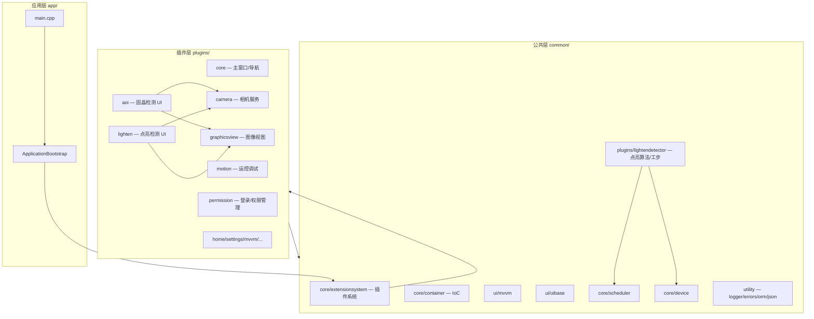

### 模块依赖关系

```
app (Bootstrap)
 └─ ExtensionSystem::PluginManager
      └─ IPlugin 各业务插件
           ├─ core → MainWindow (IMainWindowService) + PermService
           ├─ aoi → 依赖 Core, Camera, graphicsview
           ├─ lighten → 依赖 Core；cam_async 延迟初始化
           ├─ camera → ICameraService → config/camera_config.json
           ├─ motion → 运控调试 + IO 工步
           ├─ lightendetector → 注册 Scheduler Step + Algorithm
           └─ permission → 用户/角色/审计 UI + LoginDialog
```

### 设计原则（源码体现）

| 原则 | 实现 |
| --- | --- |
| 关注点分离 | 插件系统、IoC、MVVM、UI 基础设施、业务插件各自独立目录与 CMake 目标。 |
| 依赖倒置 | 跨插件通过 `IMainWindowService`、`ICameraService`、`IGraphicsVew` 等纯接口通信。 |
| 开闭原则 | 新功能以插件 DLL + JSON 元数据扩展，无需修改 `PluginManager` 核心。 |
| 配置外置 | 相机、配方、系统参数、权限数据（DB/SQL 种子）以 JSON/TOML/SQL 落盘，支持运维调整。 |
| 两阶段初始化 | 插件：`initialize()` 注册页面 → `extensionsInitialized()` 构建导航；容器：`doRegister()` → `boot()`。 |

### 启动架构

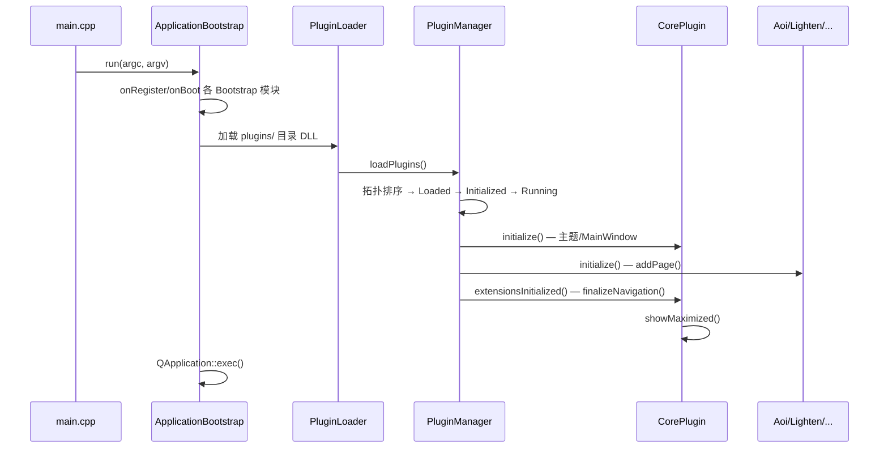

**Bootstrap 默认模块**（`app/bootstrap/bootstrap_config.h`）：

| 模块 | 默认 enabled | 职责 |
| --- | --- | --- |
| Config | true | 读取 `config/app.toml` |
| Logger | true | 日志目录 `logs/` |
| Orm | **false** | 数据库 ORM |
| DeviceManager | **false** | 设备管理器 |
| Scheduler | **false** | 流程调度（注释标明预留接入） |
| ParamBackup | true | 参数定时备份，默认间隔 1h |
| PluginLoader | true | 扫描 `{exe}/plugins/` |
| SplashScreen | true | 启动画面 |

---

## 核心流程

### 1. 应用启动与插件加载

1. `main.cpp` 构造 `BootstrapConfig`（应用名 PluginApp、插件 IID、参数备份 1h）。
2. `registerDefaultCoreModules()` 注册 Bootstrap 模块链。
3. `ApplicationBootstrap::run()` 创建 `QApplication`，依次 `onRegister` / `onBoot`；任一失败则逆序 `onShutdown` 并返回 1。
4. `PluginLoader` 设置插件路径与 IID，调用 `PluginManager::loadPlugins()`：
   - 扫描 DLL → `Read` → `resolveDependencies` → DFS 拓扑 `loadQueue`
   - 批量 `Loaded`（`QPluginLoader`）→ `Initialized`（`initialize()`）→ 逆序 `Running`（`extensionsInitialized()`）
   - 延迟初始化队列 20ms 间隔调用 `delayedInitialize()`
5. `CorePlugin::extensionsInitialized()` 调用 `finalizeNavigation()`，按 `order` 排序并结合 `PermService::canNav` 门控显示导航，主窗口最大化显示。
6. 退出时 `pluginManager.shutdown()` → `aboutToShutdown()` → 卸载 DLL。

`continueOnPluginErrors` 默认为 **true**：单个插件失败仅警告，不中止进程。

### 2. 导航注册与权限门控

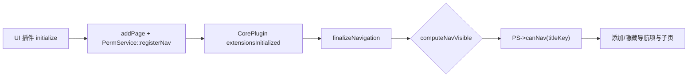

`MainWindow::computeNavVisible()`（`common/plugins/core/mainwindow.cpp`）：

```
最终可见 = PS->canNav(navPageId)
```

各 UI 插件在注册页面时同步调用 `PermService::registerNav` / `registerSubPage` 将资源写入权限目录（DB 或 mock）。登录成功后 `LoginViewModel` 调用 `PS->reloadForUser(userId)`；`permissionsChanged` 信号触发 `refreshNavigation()` 刷新主导航与子导航可见性。

全部插件 `initialize()` 完成后，`PermissionPlugin::extensionsInitialized()` 执行 **Catalog Reconcile**（见 §异常与安全 · 权限资源目录对齐），清理已部署移除插件遗留的 `perm_permission` 行。

### 3. AOI 首页与配方配置流程

当前 `AoiPlugin::initialize()` **注册 4 页**：首页（`aoi.nav.home`）、系统配置（`aoi.nav.system`）、产品配方（`aoi.nav.recipe`）、复判（`aoi.nav.review`）。**§3.1.5 设计定稿**将新增 **检测结果**（`aoi.nav.results`）。

#### 3.1 AOI 首页（运行监控）

目标稿见 `首页.png`（操作员主控台）。**产线启停与检测编排**由 `HomeViewModel` → `MachineFSM` / `Scheduler` 驱动：流程定义在 `config/flows/*.json`，Bootstrap `SchedulerModule` 加载并注册，`ISchedulerService` 供 Aoi 插件获取；`flow_host::FlowHostCoordinator` 挂接 Scheduler 流程钩子，AOI 业务由 `service/flow/` 的 `bindAoiScanFlowHost()` → `AoiScanFlowLifecycleHandler::onFlowStart` 创建并注入 `InspectionSession`（含 `ScanFlowProgressBridge`）。

#### 3.1.1 扫描工步流（P1）

**协作分层**

| 模块 | 关键类 | 职责 |
| --- | --- | --- |
| `flow_host/` | `FlowHostCoordinator`、`FlowLifecycleHandler` | 通用 Scheduler 流程宿主（单次 submit、流程结束回写）；不含 AOI 业务 |
| `service/flow/` | `ScanFlowProgressBridge`、`AoiScanFlowLifecycleHandler`、`waitWhileMachinePaused`、`scan_flow_context` | Session 注入与 abort 急停；工步→UI 进度桥；整机 `Paused` 时阻塞等待 |
| `service/capture/` | `CaptureMotionGateway`、`FovCaptureExecutor`、`CaptureProfile` | Mark/FOV 运动+曝光+原图；直调 `DeviceManager::ImageCapture`，debayer 一次得 `processImage` |
| `service/inspection/` | `InspectionSession`、`inspection_step_ops`、`InspectionDetectEngine` | 会话状态、工步编排、异步检测与结果汇总 |

**工步链**（`step/aoi_inspection_steps.*` 注册）

| 工步 typeName | 类 | 职责 |
| --- | --- | --- |
| `aoi.load_recipe` | `AoiLoadRecipeStep` | 加载默认配方 + 系统配置；`CaptureMotionGateway::checkReady` |
| `aoi.mark_locate` | `AoiMarkLocateStep` | `InspectionMarkerService`：Mark 运动 + 采图 + 可选 CISDK 匹配 |
| `aoi.plan_geometry` | `AoiPlanGeometryStep` | `FovPlanService::generate` + `CapturePathService::planFromGrid` |
| `aoi.fov_capture` | `AoiFovCaptureStep` | `FovCaptureExecutor`：逐格运动采图；每帧 `detectAsync` 入队；虚拟 FOV 进度上抛 UI |
| `aoi.fov_detect` | `AoiFovDetectStep` | `runFovDetectService`：对 `session->pendingDetectFutures` 统一 `get`，检测前 `waitWhileMachinePaused` |
| `aoi.aggregate_results` | `AoiAggregateResultsStep` | 板级 KPI/快照汇总 → `ScanFlowProgressBridge::reportInspectionSnapshot` |
| `aoi.track_pipeline` | `AoiTrackPipelineStep` | 单轨完整链路（Mark→规划→采图+异步检测→汇总）；双轨时轨1 规划与轨2 Mark 并行 |

**采图与检测流水线**：`FovCaptureExecutor` 每采一帧即 `InspectionDetectEngine::detectAsync(processImage, …)` 并 push 至 `session->pendingDetectFutures`，**不等待**下一格运动；`aoi.fov_detect` 工步再逐个 `future.get()` 收结果。采图/检测循环内遇整机 `Paused` 调用 `flow::waitWhileMachinePaused` 阻塞，恢复后继续；abort 时 `CaptureMotionGateway::emergencyStop`。

**图像约定**：AOI 后台（`algorithm`/`data`/`flow_host`/`service`/`step`）全程 `shared_ptr<ImageInfo>`；UI 边界由 `ScanFlowProgressBridge` signal → `HomeViewModel` 内 `imageInfoToQImage` 转 `QImage`。

**设备参数**：`AoiSystemConfig.common` 的 `captureName` / `axisXName` / `axisYName` / `motionSpeed` / `motionTimeoutMs`（`COMMON_PARAMS_FIELDS`）。

**UI 回写**：`ScanFlowProgressBridge`（QueuedConnection）→ `HomeViewModel::modifyRuntime`：日志、`preview.currentFov`、Mark 预览、虚拟 FOV 导航、流程条高亮、`kpi.deviceState`（RUN/IDLE/ALM）、板级快照。缺陷判定与快照表统计留 P2。

#### 3.1.2 首页布局与 VM（P0 基线）

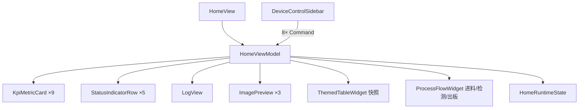

**布局**（`ui/view/home/home_view`）：

| 区域 | 宽度/比例 | 内容 |
| --- | --- | --- |
| 左栏 | 350px 固定 | `DeviceControlSidebar`：`ThemedSectionPanel`×2（**设备控制** 8 按钮 + **硬件连接状态** 5 行） |
| 顶栏 | 主区全宽 | 9 个 KPI 卡（总数/OK/NG/RW/通过率/TT/运行模式/设备状态/当前配方） |
| 中左 | stretch ≈62% | `ThemedSectionPanel` **灯板虚拟图**（P0 占位）；`HomeProcessFlowWidget` 流程条；`ThemedSectionPanel` **运行日志** + `LogView` |
| 中右 | stretch ≈38% | `ThemedSectionPanel` **图像预览**（Mark1/Mark2/当前 FOV）；`ThemedSectionPanel` **当前检测结果**（SN+总判行 + 快照表） |

`HomeView::buildLayout()` 拆分为 `buildSidebar` / `buildKpiRow` / `buildVirtualPanel` / `buildProcessFlow` / `buildLogPanel` / `buildPreviewPanel` / `buildSnapshotPanel` 等子函数，便于维护各区块比例与固定高度（如日志区、快照 SN 行 40px）。

**通用卡片 `ThemedSectionPanel`**（`ui/widgets/group/themed_section_panel.*`）：带标题栏（默认 30px，可 `setTitleBarHeight`）+ `contentLayout()` 内容区；用于首页各区块与侧栏分组，比 `FormGroupBox` 更轻（无折叠/表单行 API）。样式随 `ThemeTokens` + `bindThemeRefresh` 刷新。

**侧栏命令**：`DeviceControlSidebar` 八个按钮 `connect` 到 `HomeViewModel` 的 8 个 `Command`。**启动** → `MachineFSM::uiStartButton`（持续模式；**v0.6 设计**合并「继续」语义，不再单独 `uiResumeButton`）；**暂停** → `uiStopButton`；**复位** → `uiResetButton`；**单次检测** → `Scheduler::submit`；进度经 `ScanFlowProgressBridge` 回写 UI。按钮使能规则见 §3.1.3「UI 映射」。

**快照表**（`ThemedTableWidget`）：

- 固定 **6 列**：检测项 / R / G / B / Total / Result（翻译键 `aoi.home.result.*`）。
- 行数 **`kDefectKindCount`（11）**；**检测项**列文案与系统配置、配方结果区一致，使用 `defectKindDisplayKey(DefectKind)` + `TR()`（`param_define.h` / `recipe_config_model.cpp`）。
- R/G/B/Total 为数值列；Result 为 OK/NG，前景色经 `ThemeTokens`（accent / dangerText）。
- 表头上方：**SN**、**总判 OK/NG** 两行标签（`HomeView::refreshFromRuntime` 读 `snapshot.serialNumber` / `snapshot.overallResult`）。

**`HomeRuntimeState`**（`ui/vm/home_runtime_state.h`）：KPI 数组、硬件状态列表、日志条目、快照行、预览图（QImage）、流程步骤枚举、当前 SN/总判等展示 DTO。

**分期**：P0 布局 + 通用控件 + VM mock；P1 日志/MessageCenter、命令 handler 占位接口；P2 检测工步回写 KPI/快照/FOV 图；P3 灯板虚拟图。

#### 3.1.3 整机状态机（MachineFSM）

> **实现状态**：v0.6 设计定稿；`machine_fsm.h` 头文件含新旧双套枚举草稿，**`.cpp` 仍实现旧 10 态**；本节为落地真相源。

**代码位置**：`common/core/scheduler/machine/machine_fsm.*`、`button_monitor.*`；Bootstrap `SchedulerModule` 装配 `SchedulerRuntime` + `MachineFSM` + `FlowLoader`。

##### 状态模型

**主态 `MachineState`（互斥，4 值）**

| 值 | 含义 | 操作员理解 |
| --- | --- | --- |
| `NotReset` | 未复位 / 不可生产 | 软件启动默认；须先按复位 |
| `Paused` | 暂停（可启动的前置态） | 复位成功、正常 Stop、Alarm 清除后 |
| `Running` | 自动运行中 | 流程执行或排空中 |
| `Alarm` | 报警停机 | **仅自 `Running` 进入** |

**子标志 `MachineSubFlags`（位掩码，可组合）**

| 位名 | 值 | 含义 |
| --- | --- | --- |
| `Resetting` | `1 << 0` | 复位动作进行中 |
| `ResettingSuccess` | `1 << 1` | 复位已成功（`Paused` 下可直接 `Start`） |
| `ManualMode` | `1 << 2` | 手自动在手动侧（禁止 `Start`） |
| `EmergencyStop` | `1 << 3` | 急停链路有效 |
| `Draining` | `1 << 4` | 运行中等待流程排空（**主态仍为 `Running`**） |
| `Error` | `1 << 5` | 暂停态报警挂起（**主态仍为 `Paused`**，非 `Alarm`） |

**组合约束**

| 规则 | 说明 |
| --- | --- |
| R1 | `Resetting` 与 `ResettingSuccess` 不同时为 1 |
| R2 | `Draining` 仅当 `main == Running` |
| R3 | `Error` 仅当 `main == Paused` |
| R4 | `Alarm` 主态时不应同时有 `Error` |
| R5 | `EmergencyStop` 可与任意主态并存；**清除须复位成功**（见急停路径） |
| R6 | 不设 `ResettingFailed` 位；复位失败 → `NotReset` 并清 `Resetting \| ResettingSuccess` |

**聚合状态**

```cpp
struct MachineStatus {
    MachineState    main;
    MachineSubFlags sub;
};
```

##### 事件 `MachineEvent`

| 事件 | 来源 | 说明 |
| --- | --- | --- |
| `Reset` | 复位按钮 / UI | 启动整机复位 |
| `Start` | 启动按钮 / UI | **等同旧 Resume**；`Paused → Running` |
| `Stop` | 停止按钮 / UI | `Running → Paused`（Scheduler pause） |
| `Alarm` | AlarmManager | `Running → Alarm`；`Paused → \|= Error` |
| `ClearAlarm` | UI | 清 `Error` 或 `Alarm → Paused` |
| `EmergencyStop` | 急停 IO / L4 | `\|= EmergencyStop`；`scheduler.emergencyStop()` |
| `EstopRelease` | 急停 IO 恢复 | **仅记录硬件释放**；不清 `EmergencyStop`、不改主态 |
| `AutoSwitch` / `ManualSwitch` | 手自动拨钮 | 清/置 `ManualMode`；Running 切手动先 `Draining` |
| `FlowDrained` | **内部** Scheduler idle | 清 `Draining`（替代旧 `AllFlowsStopped`） |

**已删除（相对旧实现）**：`ResumeBtn`、`InitOk`/`InitFail`、`ResettingFailed` 子标志、`Stopping`/`Stopped` 等独立主态。

##### 操作闭环（定稿）

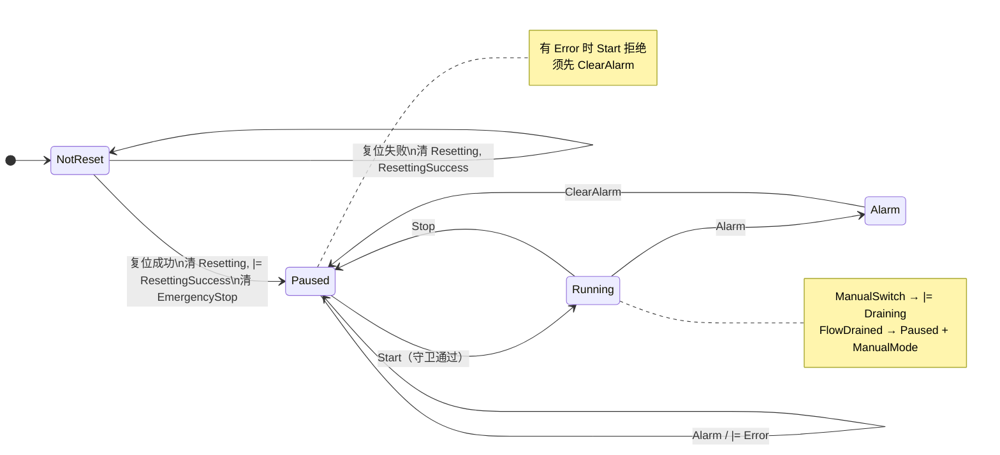

**首次启动路径**：`NotReset` → `Reset` → 复位成功 → `Paused + ResettingSuccess` → `Start` → `Running`。`Running` **只能**自 `Paused` 恢复。

**急停路径（已确认）**：

1. 任意态 + `EmergencyStop` → `\|= EmergencyStop`，Scheduler 急停，关持续模式。
2. `EstopRelease` → **仅日志/提示**，`EmergencyStop` **保持**，仍不可 `Start`。
3. `Reset` → 复位成功 → `Paused + ResettingSuccess`，**清 `EmergencyStop`** → 可 `Start`。
4. 复位失败 → `NotReset`，`EmergencyStop` **保持**。

##### `Start` 守卫（`canStart`）

```text
main == Paused
AND NOT ManualMode
AND NOT EmergencyStop
AND NOT Error          // 须先 ClearAlarm
AND NOT Resetting
AND NOT Draining
// ResettingSuccess 允许（复位后可直接 Start）
```

##### 完整转移表

**全局优先**

| 当前 | 事件 | 新主态 | 子态变化 | Scheduler 动作 |
| --- | --- | --- | --- | --- |
| `*` | `EmergencyStop` | 不变 | `\|= EmergencyStop` | `emergencyStop()`；关持续模式 |
| `*` | `EstopRelease` | 不变 | **不变** | 日志 |

**`NotReset`**

| 子态 | 事件 | 新主态 | 新子态 | 动作 |
| --- | --- | --- | --- | --- |
| — | `Reset` | `NotReset` | `\|= Resetting`；清 `ResettingSuccess` | 启动复位序列 |
| `Resetting` | 复位成功 | `Paused` | 清 `Resetting`；`\|= ResettingSuccess`；**清 `EmergencyStop`** | `setAcceptingRequests(true)` |
| `Resetting` | 复位失败 | `NotReset` | 清 `Resetting \| ResettingSuccess` | 报警日志 |
| 任意 | `Start` | — | — | **拒绝** |
| 任意 | `ManualSwitch` | `NotReset` | `\|= ManualMode` | — |
| 任意 | `AutoSwitch` | `NotReset` | 清 `ManualMode` | — |

**`Paused`**

| 子态 | 事件 | 新主态 | 新子态 | 动作 |
| --- | --- | --- | --- | --- |
| 无 Error，守卫通过 | `Start` | `Running` | 可选清 `ResettingSuccess` | 持续模式则 `submitContinuousFlow()` |
| 有 `Error` | `Start` | — | — | **拒绝** |
| 有 `ManualMode` / `EmergencyStop` | `Start` | — | — | **拒绝** |
| 任意 | `Stop` | — | — | 忽略 |
| 无 Error | `Alarm` | `Paused` | `\|= Error` | 保持 pause |
| 有 `Error` | `ClearAlarm` | `Paused` | 清 `Error` | `alarmMgr.clearAll()`（若适用） |
| 任意 | `Reset` | 走复位流程 | 同 `NotReset` | 可清 Error |
| 任意 | `ManualSwitch` | `Paused` | `\|= ManualMode` | 必要时 `stopAll` |
| 有 `ManualMode` | `AutoSwitch` | `Paused` | 清 `ManualMode` | — |

**`Running`**

| 子态 | 事件 | 新主态 | 新子态 | 动作 |
| --- | --- | --- | --- | --- |
| 无 `Draining` | `Stop` | `Paused` | 清 `Draining` | `pauseAll()` |
| 无 `Draining` | `Alarm` | `Alarm` | 清 `Draining` | `stopAll()`；关持续模式 |
| 无 `Draining` | `ManualSwitch` | `Running` | `\|= Draining`（`\|= ManualMode` 可延后至排空后） | `stopAll` 或 `setOnIdle` |
| `Draining` | `FlowDrained` | `Paused` | 清 `Draining`；保留 `ManualMode` | — |
| `Draining` | `Stop` | `Paused` | 清 `Draining` | 等同暂停 |
| 任意 | `Reset` | — | — | **拒绝**（建议） |

**`Alarm`**

| 事件 | 新主态 | 新子态 | 动作 |
| --- | --- | --- | --- |
| `ClearAlarm` | `Paused` | 清 `Error`（若有） | 清报警；`setAcceptingRequests(true)` |
| `Reset` | 走复位成功路径 | 同 § | → `Paused + ResettingSuccess` |
| `Start` | — | — | **拒绝** |

**推断：`softShutdown()`** 默认映射为 `Stop → Paused`；若班次结束须强制再复位，上层可清 `ResettingSuccess` 并切 `NotReset`（待 SOP 对齐）。

##### 旧 10 态映射（迁移）

| 旧主态 | 新表示 |
| --- | --- |
| `Initializing` | `(NotReset, Resetting)` |
| `Ready` | `(Paused, ResettingSuccess)` 且 !ManualMode |
| `ManualMode` | `ManualMode` 位 + 主态多为 `Paused` |
| `Running` | `(Running, !Draining)` |
| `Paused` | `(Paused, !Error)` |
| `Stopping` | `(Running, Draining)` |
| `Stopped` | `(NotReset, 无 ResettingSuccess)` |
| `AlarmStop` | `(Alarm)` 或 `(Paused, Error)` |
| `EmergencyStop` | `EmergencyStop` 位 |
| `Error` | 复位失败 → `NotReset`；或 `(Paused, Error)` |

##### 位操作与 FSM API（草案）

**位工具**（`machine_status.h` 或 `machine_fsm.h` 内联）：

```cpp
bool hasFlag(MachineSubFlags set, MachineSubFlags bit);
MachineSubFlags setFlag(MachineSubFlags set, MachineSubFlags bit);
MachineSubFlags clearFlag(MachineSubFlags set, MachineSubFlags bit);
MachineSubFlags clearFlags(MachineSubFlags set, MachineSubFlags mask);
bool canStart(const MachineStatus& st);
bool isDraining(const MachineStatus& st);
QString statusToString(const MachineStatus& st);
```

**`MachineFSM` 公开接口（目标）**

| 方法 | 说明 |
| --- | --- |
| `MachineStatus currentStatus() const` | 替代仅返回 `MachineState` |
| `void sendEvent(MachineEvent, std::any payload = {})` | 统一事件入口 |
| `void onStatusChanged(fn(MachineStatus old, MachineStatus new))` | 主态或子态变化均通知 |
| `uiStartButton()` | → `Start` + 守卫 |
| `uiStopButton()` | → `Stop` |
| `uiResetButton()` | → `Reset` |
| `uiClearAlarm()` | → `ClearAlarm` |
| `uiEstopButton()` / `uiEstopRelease()` | 急停 / 释放 |
| `uiManualAutoToggle()` | 手自动 |
| `enableContinuousMode` / `softShutdown` / `attachStationManager` | 保留现语义，按新态适配 |

**EventBus**：`SystemReady` 等 payload 建议改为 `MachineStatus`（或 `{main, sub}`），避免 UI 丢失 `Draining`/`Error`/`ManualMode`。

##### UI 映射（`HomeViewModel`）

| 条件 | `kpi.deviceState` | 按钮 |
| --- | --- | --- |
| `Running && !Draining` | RUN | Start 禁用 |
| `Running && Draining` | PAU（或 RUN+「排空中」） | — |
| `Paused && !Error` | PAU / IDLE（有 `ResettingSuccess` 可 IDLE） | Start=`canStart` |
| `Paused && Error` | ALM | ClearAlarm 可用 |
| `Alarm` | ALM | ClearAlarm / Reset |
| `EmergencyStop` 位 | ALM（覆盖） | Reset |
| `ManualMode` | runMode=Manual | Start 禁用 |
| `NotReset` | STP | Reset 可用 |
| 清料 `home.clear_material` | — | 使能=`canClearMaterial`：`Paused` 且 `ResettingSuccess` 且非 `Resetting` 且无 `EmergencyStop` 且无挂起报警（`Error` 或主态 `Alarm`） |

**物理按钮映射（`ButtonMonitor`）**：启动→`Start`；停止→`Stop`；复位→`Reset`；急停断→`EmergencyStop`；急停合→`EstopRelease`；手自动→`ManualSwitch`/`AutoSwitch`。

#### 3.1.4 缺陷复判 Widget（独立组件，P1）

> **实现状态**：§3.1.4 首版已落地（`ui/view/review/` + `ui/vm/review/`）；导航页 `aoi.nav.review` 已注册；会话数据经 `ScanFlowProgressBridge::reviewSessionReady` 加载；确认落盘见 `defect_info_persistence.*`；原图/结果图裁切见 `defect_review_image_crop.*`。

人工复判界面从原型抽取 **缺陷 MAP** 与 **复判区域** 两栏（左右等高）；不含流程条、运行日志；复判区坐标表**无**顶部重复类型筛选（筛选仅在 MAP 左侧）。

**目录**（不复用 `view/home/`、`widgets/` 下新文件）：

| 路径 | 职责 |
| --- | --- |
| `ui/view/review/defect_review_widget.*` | 薄壳布局（MAP \| 复判区）、**确认**按钮、`loadReviewSession` |
| `ui/view/review/defect_map_panel.*` | 左侧：缺陷类型勾选（含全选/全选缺陷/OK）+ 工具栏 + 画布 |
| `ui/view/review/defect_map_canvas.*` | 灯板网格绘制、缩放平移、命中选中 |
| `ui/view/review/defect_review_panel.*` | 原图/结果图 `ImagePreview`、快捷键说明条、`ThemedTableWidget` 坐标表 |
| `ui/vm/review/defect_review_debug_data.*` | bridge 联调 `DefectInfoList` 唯一构造入口 |
| `ui/vm/review/defect_review_image_crop.*` | 分区图路径 + `DefectInfoItem::roi` 裁切 |
| `ui/vm/review/defect_review_types.h` | `DefectReviewDieGrid`、`LampKey`、`DefectReviewLampRecord`、缺陷色、F 键映射 |
| `ui/vm/review/defect_review_view_model.*` | 类型筛选掩码、选中、内存复判缓存、确认落盘 |

**数据模型**（`plugins/aoi/data/dataDefinition/inspection_types.h`）

| 结构 / 字段 | 含义 | 复判 UI 用途 |
| --- | --- | --- |
| `DefectInfoItem::chipType` | 芯片通道 `InspectionChipType`（0=R, 1=G, 2=B） | 坐标表「芯片」列；灯点着色 |
| `DefectInfoItem::defectType` | 算法缺陷位掩码（`InspectionDefectType` bit） | MAP 筛选与展示 |
| `DefectInfoItem::rejudgeDefectType` | 人工复判缺陷位掩码（`InspectionDefectTypeMask`） | 复判写回；MAP 筛选与「复判结果」列 |
| `DefectInfoItem::isRejudge` | 是否已人工复判 | 坐标表「复判结果」列；O/R/Enter 语义 |
| `DefectInfoItem::rowIndexInPanel` / `colIndexInPanel` | 整板**芯片组**（物理灯珠组）行列 | 坐标表辅助展示；与组级统计对齐 |
| `DefectInfoItem::dieRowIndexInPanel` / `dieColIndexInPanel` | 整板**晶粒**（单颗芯片）行列 | **MAP 格定位主键** |
| `DefectInfoItem::roi` | 分区图像 ROI | 原图/结果图裁切 |
| `DefectInfoList::chipGroupRowCount` / `chipGroupColCount` | 板级芯片组（物理灯珠组）规模 | 元数据；一颗灯珠可含多颗芯片 |
| `DefectInfoList::dieRowCount` / `dieColCount` | 板级晶粒（芯片）规模 | **MAP 底图行列数** |
| `DefectInfoList::validDefectType` | 系统配置启用的缺陷类型位掩码 | 侧栏 11 类全展示；未启用项灰显且不可勾选 |

**灯板网格（晶粒级）**

- MAP 为 **晶粒网格** `dieRowCount × dieColCount`；**每一格表示一颗芯片（晶粒）**，不是一颗物理灯珠。
- 若一颗物理灯珠由三颗芯片（如 R/G/B）组成，则在 MAP 上占 **三个相邻格**；格与格之间仍按 `dieRowIndexInPanel` / `dieColIndexInPanel` 区分。
- 规模来源：优先读 `DefectInfoList::dieRowCount` / `dieColCount`（检测汇总或持久化一并写入）；调用方亦可在 `loadReviewSession` 前经 `setDieGrid` 注入（无板级文件时），**以 `loadReviewSession` 载入的 `DefectInfoList` 内字段为准**。
- **`dieRowCount` 或 `dieColCount` 为 0**：不绘制 MAP 底图，画布区展示占位提示「未配置晶粒规模」；坐标表仍可加载条目。
- `chipGroupRowCount` / `chipGroupColCount` 仅描述灯珠组规模，不直接作为 MAP 行列；UI 不在 Widget 内读配方。
- 灯点键 `LampKey = (dieRowIndexInPanel, dieColIndexInPanel)`；**一晶粒对应一条 `DefectInfoItem`**，多种缺陷写入同一项的 `defectType` 位掩码。
- 坐标越界（晶粒索引 ∉ `[0, dieRowCount)` × `[0, dieColCount)`）：列表可显示，MAP 不绘制并记日志。

**检测结果到晶粒坐标的转换（2026-06-25）** <!-- 自动补充 -->

- `DefectInfoItem::dieRowIndexInPanel` / `dieColIndexInPanel` **不得写死**为某一产品的排列公式；统一由 `service/inspection/` 内专用转换函数生成。
- 转换函数输入至少包括：`groupRow`、`groupCol`、`chipType`、`groupRowCount`、`groupColCount`、`chipArrangement`；其中 `chipArrangement` 来自当前产品配方（`recipe.basic.chipArrangement`，经 `service/fov_planner/recipe_fov_layout_adapter.*` 映射为 `FovLayoutConfig::chipArrangement`）。
- **垂直排列**：三颗芯片沿行方向展开，`dieRow = groupRow * 3 + chipType`、`dieCol = groupCol`，整板规模 `dieRowCount = groupRowCount * 3`、`dieColCount = groupColCount`。
- **水平排列**：三颗芯片沿列方向展开，`dieRow = groupRow`、`dieCol = groupCol * 3 + chipType`，整板规模 `dieRowCount = groupRowCount`、`dieColCount = groupColCount * 3`。
- 第一版仅覆盖 `Horizontal` / `Vertical` 两种组内排列；后续若配方扩展更多排列方式，只允许在该转换函数内增量扩展，复判 UI / VM 不再内嵌产品特定坐标逻辑。
- `rowIndexInPanel` / `colIndexInPanel` 继续表示芯片组（灯珠组）坐标，用于表格辅助展示；`die*` 字段才是 MAP 主键。

**侧栏筛选（缺陷类型）**

| 控件 | 规则 |
| --- | --- |
| 11 类缺陷复选框 | `DefectInfoList::validDefectType` **未启用**的类型灰显、不可勾选；对应 **F1–F11 不生效** |
| 全选 / 全选缺陷 / OK | 全选控制类型掩码与 OK 可见项；`visibleTypeMask` 与 OK 勾选做 **OR** 组合 |
| （无勾选） | MAP 仅空网格，坐标表为空 |

**灯点进入可见列表**（用于坐标表与 ↑/↓/Enter 导航）：

1. 非算法 OK（`defectType != 0` 或已复判），且
2. `(defectType | rejudgeDefectType) & visibleTypeMask != 0`，**或**侧栏勾选了 OK 且该项为复判 OK / 算法 OK。

**已复判**项仍可用 F/O/R 重新修改复判类型或回退待复判；修改仅进 `workingCopy`。

**缺陷 MAP**

- 多类型勾选可叠加显示（同心色环/多层色块）。
- 画布 `paintEvent` + 视口裁剪；滚轮缩放；选中高亮白框。

**复判区联动**

- MAP 点选 ↔ 坐标表行选 ↔ 原图/结果图双向同步；↑/↓ 在**类型筛选后的可见列表**中切换。
- 原图/结果图：经 `itemRefs` 回查 `workingCopy` 后裁切（`defect_review_image_crop.*`）：
  - 所属分区 `partitionImageOriginName` → 原图区；
  - 所属分区 `partitionImageDetectName` → 结果图区（**须非空**；为空则 warning +「暂无图像」，不回退原图）；
  - 当前晶粒对应 `DefectInfoItem::roi` → 在分区图上裁切后送入 `ImagePreview`。
- 实现：选中变化 → `DefectReviewPanel::refreshImages()`。
- ROI 无效、路径为空、ROI 越界或读图失败：记 `aoi.review.image` warning，预览区显示「暂无图像」。
- **一晶粒一 `defectItem`**；多种缺陷在 `defectType` / `rejudgeDefectType` 位掩码内表达。

**复判语义（位掩码）**

| 按键 | 行为 |
| --- | --- |
| F1–F11 | 按 `InspectionDefectType` 枚举顺序切换 `rejudgeDefectType` 对应 bit；**仅 `validDefectType` 已启用类型生效** |
| O | OK：`rejudgeDefectType = 0`，`isRejudge = true` |
| R | 待复判：`isRejudge = false`，`rejudgeDefectType = 0`（不清算法 `defectType`） |
| Enter | **提交当前项**：若未复判则认可当前缺陷（`rejudgeDefectType` 缺省沿用 `defectType`），置 `isRejudge = true`，再跳下一条可见项 |
| ↑ / ↓ | 可见列表导航 |

**无 NG 快捷键**；否定某类缺陷再按对应 F 键取消 bit。

**板级判定（以复判为准）**

- 单灯点对外语义：`isRejudge == false` → 待复判；`isRejudge && rejudgeDefectType == 0` → 复判 OK；`isRejudge && rejudgeDefectType != 0` → 复判 NG（按位展开缺陷类型）。算法 `defectType` **保留为原始记录**，不参与最终 OK/NG 展示与板级汇总。
- 板级 KPI / 快照 / 下游判定在读取 `defect_info.json` 或 `workingCopy` 时 **以复判字段为准**（`aggregatePanelResult` 等待复判链路落地时同步）。

**持久化策略**

- VM 维护 `baseline`（加载快照）与 `workingCopy`（内存编辑副本）；F 键/O/R 等**只改 `workingCopy`**，`dirty = true`。
- 工具栏 **确认**（`aoi.review.confirm`）：`dirty` 时将 `workingCopy` 写入存储接口；第一版默认实现仍写 `defectInfoFullFileName`（`defect_info.json`），成功后 `baseline = workingCopy`、`dirty = false`；失败提示且保留内存数据。
- 落盘 API：`service/inspection/` 维持 `saveDefectInfoList(const DefectInfoList &)`（JSON 序列化，与 `buildDefectInfoList` 字段对齐）；**数据库回写**见 §3.1.5（`aoi_inspection_history` + `InspectionHistoryRepository`）。
- 对外信号 `reviewConfirmed(const DefectInfoList &)` 用于通知上层“当前板复判已确认”；历史库 UPDATE 与 JSON 文件落盘并行，见 §3.1.5。

**bridge 接入与会话覆盖规则（2026-06-25）** <!-- 自动补充 -->

- 检测汇总完成后，由 `service/flow/ScanFlowProgressBridge` 新增复判会话上抛接口（建议形态：`reportReviewSession(const inspection::DefectInfoList &)`）与对应信号（建议形态：`reviewSessionReady(const inspection::DefectInfoList &)`）。
- 触发时机：`InspectionSession::panelResult.defectInfoList` 已构建完成之后；首页快照仍走 `inspectionSnapshotUpdated`，复判数据单独走 `reviewSessionReady`，二者互不替代。
- `DefectReviewViewModel` 在初始化时经 `flow_host::flowHostCoordinator()` 获取当前活跃 bridge 并建立连接；收到信号后直接执行 `loadReviewSession(data)`。
- **会话覆盖规则**：新会话到达时**直接刷新**当前复判页数据，不判断 `dirty`，不弹覆盖确认；原因是复判页后续主要以其他页面唤起的模态对话框形态使用，打开即展示当前待复判板数据。
- **联调数据**：`ui/vm/review/defect_review_debug_data.*` 提供 `buildReviewDebugDefectInfoList()`；由 `HomeViewModel::triggerDirectReviewFlow()` 经 bridge 主动投递，不在 VM 内嵌 mock 会话。

**bridge 联调测试数据（2026-06-25）** <!-- 自动补充 -->

- 为便于在检测流程未完全联通时验证 `ScanFlowProgressBridge -> DefectReviewViewModel -> DefectReviewWidget` 链路，在 `defect_review_debug_data.*` 保留**唯一**可控测试数据构造入口。
- 测试数据必须同时覆盖：
  - 垂直排列产品：验证 `dieRow = groupRow * 3 + chipType` 的 MAP 排布；
  - 水平排列产品：验证 `dieCol = groupCol * 3 + chipType` 的 MAP 排布；
  - 至少 1 个复判 OK、1 个待复判、1 个复判 NG、多缺陷位叠加、边界点（四角）与中部散点。
- 推荐做法：`buildReviewDebugDefectInfoList(verticalArrangement)` 由 `HomeViewModel` 等调用方经 bridge 信号主动触发，而不是在正式 `buildDefectInfoList` 或复判 VM 中混入测试分支。
- 测试数据的 `chipGroup*`、`die*`、`defectInfoFullFileName`、`validDefectType` 必须填完整，使其既可驱动 MAP / 列表，也可直接验证确认按钮与 JSON 落盘路径。

**源码注释要求（2026-06-25）** <!-- 自动补充 -->

- 本链路实现时，`service/inspection/inspection_result_service.*`、`service/flow/scan_flow_progress_bridge.*`、`ui/vm/review/defect_review_view_model.*` 受影响函数必须补充**与实现一致**的详细注释。
- 坐标转换函数需明确注释：输入是芯片组坐标还是晶粒坐标、`Horizontal` / `Vertical` 各自如何展开、为什么 `rowIndexInPanel` 与 `dieRowIndexInPanel` 不能混用。
- bridge 上抛函数与信号需注释：发送时机、线程语义（若仍在 UI 线程 / QueuedConnection）、该信号承载的是“整板待复判会话”而非快照 KPI。
- VM 接收函数需注释：新会话覆盖旧会话的业务原因、`baseline` / `workingCopy` 的重置规则、mock 入口仅用于联调。

**对外 API（v1）**

```cpp
void setDieGrid(int dieRowCount, int dieColCount);  // 可选；loadReviewSession 以 data 内规模为准
void loadReviewSession(const inspection::DefectInfoList &data);
inspection::DefectInfoList workingDefectData() const;
bool isDirty() const;
```

**数据**：`inspection_types.h` 之 `DefectInfoItem` / `DefectInfoList`（含板级 `chipGroup*` / `die*` 规模与晶粒坐标）；缺陷类型与 `aoi.defect.*` / `aoi.review.*` i18n 对齐。

**`DefectReviewLampRecord`**：MAP/列表用的运行时聚合（坐标、缺陷/复判掩码、`itemRefs` 写回句柄）；图像路径与 ROI **不缓存**，裁切经 `itemRefs` → `workingCopy`。

#### 3.1.5 检测历史页（检测结果导航）

> **UI 依据**：`plugins/aoi/docs/UI截图/检测结果.png`（列表页）、`检测详情弹窗.png`（详情弹窗）。  
> **实现状态**：设计定稿（v0.11）；代码待落地。

**目标**：提供 `aoi.nav.results`（i18n：**检测结果**）导航页，按 UI 稿展示历史筛选、当页 KPI 汇总、分页宽表；行末 **查看** 弹出复判界面加载该条 `DefectInfoList`。数据以 `DefectInfoList` 为真相源落库，表头展示字段为 UI 所需的**派生汇总列** + 11 类缺陷计数列。

**页面布局**（`ui/view/inspection_history/`，对齐 UI 截图）

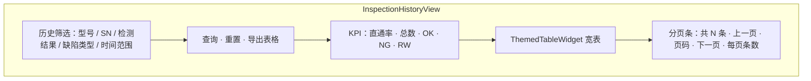

| 区块 | i18n / 文案 | 控件与行为 |
| --- | --- | --- |
| 筛选 | `aoi.insp.filter_title` | **产品型号**、**灯板编号** 文本框；**检测结果** 下拉（全部 / OK / NG / RW）；**缺陷类型** 下拉（全部 + `InspectionDefectType` 11 类，`defectKindDisplayKey`）；**时间范围** 起止 `ThemedDateTimeEdit` |
| 操作 | `aoi.insp.query` / `reset` / `export` | 查询 → 重置 `pageIndex=0` 并刷新；重置 → 清空筛选并查询；导出 → 当前筛选条件下全量 CSV（不分页） |
| KPI | `aoi.insp.stat.*` | 5 卡：`KpiMetricCard` 展示直通率、总数、OK、NG、RW；统计范围 = **当前筛选条件**下全量匹配行（独立 `COUNT` 聚合，非仅当前页） |
| 宽表 | `aoi.insp.data_title` | 列见下表；**检测结果**列 OK/NG/RW 语义色；末列 **详情** → `aoi.insp.detail`（查看） |
| 分页 | — | DB `LIMIT/OFFSET`；默认每页 **20** 条，可选 10 / 20 / 50；显示「共 N 条」与页码导航（参考 lighten `InspectionResultsView` 分页条交互） |

**宽表列（UI 展示）**

| 列 | 数据来源 | 说明 |
| --- | --- | --- |
| 产品型号 | `DefectInfoList::productName` | |
| 灯板编号 | `DefectInfoList::SN` | |
| 检测结果 | 派生 `inspection_result` | OK / NG / RW；首版算法：无待复判且板级无缺陷 → OK；存在待复判 → RW；否则 NG；复判确认后按 `workingCopy` 以复判字段重算并 UPDATE |
| 检测次数 | 派生 `inspect_times` | 同一 `SN` 在库中累计检测序号（INSERT 时 `COUNT(sn)+1`） |
| 返工次数 | 派生 `rw_count` | 该 `SN` 历史 RW 次数累计（含本条若为 RW） |
| 11×缺陷类型 | 派生 `defect_count[0..10]` | 遍历 `defectPartitions[].defectItems`，按 `InspectionDefectType` 位掩码计数（复判后以 `rejudgeDefectType` 为准若 `isRejudge`）；列标题用 `aoi.defect.*` |
| 检测时间 | `DefectInfoList::detectTime` | 展示 `yyyy-MM-dd HH:mm:ss` |
| 详情 | — | **查看** 按钮，见「详情弹窗」 |

**详情弹窗**（首版直接复用复判 Widget）

| 项 | 设计 |
| --- | --- |
| 容器 | `DefectReviewDialog`（`ThemedPanelDialog` 或最大化 `QDialog`），**不切换**主导航至 `aoi.nav.review` |
| 标题 | `检测详情 · {productName} / {SN} · {OK\|NG\|RW}`（对齐 UI 稿） |
| 内容 | 内嵌现有 `DefectReviewWidget`；`DefectReviewViewModel(bindBridge=false)`，避免 `ScanFlowProgressBridge` 覆盖历史会话 |
| 加载 | `loadReviewSession(rowToDefectInfoList(dbRow))`；`defectPartitions` 自库中 JSON 反序列化 |
| 确认 | **确认** → `saveDefectInfoList`（若路径有效）+ `repository.updateRecord(id, workingCopy)` 重算派生列 → 刷新当前页表格行 → 关闭 |
| 关闭 | 右上角 **关闭**；`dirty` 时提示放弃 |

**数据库**（`{exe}/DB/record.db`，与参数审计同库）

表 `aoi_inspection_history`：

| 列 | 类型 | 说明 |
| --- | --- | --- |
| `id` | INTEGER PK | UPDATE / 详情定位 |
| `product_name` | TEXT | `productName` |
| `sn` | TEXT | `SN` |
| `detect_time` | TEXT | `detectTime`；排序与筛选 |
| `inspection_result` | INTEGER | 0=OK, 1=NG, 2=RW |
| `inspect_times` | INTEGER | 展示列 |
| `rw_count` | INTEGER | 展示列 |
| `defect_count_0` … `defect_count_10` | INTEGER | 11 类缺陷计数 |
| `defect_partitions` | TEXT | `defectPartitions` JSON 数组（与 `defect_info_persistence` 分区结构一致） |
| `defect_info_full_file_name` | TEXT | 可选 JSON 旁路路径 |
| `valid_defect_type` | INTEGER | `validDefectType` |
| `append` | INTEGER | `append` |
| `chip_group_row_count` … `die_col_count` | INTEGER | 板级规模字段 |

索引：`idx_aoi_insp_time (detect_time DESC)`、`idx_aoi_insp_sn (sn)`、`idx_aoi_insp_model (product_name)`。

**写入时机（C：检测插入 + 复判更新）**

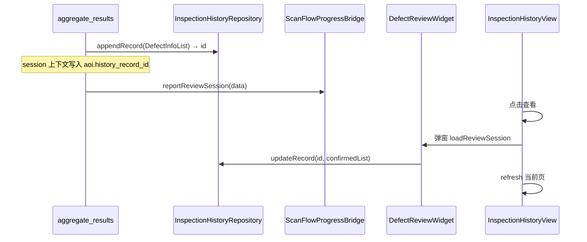

- **INSERT**：`aggregatePanelResult` 完成、`defectInfoList` 已构建后；失败仅 `qWarning`，不阻断检测流程。
- **UPDATE**：`reviewConfirmed`（导航复判页与历史弹窗共用）；优先 `session` 内 `history_record_id`，否则 `id` / `sn+detect_time` 匹配。
- **JSON 编解码**：`defect_info_persistence.*` 抽取 `partitionsToJson` / `defectInfoListFromRow`，文件落盘与库列共用。

**模块划分（待实现）**

| 路径 | 类 | 职责 |
| --- | --- | --- |
| `repository/inspection_history/` | `InspectionHistoryRepository` | 建表、`appendRecord` / `updateRecord` / `queryPage` / `queryStats` |
| `service/inspection/` | `inspection_history_mapper.*` | `DefectInfoList` ↔ 行实体；派生 OK/NG/RW 与 11 类计数 |
| `ui/view/inspection_history/` | `InspectionHistoryView` | 筛选、KPI、宽表、分页条 |
| `ui/vm/inspection_history/` | `InspectionHistoryViewModel` | 筛选状态、分页、`query` / `goToPage` / `exportCsv` |
| `ui/view/review/` | `DefectReviewDialog` | 历史详情弹窗壳 |

**导航注册**：`AoiPlugin::initialize()` 增加 `addPage("aoi.nav.results", …, order≈24)`（复判 `23` 之后）；`PermService::registerNav`。

**与 §3.1.4 关系**：导航页 `aoi.nav.review` 仍接收 bridge 实时会话；历史 **查看** 走独立弹窗实例，二者 VM 互不覆盖。

#### 3.2 AOI 配方配置与调试

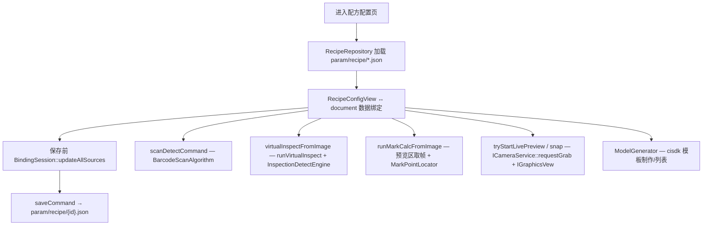

**AOI 缺陷类型**（`param_define.h` · `DefectKind`，与系统配置开关/阈值、配方结果表、首页快照表共用）：缺晶、偏移、错件、反向、翻转、立碑、多件、损伤、异物、多晶、少晶（共 11 类）。

**虚拟调测（2026-06-23 产线同源修订）**

配方页工具栏 **检测**：对按下瞬间当前帧执行整板 DL 检测（静态读图 / 单次拍照 / 实时预览均适用）。若在实时预览，先 `stopPreview` 锁帧；检测中主区仍显示冻结原图，底部半透明进度条浮层（`VirtualInspectOverlayWidget`）；完成后主预览 **SetImage 算法结果图**（`exportDlDieBondingDetectResultPng` → PNG，框由 CISDK 绘制，Aether 不自绘全量框）。

与产线扫描 **互斥**：虚拟调测与 `aoi.fov_detect` 不会并行；故不再 spawn `aoi_algo_detect_demo` 子进程隔离 CISDK/Qt，统一走进程内 `InspectionDetectEngine` 句柄池 + `detectFovProcessImage`。

| 组件 | 路径 | 职责 |
| --- | --- | --- |
| `VirtualInspectResult` | `service/inspection/virtual_inspect_types.h` | `sourceFrame` 冻结原图、`resultFrame` 算法导出图、`displayFrame()` 展示优先结果图；11 类合计 + `defectItems`（中心点 `roi.x/y`，w/h=0） |
| `InspectionDetectEngine` | `service/inspection/inspection_detect_service.*` | 句柄池初始化、`detectSync(..., useTempFileInput=false, dlCropLocate=false)`；`exportDetectResultPng` 委托 `vision_algo::exportDlDieBondingDetectResultPng` |
| `VirtualInspectRunner` | `service/inspection/virtual_inspect_runner.*` | 独立 `QThread` 承载引擎（仅 UI 不阻塞）；进度阶段键 i18n；无 `QProcess` |
| `virtual_inspect_service` | `service/inspection/virtual_inspect_service.*` | 临时 PNG 路径、`fillVirtualInspectDefectTotals` / `buildVirtualInspectDefectItems` |
| `RecipeVirtualInspectViewModel` | `ui/vm/recipe_config/recipe_virtual_inspect_view_model.*` | 虚拟调测：预览取帧、`virtualInspecting` 守卫、进度与快照信号 |
| `RecipeConfigCenterView` | `ui/view/recipe_config/recipe_config_center_view.*` | 结果区汇总表 ↔ 5 列明细表切换；`applyVirtualInspectDisplay`；工控机仅换 Aoi.dll 时不画十字线 |
| `RecipeVirtualInspectDetailDialog` | `ui/view/recipe_config/recipe_virtual_inspect_detail_dialog.*` | **[遗留]** 带图弹窗；配方页已改内嵌明细表，默认不再打开 |

数据流：点 **检测** → 锁帧 → 后台线程 `InspectionDetectEngine::detectSync` → `chip_detect_bridge::detectFovProcessImage` → `VisionAlgo` 固晶单元 → 导出结果 PNG + 填 `FovDetectRecord` → 主区显示结果图 + 右侧 11 类汇总 → **查看结果详情** 切明细表 → 点行十字线定位（不自绘检测框）。

**Mark 计算（2026-07-02）**

Mark 页 **Mark计算** 与虚拟调测/扫码一致，使用中间预览区当前帧，不再 `snapOnce` 硬采。实时预览时 **先** `stopPreview(false)` **再** `IGraphicsVew::GetImage` 拷贝 → `RecipeMarkCalcViewModel::runMarkCalcFromImage` 同步 `MarkPointLocator::locate`；读图/单帧拍照场景直接 `GetImage`。产线 `InspectionMarkerService` 仍走运动采图，不受影响。

**全图导航（2026-06-18）**

与检测工步共用 `service/fov_planner/` 几何层（**不再**使用已废弃的 `service/panel/`）。

| 组件 | 路径 | 职责 |
| --- | --- | --- |
| `buildFovLayoutConfig` / `computeFovSizeMm` | `service/fov_planner/recipe_fov_layout_adapter.*` | 配方 → `FovLayoutConfig`；标定预览以 `marks[].capturePos` 作物理 Mark 锚点 |
| `FovCoordinateSystem` | `service/fov_planner/fov_coordinate_system.*` | 逻辑↔物理仿射；`markPhysicalAabb()` 供轴点动 XY 钳位 |
| `computeNavigatorViewBounds` 等 | `service/fov_planner/fov_layout_types.*` | 缩略图视口（`computeNavigatorViewBounds`）、可点击范围（`computeMarkNavigateLogicalBounds`） |
| `PanelOverviewPainter` | `ui/widgets/domain/panel_overview_painter.*` | 由 `FovCoordinateSystem` + 配方基本信息绘制灯板示意缩略图（组矩形、M1/M2）；Mark 仿射无效时占位提示 |
| `PanelNavigatorOverlay` | `ui/widgets/domain/panel_navigator_overlay.*` | 预览区左下 1/3×1/3 浮层；静态底图 + 动态 FOV 框；点击 → 逻辑坐标 → `logicalToPhysical` |
| `RecipeConfigCenterView` | `ui/view/recipe_config/recipe_config_center_view.*` | 工具栏「全图导航」toggle（`aoi.recipe.nav.toggle`，位于清屏后）；挂载 overlay；监听 `axisStatesUpdated` 刷新 FOV |
| `RecipeConfigViewModel::moveCaptureToPhysicalXY` | `ui/vm/recipe_config_view_model.*` | 经 `ICameraService::captureAxisNames` 取 XY 轴，`IMotionControlService::moveToPosition` 绝对定位；**Z 不动** |

数据流：`RecipeDocument` → `buildFovLayoutConfig()` → `FovCoordinateSystem::build()` → 示意板缓存；轴反馈 `(X,Y)` + `computeFovSizeMm()` → 物理 FOV 框 → 逻辑坐标绘制；点击缩略图 → `moveCaptureToPhysicalXY`。

### 4. 点亮检测调度流程

点亮检测**运行时逻辑**在 `LightenDetectStep::execute()`（`common/plugins/lightendetector/step/lighten_steps.cpp`），非 `lighten` UI 插件直接驱动。

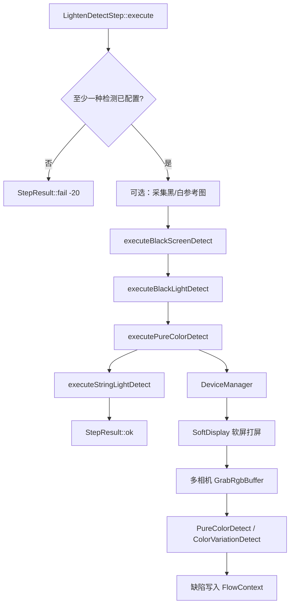

**纯色差检测子流程**：`DeviceManager` → `SoftDisplay` → 并行多相机 `GrabRgbBuffer` → 算法 `PureColorDetect` / `ColorVariationDetect` → 结果 key（`deads_out_key_` 等）。

**推断：** 完整产线需 Bootstrap 启用 `deviceManager` + `scheduler`，并配置 `param/device_config.json` 与流程 JSON；仓库内 Scheduler 示例位于 `common/core/scheduler/examples/`，默认 Bootstrap **未自动加载**这些文件。

### 5. 相机采图流程

> **架构决策（2026-06-10）**：采用 **方案 A** — 采集器中心 + 扩展 `ICameraService`；UI/工艺统一 `CameraFrame` 事件路由；`FrameDispatcher` 首版不对接 MessageCenter（后续扩展点）。**实现状态：P1～P3 已落地；配方 UI 仍走 v1 `setPreviewFrameHandler` 适配层（P4 多 widget 路由待迁）。**

#### 5.1 现状（代码事实）

- **UI 路径**：`RecipeConfigViewModel` 通过 `PluginManager::getInterface<ICameraService>()` 调用：
  - **单帧拍照 / Mark 抓拍**：`requestGrab`（非阻塞，`GrabWorker` 后台采图，主线程回调）。
  - **实时预览**：`asyncGrab` + 全局 `setPreviewFrameHandler(QImage)`（**无** captureName / 图像类型标识）。
  - **扫码**：从 `IGraphicsVew` 取图 + `QTimer::singleShot` 主线程识别。
- **Camera 插件**：`CameraServiceImpl` 直接持有 `GalaxyCameraWrapper`，自读 `config/camera_config.json` 开相机，**与 `DeviceManager` 双轨建连**。
- **ImageCapture**（`common/core/device/imageCapture/`）：绑定 `cameraName` / `lightName`；`ImageInfo` 仅含 `AlgoMat` + `BayerType`；`imageDeque` 为 **static**（多采集器会互串）；`m_execDispFuncCB` 控制是否执行 `RegisterDispCB` 显示回调。
- **调度路径**：`lighten_device_ops::GrabRgbBuffer` 经 `DeviceManager` 取图（与 Camera 插件独立）。
- **Lighten 异步相机**：`LightenPlugin::delayedInitialize()` → `cam_async::Init()`。

#### 5.2 目标分层（方案 A）

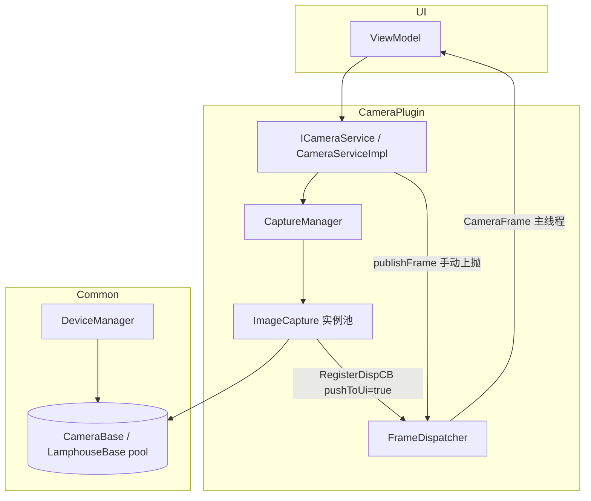

| 组件 | 职责 |
| --- | --- |
| **DeviceManager** | 设备连接唯一真相源；`getCameraNameList()`、`CameraHandler(name)`、`LamphouseHandler(name)` |
| **ImageCapture** | 单路「相机 + 光源 + 轴元数据」采图；队列、帧序号、可选显示回调；**不感知 UI** |
| **CaptureManager** | 读 `config/image_capture_config.json`；构造采集器；`init()` 时注入 DM 设备池 |
| **FrameDispatcher** | `ImageInfo`/`AlgoMat` → `QImage`；组装 `CameraFrame`；`QMetaObject::invokeMethod` 切主线程投递 `registerFrameHandler` |
| **CameraServiceImpl** | 实现扩展后 `ICameraService`；**不含厂商 wrapper 类型** |

#### 5.3 ImageCapture 数据模型（目标）

**`ImageInfo` 扩展**

| 字段 | 说明 |
| --- | --- |
| `bayerType` | 现有 |
| `imageMat` | 现有 `shared_ptr<AlgoMat>` |
| `frameIndex` | `uint64_t`，本采集器内从 **1** 单调递增 |

**配置 JSON 扩展**（采集器条目）

| 键 | 说明 |
| --- | --- |
| `cameraName` | 对应 DeviceManager 相机名 |
| `lightName` | 光源名（可空） |
| `axisNames` | `string[]` 绑定轴列表；**首版仅元数据**（走位由工艺层调 MotionController，采集器内不自动运控） |
| `delayTime` / `channelData` | 现有 |

**帧序号规则**

| 事件 | 行为 |
| --- | --- |
| 入队成功 | `++m_frameCounter` → 写入 `ImageInfo::frameIndex` |
| `clearImageDeque()` | 清队列 + **`m_frameCounter = 0`** |
| `stopCapture()` 排空完成 | **`m_frameCounter = 0`** |
| 新一次 `captureImage` / `continuousCapture` | 不主动重置（停止后从 1 再计） |

**必须修复**：`static imageDeque` → 实例成员 `m_imageDeque`。

#### 5.4 CameraFrame 与 UI 路由（目标）

```cpp
enum class CameraImageKind { LivePreview, SingleShot, External, Processed };

struct CameraFrame {
    QString captureName;      // 采集器名 — 路由主键
    QString cameraName;       // 物理相机名
    CameraImageKind kind;
    uint64_t frameIndex;
    QImage displayImage;
    std::shared_ptr<ImageInfo> algoInfo;  // 可选，算法链保留 AlgoMat
};
```

- UI ViewModel 注册 `registerFrameHandler`，按 **`(captureName, kind)`** 映射到 Preview / Mark / 其它 widget。
- **手动上抛**：外部以 `execDispFuncCB=false` 使用采集器，处理完成后调用 `ICameraService::publishFrame(CameraFrame)`。
- **FrameDispatcher 扩展点（非首版）**：可向 MessageCenter 转发，供工艺链订阅。

#### 5.5 ICameraService 扩展 API（目标）

在保留 v1 方法（标记 legacy/适配）基础上：

| 分类 | 方法 | 说明 |
| --- | --- | --- |
| 设备代理 | `cameraIds()` | = DeviceManager 相机名列表 |
| 采集器 | `captureNames()`、`isCaptureReady(name)` | CaptureManager |
| 采图控制 | `captureOnce(captureName, pushToUi, kind)` | 单帧；`pushToUi` ↔ `execDispFuncCB` |
| | `startContinuous` / `stopCapture` / `clearImages` | 连续采图 / 停止 / 清队列 |
| 参数 | `setExposure(captureName, us)`、`setLight(...)` | 曝光 / 光源通道 |
| 上抛 | `registerFrameHandler(handler)` | 统一 `CameraFrame` 回调 |
| | `publishFrame(CameraFrame)` | 手动上抛 |
| v1 兼容 | `asyncGrab(cameraId, …)` | 内部映射 `cameraId → defaultCaptureName`，`kind=LivePreview` |

#### 5.6 配置与初始化（目标）

| 文件 | 职责 |
| --- | --- |
| DeviceManager 设备 JSON | 相机/光源/运控 **连接**（已有） |
| `config/image_capture_config.json` | 采集器条目：`ImageCapture.{captureName}` → camera/light/axisNames/… |
| `config/camera_config.json` | **废弃于 Camera 插件内独立开相机**；设备连接归 DeviceManager |

`CameraPlugin::extensionsInitialized`（或 DM Ready 后）：`CaptureManager::load` → 各 `ImageCapture::init(dm pools)` → 注册 `RegisterDispCB` → `FrameDispatcher`。

#### 5.7 实施阶段

| 阶段 | 内容 |
| --- | --- |
| P1 | `ImageCapture`：实例队列、frameIndex、axisNames、序号清零 |
| P2 | `CaptureManager` + 移除 `GalaxyCameraWrapper` + 接 DeviceManager |
| P3 | `ICameraService` v2 + `FrameDispatcher` + v1 适配层 |
| P4 | 配方等 UI 改 `registerFrameHandler` 多 widget 路由 |

#### 5.8 虚拟相机（VirtualCamera）

> **实现状态（2026-06-10）**：`common/core/device/camera/virtual_camera/` 已落地；CMake 选项 `VIRTUAL_CAMERA_BUILD`（默认 ON）产出 `virtual_camera.dll`；`DeviceManager` 在 `BUILD_CAMERA_VC` 下可工厂创建 `CDN_VC` 实例。

**用途**：无物理相机或离线调试时，由 `DeviceManager` 统一走 `CameraBase` 接口模拟采图，与 `ImageCapture` / 工艺链复用同一设备池。

**开关与配置**（`config/app.toml`，插件侧副本 `plugins/aoi/config/app.toml`）

| 键 | 类型 | 默认 | 说明 |
| --- | --- | --- | --- |
| `virtual_debug.virtual_camera_enable` | bool | `false` | `true` 时 `createCameraInstance` **忽略**设备 JSON 中的 `type`，强制 `CDN_VC` |
| `virtual_debug.camera.image_path` | string | `""` | 图像根目录；空则自生成 1920×1080 RGB 彩条图 |
| `virtual_debug.camera.frame_rate` | int | `10` | AsyncGrab / 硬触发连播帧率（fps） |

**图清单规则**（`scanPlaylist`，**仅扫描一层子目录**）

| 路径结构 | 行为 |
| --- | --- |
| 根目录平铺 `*.png/jpg/jpeg/bmp/tif/tiff` | 归入 `flatImages_`，排在全清单末尾 |
| 根下**一级**子目录（目录内仅文件，不再递归） | 每个非空子目录为一组 `subdirGroups_` |
| 根路径不存在或无有效图 | 回退合成彩条图 |

**采图语义**

| 接口 | 行为 |
| --- | --- |
| `SyncGrab` / 软触发 | 按「各子目录组顺序 + 平铺图」全清单循环取下一帧 |
| `AsyncGrab` | 按 `frame_rate` 循环投递全清单 |
| 硬触发 | 每次触发按帧率连播**当前子目录组**全部图；播完切下一组；无子目录时以平铺图为一组 |
| `Open` / `refreshCameraInfo` | 首帧填充 `CameraInfo`（型号 `VirtualCamera`） |


**设备层清理**：移除 `device_type_def.h`、`DeviceType`、`IsMachineVirtual()` 及各设备基类 `m_deviceType_`；设备型号由各模块自有 `*DevType` 枚举表达。

**实现注意**：`device_manager.cpp` 须 `#include <common/core/config/include/Config.h>`（Windows 下 `<Config.h>` 可能与 libmodbus `config.h` 冲突）。

### 6. 运控 / IO 流程

- **调试 UI**：`MotionPlugin` 注册 `MotionDebugView`（菜单键 `nav.lighten.motion_debug`），读写 `param/device_config.json`、`param/ioCombine.json`。
- **工步**：`lighten.ioctrl10/12/22` 写 DO；`lighten.iosensor` 读 DI 等待。

### 7. 登录与会话权限流程

`permission` 插件提供 `LoginDialog`；`LoginViewModel::applySessionToApp` 调用 `PermService::reloadForUser(userId)` 从 DB/mock 加载当前用户 grants，并广播 `permissionsChanged`。

详见 `plugins/permission/权限运行时控制.md`。

---

## 模块详解

### app — 应用入口与 Bootstrap

| 类/文件 | 职责 |
| --- | --- |
| `main.cpp` | 构造 `BootstrapConfig`，注册默认模块，调用 `bootstrap.run()` |
| `ApplicationBootstrap` | 模块排序、`onRegister`/`onBoot`/`onShutdown` 生命周期 |
| `bootstrap_config.h` | 各子模块开关与路径配置 |
| `core_modules.cpp` | Config、Logger、Orm、DeviceManager、Scheduler、ParamBackup、PluginLoader |
| `plugin_loader_module.cpp` | 插件扫描加载、Splash 结束、`continueOnPluginErrors` 策略 |

### common/core/extensionsystem — 插件系统

| 类 | 职责 |
| --- | --- |
| `PluginManager` | 插件路径、加载、对象池（`addObject`/`getObject<T>`） |
| `PluginSpec` | 插件元数据与 8 态状态机（Invalid→…→Deleted） |
| `IPlugin` | `initialize` / `extensionsInitialized` / `delayedInitialize` / `aboutToShutdown` |
| `Invoker` | 基于 Qt 元对象的跨插件 slot 反射调用 |

依赖解析：DFS 拓扑排序 + 环依赖检测；`extensionsInitialized` **逆序**调用。

### common/core/container — IoC 容器

| 类 | 职责 |
| --- | --- |
| `Container` / `Application` | `bind`/`singleton`/`make`、循环依赖检测、上下文绑定 |
| `ServiceProvider` | 两阶段 `doRegister` + `boot` |
| `NamedBinding` + `MethodDispatcher` | 命名服务与 `std::any` 动态调用 |
| `Facade<T>` | 静态门面访问 `Application::instance()->make<T>()` |

### common/ui/mvvm — MVVM 基础设施

| 类 / 头文件 | 职责 |
| --- | --- |
| `ViewModel` | `QHash<QString,QVariant>` 属性、`propertyChanged`、批量更新、属性中间件管道 |
| `DataBinding` | 控件绑定（默认 `TwoWay` + `OnChanged`）、`bindStructField` / `bindStructIndexField`、`bindCommand` |
| `BindingOptions`（`binding_options.h`） | `BindingMode`（`TwoWay`/`OneWay`）、`UpdateSourceTrigger`（`OnChanged`/`OnLostFocus`/`Manual`） |
| `BindingSession` | 登记 `BindingHandle`；`updateAllSources()` flush Manual 项；`beginSuspendUpdates` 暂停 VM→View |
| `BindingHandle` | 单条绑定的 `updateSource()`，供 Manual 与保存前批量提交 |
| `Command` / `FunctionalCommand` | 可执行命令 + `canExecute` + 命令中间件 |
| `AuditCommandMiddleware` | 命令审计（`command_audit_registry`） |

**绑定数据流（双向）**：

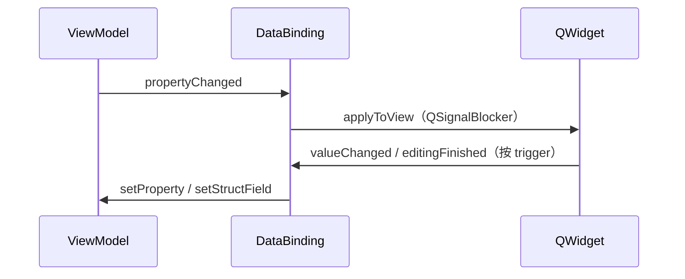

单元测试：`tests/test_mvvm_binding.cpp`（`OnChanged`/`OnLostFocus`/`Manual`/`OneWay`/`BindingSession`）。

### common/ui/uibase — UI 基础设施

| 类 | 职责 |
| --- | --- |
| `MainWindow`（plugins/core） | 实现 `IMainWindowService`，无边框窗口、导航、权限联动 |
| `ThemeManager` | ACSS 主题；8 套配色 xml（`dark_*` / `light_*`，主题名即文件名）；`setCurrentAcssTheme(name)` 细粒度切换；`setTheme`/`toggleTheme` 切换默认暗 `dark_sky_blue` 与亮 `light_iot_green` |
| `LanguageManager` | 中英文翻译字典，`TR(key)` 宏 |
| `PermService` | 导航/子页/操作权限运行时：`canNav`、`canSubPage`、`canAction`、`reloadForUser`、`permissionsChanged` |
| `PageWidget` | 页面懒加载 `onLoad`/`onShow`/`onHide`/`applyTheme` |
| `PrimaryNavigationManager` | 一级导航 + `QStackedLayout` 切页 |

### plugins/core — 主窗口插件

- `CorePlugin::initialize()`：主题初始化、创建 `MainWindow` 并 `addObject`（不再加载 menu.json/roles.json）。
- `CorePlugin::extensionsInitialized()`：`finalizeNavigation()` + 显示主窗口。

### plugins/aoi — AOI 固晶检测

**插件元数据**（`aoiplugin.json`）：依赖 Core、Camera、graphicsview；描述含六页，**实际注册 2 页**。

| 子模块 | 关键类 | 职责 |
| --- | --- | --- |
| data/dataModel/base | `param_define.h`、`param_meta`、`param_serde`、`param_model_macros` | 参数反射、JSON 序列化、共享枚举与几何类型；维护说明见 `base/README.md` |
| data/dataModel | `RecipeDocument`、`AoiSystemConfig` | 参数结构体与 `DEFINE_PARAM_STRUCT` 宏体系 |
| data/dataModel | `RecipeRepository`、`SystemConfigRepository` | 配方/系统配置 CRUD（`json_utils` 读写 `param/`） |
| data/orm | `RevisionHistory`、`register.cpp` | 参数变更 ORM 实体注册 |
| repository/param_change | `ParamChangeDbStore`、`ParamChangeFileStore` | `IParamChangeStore` 的 DB / 文件后端 |
| service/param_change | `ParamChangeParser`、`ParamChangeAuditManager` | 变更解析与审计编排（启动时注入 store 策略） |
| service/fov_planner | `FovPlanService`、`FovCoordinateSystem`、`FovGridPlanner`、`recipe_fov_layout_adapter` | FOV 几何规划；检测工步与配方全图导航共用布局/坐标系 |
| service/path_planner | `CapturePathService`、`CapturePathPlanner` | 采集路径规划（逐点 / 双轴插补）；输出 `captureMotionPlan` |
| service/marker | `InspectionMarkerService` | Mark 定位；`CaptureMotionGateway::captureRawAt`；结果写入 Session `markerLocatedPhysical` |
| service/flow | `ScanFlowProgressBridge`、`AoiScanFlowLifecycleHandler`、`scan_flow_pause` | 扫描进度桥、流程生命周期、整机暂停轮询 |
| service/capture | `CaptureMotionGateway`、`FovCaptureExecutor`、`CaptureProfile` | Mark/FOV 运动采图；`ImageInfo` 链，debayer 一次 |
| service/inspection | `InspectionSession`、`inspection_step_ops`、`InspectionDetectEngine`、`inspection_detect_service` | 检测会话、工步编排、异步检测与汇总 |
| step | `aoi_inspection_steps.*` | Scheduler 工步注册（`aoi.load_recipe` … `aoi.aggregate_results` / `aoi.track_pipeline`） |
| flow_host | `FlowHostCoordinator`、`FlowLifecycleHandler` | 通用 Scheduler 流程宿主；业务生命周期由 `service/flow` 注入 |
| algorithm | `ModelGenerator`、`CisdkModelApi` | cisdk 动态库模板制作 |
| algorithm | `MarkPointLocator` | Mark 点定位 |
| algorithm | `BarcodeScanAlgorithm` | ZXing 条码/二维码扫描 |
| ui/binding | `bindStructFieldPillSwitch` | 自定义 Pill 开关 ↔ struct 字段；约定见 `ui/binding/README.md` |
| ui/vm | `RecipeScanDetectViewModel` | 工具栏 **扫码**：预览帧 → BarcodeScan；`scanDetecting` / `scanResultChanged` |
| ui/vm | `RecipeMarkCalcViewModel` | Mark 页 **计算**：预览区取帧 → `MarkPointLocator::locate`；按槽位缓存 `MarkLocateResult` |
| ui/vm | `RecipeVirtualInspectViewModel` | 工具栏 **检测**：虚拟调测进度/快照；`virtualInspecting` 守卫 |
| ui/vm | `RecipeConfigViewModel` | `document` 属性、配方列表、预览帧/相机、全局 `status`；暴露 `*Vm()` 供 View 直连 |
| ui/vm | `SystemConfigViewModel` | `config` 属性；`saveCommand` 显式落盘（无改即写盘） |
| ui/view/recipe_config | `RecipeConfigView` | 三列薄壳（250px 列表 \| 中间调试 \| 360px 参数）；`CursorToast` 状态提示；保存/导入/导出前 `ParamPanel::updateAllSources()` |
| ui/view/recipe_config | `RecipeConfigCenterView` | 预览工具栏（相机下拉、单次拍照/实时预览图标、ThemedPushButton 动作与 ROI 工具）、`ThemedTableWidget` 缺陷结果表、**查看结果详情**、轴点动 |
| ui/view/recipe_config | `RecipeConfigParamPanel` + 六 SubView | `basic`/`camera`/`algo`/`mark`/`calib`/`other`；`FormGroupBox(Collapsible)` |
| ui/view/recipe_config | `recipe_config_document_bindings.cpp`、`recipe_config_widgets.h` | document 绑定独立 TU；Mark/标定控件聚合结构体 |
| ui/view/mark_template | `MarkTemplateDialog`、`MarkTemplatePickDialog` | `ThemedPanelDialog` 壳 + 表单内容；`ThemedFormLabel` 标签 |
| ui/view/system_config | `SystemConfigSwitchView` / `GeneralView` / `ThresholdView` + `system_config_view` 底栏 | `addContainerPage` 二级导航；各子页 `FormGroupBox(Static)` + `setupBindings()`；容器底栏 **保存配置** 统一 flush 三子页后 `saveCommand` |
| ui/view/home | `HomeView`、`HomeProcessFlowWidget` | `PageWidget` 薄壳；`ThemedSectionPanel` 分区块；布局拆分子函数；绑定 `HomeViewModel` |
| ui/vm | `HomeViewModel`、`HomeRuntimeState` | 首页展示状态；8 个设备侧栏 `Command`（P0 execute 预留）；快照/日志/KPI/硬件/图像由 VM 下发 |
| ui/view/home | `HomeView`、`DeviceControlPanel` 等 | 首页运行监控 |
| ui/view/review | `DefectReviewWidget`、`DefectMapPanel`、`DefectReviewPanel`、`DefectReviewDialog` | 缺陷 MAP + 复判区（§3.1.4）；历史详情弹窗（§3.1.5） |
| ui/vm/review | `DefectReviewViewModel`、`defect_review_types` | 复判筛选/选中/内存缓存/确认落盘 |
| ui/view/inspection_history | `InspectionHistoryView` | 检测历史：筛选、KPI、分页宽表（§3.1.5） |
| ui/vm/inspection_history | `InspectionHistoryViewModel` | 历史查询、分页、导出 |
| repository/inspection_history | `InspectionHistoryRepository` | `aoi_inspection_history` 建表与 CRUD |
| ui/widgets/controls/label | `KpiMetricCard`、`StatusIndicatorRow` | KPI 指标卡；硬件连接状态行（指示灯 + 名称 + 状态文字） |
| ui/widgets/image | `ImagePreview` | 只读图像预览：`setImage`/`setRoi`/`setFocusRect`；滚轮缩放；无工具栏；overlay 色随 `ThemeTokens` |
| ui/widgets/logView | `LogView` | 运行日志：`syncEntries` 增量同步 / `appendEntry`；`setMaxEntries` 容量策略；级别着色随主题 |
| ui/widgets/controls | `PillSwitch`、`ThemedSpinBox`、`ThemedPushButton`、`ThemedIconButton`、`ThemedComboBox`、`ThemedFormLabel`、`ArrowButton` | 通用表单控件；样式经各 `*Style` + `ThemeTokens` |
| ui/widgets/group | `FormGroupBox`、`ThemedSectionPanel` | 表单分组（静态/可折叠）与轻量卡片分组（标题栏+内容区） |
| ui/widgets/table | `ThemedTableWidget` | 主题表格；`applyCompactFormDefaults()` 用于只读表单型列表 |
| ui/widgets/list | `RecipeListPanel`、`ThemedListWidget` | 配方列表侧栏 |
| ui/widgets/dialog | `ThemedPanelDialog`、`ThemedMessageBox` | 面板弹窗与确认框 |
| ui/widgets/domain | `AxisJogPanel`、`DeviceControlSidebar` | 轴点动面板；首页/复判侧栏（设备控制+硬件状态） |
| ui/widgets/domain | `PanelNavigatorOverlay`、`PanelOverviewPainter` | 配方预览全图导航浮层与灯板缩略图绘制（依赖 `service/fov_planner/`） |
| ui/widgets/diagram | `CoordSystemDiagram` | 坐标系示意图（配方基本信息等） |
| ui/widgets/feedback | `CursorToast` | 光标跟随提示；`showMessage(text, hideMs)`，`hideMs≤0` 常驻至下次刷新 |
| ui/widgets/theme | `ThemeTokens`、`ThemeFont`、`ThemeRefresh`、`aoi_theme_bootstrap` | ACSS 语义色、字体与主题刷新；插件 init 时 `applyAoiGlobalTheme()` 注入 AOI 七色与语义变量 |
| ui/widgets/behavior | `NoWheelInputGuard` | SpinBox 等滚轮输入守卫 |

AOI 绑定约定详见 `plugins/aoi/ui/binding/README.md`。自定义 UI 组件按上表分子目录，样式经 `ThemeTokens` 读取 ACSS 语义色。

#### UI 层代码注释约定（`plugins/aoi/ui`）

| 层级 | 路径 | 注释要点 |
| --- | --- | --- |
| View | `ui/view/` | 页面职责、MVVM 绑定、布局比例；大文件用 `// ── 区块 ──` 分段 |
| ViewModel | `ui/vm/` | 属性/Command 列表、与 View 的数据流、P0 占位说明 |
| Widget | `ui/widgets/` | 控件用途、ThemeTokens 依赖、对外 API；`*_style.h` 注明 variant 与语义色 |
| Binding | `ui/binding/` | 模板参数、适用控件、与 ViewModel 字段的绑定关系 |

每个 `.h`/`.cpp` 文件顶部应有 `@file` + `@brief`；公开类与非平凡方法补充 Doxygen 块；**禁止**在源码中插入「每行一空行」的异常排版。

### common/core/scheduler — 流程调度与整机 FSM

目录结构见 `common/core/scheduler/README.md`；对外 API 在 `api/`（`ISchedulerService`、`SchedulerRuntime`）。

| 子目录 / 类 | 职责 |
| --- | --- |
| `engine/` · `Scheduler` | 流程注册、submit、pause/stop/emergencyStop、idle 回调 |
| `step/` · `IStep` / `StepFactory` | 工步抽象与 JSON `type` 工厂 |
| `api/` · `SchedulerModule` | Bootstrap 装配 `FlowLoader` + `MachineFSM` + `ISchedulerService` |
| `machine/` · `MachineFSM` | 整机主态 + 子标志；驱动 Scheduler；§3.1.3 为 v0.6 设计真相源 |
| `machine/` · `ButtonMonitor` | 物理按钮 DI → `MachineEvent` |
| `alarm/` · `AlarmManager` | 报警登记与 L3/L4 回调 → FSM |
| `station/` · `StationManager` | 多工位模式代理启停（单工位默认直连 Scheduler） |

**实现注意**：`machine_fsm.h` 当前含新旧枚举重复定义；落地 v0.6 时须合并为 §3.1.3 一套，并同步 `button_monitor`、`HomeViewModel`、EventBus payload。

### plugins/lighten — 点亮检测 UI

注册 6 页：首页、系统配置、配方、检测结果、虚拟像素、帮助。

| 子模块 | 关键类 | 职责 |
| --- | --- | --- |
| model | `HomeModel`、`HomeRuntimeState` | 首页 KPI、进度、结果快照 |
| model | `RecipeRepository`、`SystemConfig` | 配方与 `param/system_param.json` |
| ui/vm | `HomeViewModel` | 注释明确：产线启停由应用层调度负责，VM 仅维护界面展示状态 |
| ui/view | 各 `*View` | MVVM 页面 |

### common/plugins/lightendetector — 点亮检测核心

| 类 | typeName | 职责 |
| --- | --- | --- |
| `LightenDetectStep` | `lighten.light_detect` | 黑屏/黑屏亮灯/纯色/串灯检测编排 |
| `FlashDetectSteps` | `lighten.flash_detect` | 闪存检测（串口 `CheckFlash`） |
| `PureColorDetectAlgorithm` 等 | AlgorithmFactory 注册 | Dead/Dark/Bright、色差、串灯、黑屏等 |
| `lighten_device_ops` | — | `SoftDisplay`、`GrabRgbBuffer` 设备操作封装 |

### plugins/camera — 相机服务

> **目标架构见 §5.2～§5.7**；下列「现状」为当前仓库代码事实。

**现状**

- `CameraServiceImpl` 实现 `ICameraService`。
- 直接持有 `GalaxyCameraWrapper`（`CDN_GALAXY`），自读 `config/camera_config.json` 开相机。
- `GrabWorker`：单帧采图后台队列；预览经 `PreviewFrameHandler(QImage)` 上抛。

**目标（方案 A）**

| 类/文件 | 职责 |
| --- | --- |
| `CameraServiceImpl` | 实现扩展 `ICameraService`；编排 CaptureManager / FrameDispatcher |
| `CaptureManager` | 加载 `image_capture_config.json`；托管 `ImageCapture` 实例 map |
| `FrameDispatcher` | 统一 `CameraFrame`、主线程投递、`publishFrame` 入口 |
| `CameraImageConverter` | `AlgoMat`/raw buffer → `QImage`（复用） |
| `GrabWorker` | 单帧阻塞任务（保留） |

**删除**：`plugins/camera/device/galaxy_camera_wrapper.*`（设备句柄改由 DeviceManager → `CameraBase` 注入 `ImageCapture`）。

### common/core/device/imageCapture — 图像采集器

| 类 | 职责 |
| --- | --- |
| `ImageCapture` | 绑定 camera/light/axisNames；`captureImage` / `continuousCapture` / `stopCapture`；队列 `getImage` |
| `ImageInfo` | 算法图 + `frameIndex`（目标） |
| `CaptureLightData` | 六通道光源亮度 |

初始化：`ImageCapture::init(cameraPool, lampHousePool)` 从 DeviceManager 池解析句柄，注册 `CameraBase::RegisterGrabCB` → `imageCallback`。

### common/core/device/camera — 相机驱动

| 模块 | 类型枚举 | 说明 |
| --- | --- | --- |
| `galaxy_camera` | `CDN_GALAXY` | 大恒 Galaxy SDK |
| `mv_camera` | `CDN_DALSA` | 海康 MVS |
| `toup_camera` | `CDN_TOUP` | Toup 相机 |
| `virtual_camera` | `CDN_VC` | 虚拟相机；见 §5.8 |

各驱动继承 `CameraBase`，由 `DeviceManager::createCameraInstance(CameraDevType)` 工厂创建；虚拟调试开关见 `virtual_debug.virtual_camera_enable`。

### plugins/motion — 运控

- `MotionDebugView`：IO 调试 UI。
- `MotionDeviceConfigReader`：读取 `param/device_config.json`、`param/ioCombine.json`。
- IO 工步：`lighten.ioctrl10/12/22`、`lighten.iosensor`。

### plugins/graphicsview — 图像显示

- `GraphicsViewImpl` 实现 `IGraphicsVew`：`CreateWidget`、`SetImage`、ROI 绘制（Rect/Circle/Polygon 等）。

### plugins/permission — 权限管理

- 容器页 `nav.permission` + 用户/角色/资源/审计子页。
- `DataStore::configure(mock())` 默认 mock 存储；支持 SQLite/MySQL 实现。
- 标题栏 `LoginDialog` → `PermService::reloadForUser`。
- **Catalog Reconcile**：`PermCatalogRegistrar` 注册业务目录；`extensionsInitialized` 后按 `IPluginAvailability` 清理**未部署**插件的 `source=plugin` 资源；已部署但启动失败则保留资源与角色授权；详见 §异常与安全 · 权限资源目录对齐。

#### UI 主题（对齐 AOI，已实现）

权限管理 UI（**不含登录页**）与 AOI 插件共用同一套主题链路，**不维护插件级页面 QSS**（已移除 `permissionThemeStyleSheet` 及硬编码暗色 `#hex` 体系）。

**三层架构**（与 §common/ui/uibase `ThemeManager`、AOI `HomeView`/`RecipeConfigView` 一致）：

| 层级 | 机制 | 权限插件用法 |
| --- | --- | --- |
| L1 全局 | ACSS → `qApp::setStyleSheet()`；`registerBeforeStylesheetHook`（AOI `applyAoiGlobalThemeVariables`） | 不注册独立 hook；随全局主题切换 |
| L2 组件 | `common/ui` 的 `Themed*`（`ThemedLineEdit`/`ThemedComboBox`/`ThemedPushButton`/`ThemedTableWidget`/`ThemedPanelDialog`/`ThemedMessageBox` 等）；`*_style.h` 从 `ThemeTokens::resolve()` 生成 QSS；控件内 `bindThemeRefresh` | 筛选栏、表单、表格、弹窗、对话框统一使用；`PermComboBox` 子类化 `ThemedComboBox`，仅保留弹出定位/箭头自绘 |
| L3 自绘 | Delegate / `paintEvent` 仅读 `ThemeTokens`，不写 QSS | 角色权限卡片、权限资源树、审计结果列等；`paintPermission*` 辅助函数改为接收 `ThemeTokens` |

**主题切换**：`PageWidget` 连接 `ThemeManager::themeChanged` / `stylesheetUpdated` → 各子页 `applyTheme()` → `permission_ui::applyPermissionTheme`（页面装饰 QSS、`ThemedDateTimeEdit::refreshTheme`、审计表 QSS、`ThemedFormLabel::applyFontsIn`、`ensureThemedSpinStyles`、一次性 QSS 控件 QTextEdit/PermCheckBox 重刷、自绘区 `viewport()->update()`）；权限资源页额外 `PermissionResourceTreeDelegate::applyTreeStyle`；自绘重的 View 可额外 `bindThemeRefresh`（如 `UserListWidget`）；模态弹窗用 `bindPermissionDialogTheme` 在打开期间跟随主题。

**页面与控件策略**：

| 页面/区域 | 控件策略 |
| --- | --- |
| 用户管理 | 筛选栏 `Themed*`；**用户列表保持 `QListView` + `UserRowDelegate`**（容器背景 token，行/表头自绘读 `ThemeTokens`）；批量操作区 `ThemedPushButton` |
| 角色管理 | 左侧角色列表 `ThemedListWidget` 或 token 化 Delegate；右侧 `RolePermissionPageDelegate` 全 token 自绘 |
| 权限资源 | 树 `PermissionResourceTreeDelegate` token 自绘；右侧表单 `ThemedLineEdit`/`ThemedSpinBox`/`ThemedFormLabel` |
| 操作审计 | 筛选 `ThemedDateTimeEdit` + `PermComboBox`；表格 `QTableView` + `buildTableWidgetStylesheet`（`initAuditLogTableView`） |
| 弹窗/对话框 | `MessagePopup` 与业务弹窗暂为 `QWidget` 薄壳 + `bindPermissionDialogTheme` / `permissionDialogPanelStyleSheet`；**待迁** `ThemedPanelDialog` / `ThemedMessageBox` |
| 登录 | **本次不改造**（`login_view`/`login_dialog` 维持现状） |

**新增公共组件**（`common/ui/component/controls/datetime/`，自 `perm_datetime_edit` / `perm_datetime_picker_popup` 迁移）：

- `ThemedDateTimeEdit`：字段框样式由 `datetime_edit_style.h` + `ThemeTokens` 生成；`bindThemeRefresh` 自动刷新。
- `ThemedDateTimePickerPopup`（或同级 popup 类）：日历/时分面板 QSS 与自绘读 token；权限插件与后续业务插件共用。

**扩展新主题**：新增 ACSS `themes/*.xml` + `app.toml` 配置即可；权限插件无硬编码色板，颜色经 `ThemeTokens` 从 ACSS 七原色与 material.json 语义色派生。

**实施分期（当前状态）**：① 瘦身 `permission_ui_utils`、筛选栏 Themed 化 — **已完成**；② 审计表 QSS + 资源表单 Themed 化 — **已完成**；③ 角色权限与树 Delegate token 化 — **已完成**；④ 日期迁 `common/ui` `ThemedDateTimeEdit` — **已完成**；⑤ 删除废弃暗色 QSS — **已完成**；⑥ 弹窗迁 `ThemedPanelDialog` — **未做**；⑦ 登录页主题 — **范围外**。

### 其他插件（框架演示 / 辅助）

| 插件 | 职责 |
| --- | --- |
| home | 通用首页 `SimplePage` |
| settings | 设置容器（通用/账号/隐私/关于四子页） |
| container / mvvm / middleware / invoker | 框架能力演示页 |

---

## 接口与配置

### 跨插件服务接口

| 接口 | 头文件 | 实现插件 | 主要方法 |
| --- | --- | --- | --- |
| `IMainWindowService` | `common/ui/uibase/imainwindowservice.h` | core | `addPage`、`addContainerPage`、`finalizeNavigation`、`setPageVisible` |
| `ICameraService` | `common/include/camera/icamera_service.h` | camera | **现状**：`requestGrab`、`syncGrab`、`asyncGrab`、`stopGrab`、`setPreviewFrameHandler`；**目标（§5.5）**：+ `captureNames`、`captureOnce`、`startContinuous`、`registerFrameHandler`、`publishFrame`、`CameraFrame` |
| `IGraphicsVew` | `common/include/interface/igraphicsView.h` | graphicsview | `CreateWidget`、`SetImage`、`SetRoi`、`GetRoi` |

获取方式：

```cpp
// 对象池（QObject + Q_INTERFACES）
IMainWindowService *svc = PluginManager::getObject<IMainWindowService>();

// 纯接口
ICameraService *cam = PluginManager::getInterface<ICameraService>();
```

### 插件元数据（*.json）

| 字段 | 说明 |
| --- | --- |
| Name | 插件名，依赖解析键 |
| Version | 语义版本 |
| Description | 描述 |
| Category | 分类（如 UI） |
| Required | 是否必需 |
| Dependencies[] | `{ Name, Version }` 列表 |

### 静态配置文件

#### config/camera_config.json

```
Camera.{cameraId}.type          // 如 "CDN_GALAXY"
Camera.{cameraId}.pixelFormat   // 如 "BayerRG8"
Camera.{cameraId}.connOpts.{ SN, connType, devNO, index, ip, port }
```

#### config/app.toml（Bootstrap Config 模块）

- `ui.theme`：ACSS 主题名（CorePlugin 读取，默认 `light_cyan_500`）。
- `[virtual_debug]`：虚拟相机调试（见 §5.8）；`virtual_camera_enable`、`[virtual_debug.camera]` 的 `image_path` / `frame_rate`。

### CMake 编译开关归类（规划） <!-- 自动补充 -->

> **状态**：规划中；用于收敛现有编译开关的命名、分组与声明位置。  
> **边界**：**只整理仓库里已经存在的 `option()`**，不为原本没有开关的子项目新增 `option()`；不改第三方目录 `common/3rdparty/` 自带选项；不提供旧名兼容层，落地后通过删除构建缓存重新配置。

#### 目标

1. 改善 CMake GUI / CMake Cache 中编译选项的可读性。
2. 将分散在根目录、`common/` 与各子模块中的重复 `option()` 收拢为集中声明。
3. 保持现有可裁剪范围不变，只重命名和迁移**已有**开关。

#### 分类规则

CMake GUI 按变量名首段前缀分组，因此统一采用：

```text
<CATEGORY>_<DETAIL>...
```

| 前缀 | 含义 | 说明 |
| --- | --- | --- |
| `APP_` | 应用层开关 | 当前仅主程序控制台等应用级选项 |
| `CORE_` | 已有核心库开关 | 仅覆盖当前已存在的核心库选项 |
| `HW_` | 硬件库开关 | 第二段继续细分为 `CAMERA` / `MOTION` / `LAMP` 等 |
| `PLUGIN_` | 插件本体开关 | 业务插件 DLL 是否产出 |
| `DEMO_` | 示例/演示开关 | 各模块 `*_EXAMPLE*` 与算法 Demo |

#### 变量归类原则

- **APP**：如 `MYAPP_ENABLE_CONSOLE` → `APP_ENABLE_CONSOLE`。
- **CORE**：仅迁移当前已存在的核心选项，如 `ALGORITHM_BUILD`、`IMGPROC_BUILD`、`SCHEDULER_BUILD`。
- **HW**：迁移设备/驱动类开关，并在第二段体现子类，例如：
  - `GALAXY_CAMERA_BUILD` → `HW_CAMERA_GALAXY_BUILD`
  - `DEVICE_MOTION_BUILD` → `HW_DEVICE_MOTION_BUILD`
  - `LAMPHOUSE_BUILD` → `HW_LAMPHOUSE_BUILD`
- **PLUGIN**：保留已有插件主开关前缀不变，必要时仅统一命名细节；`COMMON_ALGORITHM_PLUGINS_BUILD` 归入插件类别。
- **DEMO**：统一承接所有示例开关，例如：
  - `ALGORITHM_BUILD_EXAMPLE` → `DEMO_ALGORITHM_BUILD`
  - `ORM_EXAMPLE_SQLITE` → `DEMO_ORM_SQLITE`
  - `AOI_BUILD_ALGO_DEMO` → `DEMO_PLUGIN_AOI_ALGO`

#### 声明位置调整

按顶层目录拆为三文件，根 `CMakeLists.txt` 在 `add_subdirectory` 之前统一 include：

```text
app/cmake/AppOptions.cmake           # APP_*（主程序）
common/cmake/ProjectOptions.cmake    # CORE_* / HW_* / common 插件与 example
plugins/cmake/PluginOptions.cmake    # plugins/ 下插件与 example
```

include 顺序：`AppOptions` → `ProjectOptions` → `PluginOptions`。各子模块 `CMakeLists.txt` 不重复声明 `option()`，只消费变量；选项变量名与 `cmake -D` 命令行用法不变。

#### 本次实施约束

| 项 | 约束 |
| --- | --- |
| 选项数量 | 不新增原本不存在的功能开关 |
| 第三方 | 不修改 `common/3rdparty/` 的上游选项命名 |
| 兼容策略 | **不保留** `OptionsCompat.cmake` 等旧名兼容层 |
| 切换方式 | 通过删除 `build/` 或清理 `CMakeCache.txt` 后重新配置 |
| 验证目标 | 新分组应在 GUI 中收敛为 `APP` / `CORE` / `HW` / `PLUGIN` / `DEMO` 五组 |

### 运行时参数目录（相对 exe）

| 路径 | 模块 | 内容 |
| --- | --- | --- |
| `param/aoi_system.json` | aoi | `AoiSystemConfig`：general/iface/paths/defects |
| `param/recipe/{id}.json` | aoi/lighten | 配方文档 |
| `param/current_recipe.json` | aoi | 当前默认配方副本 |
| `param/system_param.json` | lighten | 点亮系统配置 |
| `param/device_config.json` | lighten/motion | 设备/相机/运控 IO |
| `param/ioCombine.json` | motion | IO 联动规则 |

### AOI 配方主要字段（RecipeDocument）

| 分组 | 字段示例 |
| --- | --- |
| basic | name, width, height, pitchUm, pitchMm, usePitchUm, chip/pad 尺寸, coordSystemIndex |
| camera | lightBrightness, exposureUs, photoHeight, captureAccuracy |
| algo | 置信度、偏移阈值等 |
| marks[] | capturePos, marker（`vision_algo::MarkerDetectInfo`：markType、isWhiteMark、modelFileName 等） |
| calibration | panel/gerber 模式 |
| other | trackPosition, scanPosition |
| debug | 调试开关 |

### AOI 系统配置字段（AoiSystemConfig）

| 分组 | 字段 |
| --- | --- |
| general | scanEnabled, reviewEnabled |
| common | trackMode（`TrackMode`：SingleTrack / DualTrack） |
| iface | upstreamEnabled, downstreamEnabled |
| paths | imagePath, resultPath, thirdPartyPath |
| defects | `QMap<DefectKind, DefectItemSetting>`：每项含 enabled/lower/upper；内嵌 `total` 键为总数阈值 |

> 2026-06-08 增量：字段声明采用统一参数宏 `PARAM(type,name,default,label)`（基础类型/结构体/容器同一入口）；审计标签按父子层级拼接，例如 `system_config.general.scan_enabled`、`system_config.per_defect{missing_chip}.upper`，并归一化生成模式标签 `system_config.per_defect{*}.upper`。
> 2026-06-08 增量：配方模型（`RecipeDocument` 及主要子结构）同样使用参数宏 + 自动类型元数据定义，统一参数标签来源；JSON 文件读写改为直接复用 `common::utility::json_utils` 扩展接口，避免重复维护 `recipe_file_io` 与 `system_config_file_io`。
> 2026-06-09 增量：`param_model_macros.h` 的 `DEFINE_PARAM_STRUCT` 由 `*_FIELDS` 一份清单自动生成反射与 `operator==`；`DefectSettings` 使用 `QMap<DefectKind, DefectItemSetting>` 合并缺陷开关与单项阈值，JSON 键为缺陷英文名（`total` 为总数阈值）。`RecipeBasicInfo` 同时持久化 `pitchUm`/`pitchMm`，`usePitchUm` 指示计算采用微米或毫米。反射基础设施与 `DefectKind`/`MarkSlot` 等枚举迁至 `plugins/aoi/data/dataModel/base/`，维护说明见 `base/README.md`。

### LightenDetectStep 工步 JSON 参数（摘要）

| 键 | 说明 |
| --- | --- |
| soft_screen_key_ | 软屏设备键 |
| cameras_ / camera_name_ | 参与检测的相机 |
| string_light_enabled_ / black_light_enabled_ / black_screen_enabled_ | 检测项开关 |
| *_out_key_ | FlowContext 输出键 |
| 算法 params 子对象 | led_w, dead_check, thr_black_screen 等 |

### Scheduler 示例配置（common/core/scheduler/examples/）

| 文件 | 用途 |
| --- | --- |
| flow_inspection.json | 产线 AOI 示例（含 script 步骤名） |
| flow_st_inspect.json | 检测工位流程 |
| step_flows_config.json | warmup/finish 工步映射 |
| line_config.json | 产线配置 |
| device_config.json | DeviceManager 示例 |

**推断：** 上述示例供集成参考，非默认运行时自动加载。

---

## 异常与安全

### 异常处理分层

| 层级 | 策略 | 代码位置/表现 |
| --- | --- | --- |
| Bootstrap 模块 | `onRegister`/`onBoot` 失败 → 逆序 shutdown，exit 1 | `application_bootstrap.cpp` |
| 插件 initialize | 写 `errorString` + `qWarning`，返回 false | `aoiplugin.cpp`、`cameraplugin.cpp` |
| 插件加载策略 | `continueOnPluginErrors=true`（默认）仅警告 | `bootstrap_config.h` |
| Scheduler 工步 | `StepResult::ok/fail/skip`；`ErrorPtr` + `FailByErr`；`catch` → code -99 | `lighten_steps.cpp` |
| 算法执行 | `AlgorithmBase::Execute` 返回 `ErrorPtr`；未注册 → -10 | lightendetector |
| AOI cisdk | 动态库不可用 → `QMessageBox` 警告 | `aoiplugin.cpp` |
| AOI 业务操作 | `ModelOpResult{ok, errorKey}`、`MarkLocateResult` | model_generator、mark_point_locator |
| JSON 持久化 | `json_utils` 扩展接口：支持缺失文件容忍、根对象归一化、自动建目录 | common/utility/json_tool/json_utils |
| 相机服务 | 配置/打开失败 → 插件初始化失败 | camera_service_impl |

### 错误码与工具

- `common/utility/errors`：`ErrorPtr`、`error_codes.h` 统一错误对象。
- `common/utility/exception_tool`：dump_helper、memory_helper 用于崩溃转储与内存诊断。
- ViewModel 未注册属性：`setProperty` 直接忽略（不抛异常）。

### 安全与权限

#### 导航门控（PermService）

```
可见性 = PS->canNav(titleKey)   // 子页：PS->canSubPage(navKey, subKey)
```

- 各 UI 插件 `initialize()` 时 `PermService::registerNav` / `registerSubPage` 注册资源元数据。
- 登录后 `reloadForUser(userId)` 从 `perm_user_role` + `perm_role_permission` 解析 grants。
- `MainWindow` 监听 `permissionsChanged`，调用 `refreshNavigation()` 更新 `PrimaryNavigationManager` 与子导航可见性。

#### 角色与权限数据源

| 来源 | 说明 |
| --- | --- |
| `config/sql/*/003_seed_permissions.sql` | 权限资源种子（nav/sub_page/action）；`display_name` 与 `key` 相同（i18n key） |
| Permission 插件 Repository | SQLite/MySQL/Mock 存储用户、角色、授权 |
| LoginDialog | 登录成功 → `reloadForUser` |
| 角色管理 UI | 运维配置角色 grants，保存后当前会话可 `reloadForUser` 刷新 |

#### 权限资源目录对齐（Catalog Reconcile） <!-- 自动补充 -->

> **状态**：Phase 1 **已实现**（2026-06-23）；Phase 2（配置禁用软下线）待 ExtensionSystem / app.toml 接入。
> **背景**：业务插件在 `initialize()` 经 `PermService` → `PermCatalogRegistrar::upsertResource` 幂等写入 `perm_permission`（`source='plugin'`），key 已存在则跳过；插件从部署中移除后 DB 仍留脏数据。

**工程事实（插件加载）**：

- `ExtensionSystem::PluginManager` 扫描 `{exe}/plugins/` 下 DLL 并尝试加载；**无运行时「按名称禁用插件」配置**（`BootstrapConfig` 仅有 `pluginSearchPaths`、`continueOnPluginErrors`；`app.toml` 无 `[plugins].disabled`）。
- 构建期可用 CMake `PLUGIN_*_BUILD` 控制是否产出 DLL；现场亦可从 `plugins/` 目录删除 DLL — 均属「部署移除」。

**数据模型**：

| 字段 | 说明 |
| --- | --- |
| `owner_plugin` | 归属 `PluginSpec::name()`（与 `*plugin.json` 的 `Name` 一致，如 `Lighten`、`Aoi`）；由 `001_schema.sql` 直接建列 |
| `source` | `seed`（Permission 种子，不参与对齐）、`plugin`（业务注册，参与对齐） |

**库表变更约定**：权限 schema 变更不做过渡迁移；**删除 `data/permission.db`（或 MySQL 整库）后重启**，由 `001_schema` + 种子 + 插件注册重建。

**注册侧**：

- `PermCatalogScope`（RAII）：在插件 `initialize()`（或 `extensionsInitialized` 注册页）入口设置当前 `owner_plugin`；首次 insert 写入 `owner_plugin`，key 已存在则幂等跳过。
- **延迟注册**：`PageWidget::onLoad()` 内 ViewModel 使用 `aoi::pluginName()` 包 `PermCatalogScope`；插件入口 `initialize()` 首行 `aoi::setPluginName(pluginSpec()->name())`（宏见 `extensionsystem/plugin_name_slot.h`、`aoi_plugin_name.h`）。
- 种子 `003_seed_permissions.sql` 中 Permission 内置资源 `owner_plugin='Permission'`（`source=seed`，不参与 Reconcile 硬删）。

**对齐时机**：`PermissionPlugin::extensionsInitialized()` 内 `QTimer::singleShot(0, …)` 延后执行，待全部插件（含 `MotionControl::registerMotionPages`）完成目录注册。

**插件可用性策略 `IPluginAvailability`**：

```text
deployedPluginNames() → plugins/ 目录扫描到的 PluginSpec.name()（含加载/初始化失败）
activePluginNames()   → 本次 state==Running 的插件名
disabledPluginNames() → 配置显式禁用的插件名（Phase 1 恒返回空）
```

Reconcile **不直接读配置**，只问该接口，便于 Phase 2 接入而无需改对齐算法。

**Reconcile 规则（分期）**：

| 条件 | Phase 1 | Phase 2（预留） |
| --- | --- | --- |
| `owner_plugin` ∉ `deployedPluginNames()` | **硬删除**该 owner 子树 + 级联 `perm_role_permission` | 同左 |
| `owner_plugin` ∈ deployed 且 ∉ `activePluginNames()` | **保留**（启动失败，不删资源、不改 enabled） | 同左 |
| `owner_plugin` ∈ active 且 ∈ `disabledPluginNames()` | 不生效（disabled 为空） | **软下线** `enabled=false` |
| `owner_plugin` ∈ active 且未 disabled | 保持 `enabled=true` | 从 disabled 恢复时置 `enabled=true` |

**保护范围**：仅处理 `source='plugin'` 且 `owner_plugin` 非空的行；`source='seed'` 不参与。

**本期明确不做**：

- 不实现运行时插件 disable 配置、不修改 `PluginLoaderModule`。
- 不做单插件内 key 级 diff。
- 不做存量库 `ALTER`/owner 回填（见上「库表变更约定」）。

**代码落点**：

| 路径 | 职责 |
| --- | --- |
| `common/core/extensionsystem/plugin_name_slot.h`、各插件 `*_plugin_name.h` | 插件内 `setPluginName` / `pluginName()`，与 `pluginSpec()->name()` 一致 |
| `common/ui/uibase/permission/perm_catalog_scope.*` | `PermCatalogScope` |
| `common/plugins/permission/service/perm_catalog_registrar.*` | upsert 写 `owner_plugin` |
| `common/plugins/permission/service/perm_catalog_reconcile.*` | Reconcile + `PluginAvailabilityFromManager` |
| `common/plugins/permission/permissionplugin.cpp` | 延后触发 Reconcile |
| `config/sql/*/001_schema.sql` | `owner_plugin` 列定义 |

**权限资源展示 i18n**（详见 `plugins/aoi/docs/knowledge-base/i18n/权限资源与翻译约定.md`）：

- 插件注册：`registerNav`/`registerSubPage`/`registerAction` 的 `displayName` 参数存 **i18n source key**，禁止 `TR()` 译文入库。
- Action：`key` 为业务短名（如 `home.start`），`display_name` 为对应插件 key（如 `aoi.sidebar.btn.start`）。
- 展示：`permission_ui::permissionResourceDisplayText`；qm 按 key 前缀分属 `aoi_*.qm`、`permission_*.qm`、`app_*.qm`。

#### 权限插件能力

- 用户/角色/权限资源/审计日志 CRUD（Repository + SQLite/MySQL/Mock）。
- 默认 `DataStore::configure(mock())` — **推断：** 生产环境需切换真实存储后端。
- `AuditCommandMiddleware` 可记录 MVVM 命令执行审计。

#### 参数安全

- `ParamBackupModule` 默认每 1h 备份参数目录（可 `enabled=false` 关闭）。
- 配方/系统配置 JSON 落盘于 exe 旁 `param/`，**推断：** 需配合文件系统权限与备份策略防止未授权篡改。
- AOI 参数变更审计改为“解析 + 存储后端”分层：`ParamChangeParser` 仅负责解析，`IParamChangeStore` 负责落盘；`ParamChangeAuditManager` 在插件启动时按配置注入 DB/文件/双写策略，默认数据库路径为 `{exe}/DB/record.db`。

#### 线程安全（框架层）

| 模块 | 机制 |
| --- | --- |
| PluginManager 对象池 | `QReadWriteLock` |
| Container Singleton | `recursive_mutex` + 双重检查 |
| Container 解析栈 | `thread_local` |
| ThemeManager 等 | Meyer Singleton |

### 已知限制与待补充项

| 项 | 说明 |
| --- | --- |
| AOI 页面注册不全 | `aoiplugin.json` 描述含 results/help 等；当前已注册 home/system/recipe/review；**检测结果** `aoi.nav.results` 见 §3.1.5 待挂接 |
| Scheduler/DeviceManager 默认关闭 | 点亮检测工步需显式启用 Bootstrap 模块 |
| AOI 在线检测工步 | 仓库内未见与 AOI 插件绑定的 Scheduler script 实现 |
| 权限体系 | 已移除 `MenuConfigManager`/`PermissionManager`/`menu.json`/`roles.json` 与 Settings 权限演示页；统一 `PermService` |
| 首页实现 | `ui/view/home_view.*` 占位将迁至 `ui/view/home/`；虚拟图 P3；操作手册首页章节待插图后补充 |

---

## 相关联文档

| 文档 | 路径 |
| --- | --- |
| 框架源码分析 | `docs/source_analysis.md` |
| SOP 描述（AI 输入） | `docs/AOI 检测软件 SOP描述.txt` |
| 操作手册 | `docs/AOI 检测软件 软件操作SOP.md` |
| 设计方案章节索引 | `docs/doc-index/design-sections.md` |
| SOP 模块索引 | `docs/doc-index/sop-modules.md` |
| 权限运行时控制说明 | `plugins/permission/权限运行时控制.md` |
