# AOI 检测软件 软件操作SOP

> **适用系统**：AOI 检测软件（V2.0）  
> **适用对象**：操作员、FAE、现场工艺  
> **文档性质**：现场操作手册

---

## 封面

| 项目 | 内容 |
| --- | --- |
| 文档名称 | AOI 检测软件 软件操作SOP |
| 适用系统 | AOI 检测软件（V2.0） |
| 系统代号 | V2.0 |
| 适用对象 | 操作员、FAE、现场工艺 |
| 文档版本 | V1.2 |
| 生效日期 | 2026-06-10 |

**审批栏（打印后签字）**

| 编制 | 审核 | 批准 | 日期 |
| --- | --- | --- | --- |
|  |  |  |  |

> 打印建议：将「封面」至「目录」作为封面+目录页；正文从「## 0.」起另起一页（依现场习惯）。

---

## 文档说明

1. 本文说明 **AOI 检测软件（V2.0）** 日常操作、换型与异常处理；研发技术说明仅供内部开发，勿与本手册混读。
2. 操作步骤以**界面名称**为准；与**页面插图**冲突时以插图为准。
3. 顶栏除 **首页**、**系统配置**、**产品配方配置**、**检测结果**、**复判**、**设置** 外，另可见若干示例菜单（如 MVVM 示例等），**非当班生产操作范围**，请勿误点。
4. 修改参数后须按各页要求执行保存；软件将自动写入参数目录（详见各页「附：工程师参考」）。
5. 无操作权限时，对应顶栏菜单不可见或按钮置灰，请联系班长或 FAE 登录授权。

---

## 目录

### 篇首

- [0. 班前 / 换型 / 班后检查](#0-班前--换型--班后检查)
  - [0.1 班前检查](#01-班前检查)
  - [0.2 换型检查](#02-换型检查)
  - [0.3 班后检查](#03-班后检查)

### 系统配置

- [1. 系统配置](#1-系统配置)
  - [1.1 开关设置](#11-开关设置)
  - [1.2 通用设置](#12-通用设置)
  - [1.3 阈值范围](#13-阈值范围)

### 产品配方配置

- [2. 产品配方配置](#2-产品配方配置)
  - [2.1 主界面与配方列表](#21-主界面与配方列表)
  - [2.2 基本信息](#22-基本信息)
  - [2.3 相机设置](#23-相机设置)
  - [2.4 算法阈值](#24-算法阈值)
  - [2.5 MARK 制作](#25-mark-制作)
  - [2.6 标定](#26-标定)
  - [2.7 其它设置](#27-其它设置)

### 首页

- [3. 首页](#3-首页)
  - [3.1 运行监控主界面](#31-运行监控主界面)

### 检测结果

- [4. 检测结果](#4-检测结果)
  - [4.1 检测历史列表与详情](#41-检测历史列表与详情)

### 附录

- [变更记录](#变更记录)
- [自检清单](#自检清单)

---

## 0. 班前 / 换型 / 班后检查

### 0.1 班前检查

| 序号 | 检查项 | 期望结果 | 不合格时 |
| --- | --- | --- | --- |
| 1 | 工控机、显示器、键鼠 | 供电正常，显示清晰 | 联系设备维护 |
| 2 | 相机、光源、运控线缆 | 接头牢固 | 重新插紧或更换线缆 |
| 3 | 软件启动 | 出现 Aether 主界面，顶栏可见 **系统配置**、**产品配方配置** | 见本章异常处理 |
| 4 | 登录状态 | 需改参数时已 **登录**，右上角显示当前用户 | 点击 **登录** 完成登录 |
| 5 | 当前配方 | **产品配方配置** 左侧列表中默认配方与工艺卡一致 | 禁止开机，联系工艺 |
| 6 | 检测项与阈值 | **系统配置** 中开关、阈值与当班工艺一致 | 按 §1 核对后调整 |

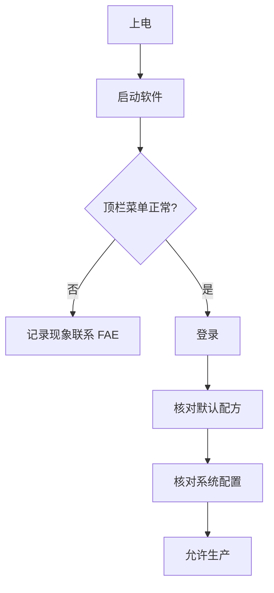

#### 常见误区

1. 未登录即修改系统配置或配方。**正确**：无权限时菜单不可见或无法保存。
2. 只核对配方名，未核对 **设为默认** 标记。**正确**：确认列表中「默认」标签与工艺一致。
3. 忽略右上角 **当前用户未登录** 提示。**正确**：班前完成登录。

#### 异常处理

1. **软件无法启动**
   - 立即动作：记录屏幕提示，勿反复强制断电。
   - 二级处理：重启工控机一次。
   - 升级条件：连续 2 次仍无法进入主界面。

2. **顶栏缺少 系统配置 或 产品配方配置**
   - 立即动作：确认是否误用演示账号或 Guest 权限。
   - 二级处理：换有权限账号 **登录**；仍不可见联系 FAE。
   - 升级条件：当班无法进入配置页。

3. **登录后仍提示无权限**
   - 立即动作：点击 **退出** 后重新 **登录**。
   - 二级处理：联系 FAE 核对账号角色。
   - 升级条件：工艺确认账号应有权仍无法操作。

---

### 0.2 换型检查

| 序号 | 检查项 | 说明 |
| --- | --- | --- |
| 1 | 停止检测 | 确认无板卡在载台/传送中 |
| 2 | 切换配方 | 在 **产品配方配置** 选中目标配方并 **设为默认** |
| 3 | 核对参数 | 展开 **基本信息**～**其它**，与工艺卡一致 |
| 4 | MARK/标定 | 换型后按工艺执行 **MARK 计算**、**生成 FOV**（如需） |
| 5 | 首件验证 | 首件 OK 后方可批量 |

#### 详细操作步骤

1. 确认设备处于安全停止状态。
2. 顶栏点击 **产品配方配置**。
3. 在左侧 **配方列表** 中找到目标配方，单击选中。
4. 单击 **设为默认**，确认名称旁出现 **默认** 标签。
5. 依次展开右侧 **基本信息**、**相机设置**、**算法阈值** 等，核对与工艺卡一致。
6. 顶栏工具区选择 **AOI相机**，执行一次 **读取图像** 确认画面正常。
7. 在 **MARK制作** 页对所需轨角执行 **MARK计算**，确认偏移有数值。
8. 单击 **保存配方**，确认无报错提示；执行首件 **检测**，结果为 OK。

#### 结果判定标准

- 默认配方名称与工艺卡一致。
- 图像区有画面，**保存配方** 后状态区无失败提示。
- 首件检测 OK，或 NG 已按工艺处置。

#### 常见误区

1. 只选中配方不设默认。**正确**：换型须 **设为默认**。
2. 换型后不重新做 MARK。**正确**：按工艺重新 **MARK计算**。
3. 首件 NG 仍批量。**正确**：须工艺确认。

#### 异常处理

1. **找不到目标配方**
   - 立即动作：停止换型，勿用近似配方代替。
   - 二级处理：使用 **导入** 或请 FAE 下发配方。
   - 升级条件：开工时间到仍无配方。

2. **保存配方失败**
   - 立即动作：记录提示原文。
   - 二级处理：检查磁盘空间与路径权限（§1.2）。
   - 升级条件：连续 3 次保存失败。

3. **首件连续 NG**
   - 立即动作：停止进料，保留首件。
   - 二级处理：检查光源亮度、MARK、标定 FOV。
   - 升级条件：连续 3 片同类型 NG。

---

### 0.3 班后检查

1. 确认无板卡在工位内。
2. 停止自动 **检测** 流程（如有）。
3. 在 **结果输出** 区确认当班数据已按现场要求留存。
4. 顶栏点击 **退出** 正常关闭软件。
5. 关闭外设电源（依现场规范）。
6. 填写交接记录。

#### 常见误区

1. 直接断电退出。**正确**：先停止流程再 **退出**。
2. 未确认图像/结果路径磁盘空间。**正确**：班后留意 §1.2 路径告警。

#### 异常处理

1. **软件无法退出** — 先停检测，等待 30 s；仍卡住联系 FAE；超 10 min 升级。
2. **结果数据找不到** — 截图 **结果输出** 与 §1.2 路径；联系 FAE 核对存储路径。

---

## 1. 系统配置

> 进入路径：顶栏 **系统配置** → 左侧选择子页。

### 1.1 开关设置

#### 页面目的

设置扫码、复判、上下游对接，以及各检测项是否参与判定。

#### 适用角色

- **FAE / 工艺**（主）：换线、联机调试时修改。
- **操作员**（辅）：班前核对开关状态。

#### 前置条件

1. 已 **登录** 且可见 **系统配置** 菜单。
2. 自动检测已停止。

#### 页面插图

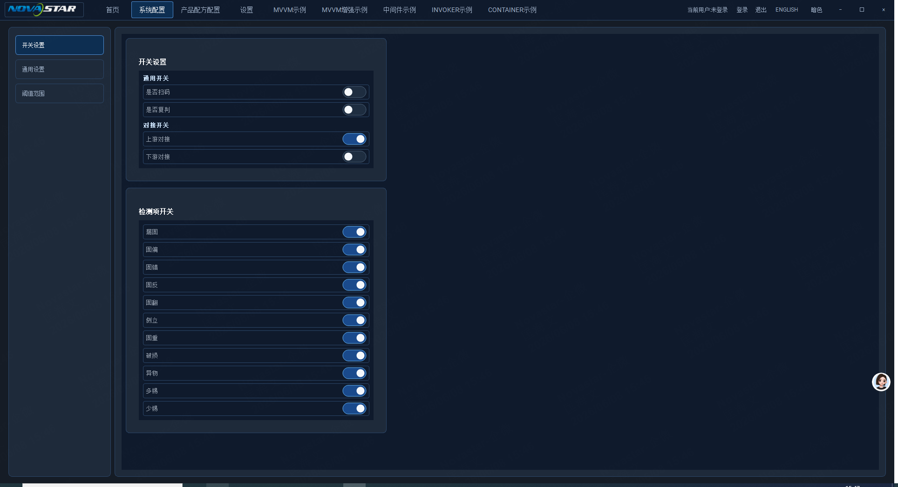

#### 核心功能详解

| 区域 | 控件 | 用途 |
| --- | --- | --- |
| 通用开关 | **是否扫码** | 开启后流程须扫码 |
| 通用开关 | **是否复判** | 开启后 NG 须复判 |
| 对接开关 | **上游对接** / **下游对接** | 产线联机通讯 |
| 检测项开关 | 漏打、偏位、漏锡…共 11 项 | 单项是否参与检测 |

> 修改后须单击页面底部 **保存配置**；出现「配置已保存」提示后生效。

#### 详细操作步骤

1. 顶栏单击 **系统配置**。
2. 左侧单击 **开关设置**（高亮表示当前页）。
3. 在 **通用开关** 区，按需拨动 **是否扫码** 开关。
4. 拨动 **是否复判** 至工艺要求状态。
5. 在 **对接开关** 区，设置 **上游对接**、**下游对接**。
6. 在 **检测项开关** 列表，逐项确认开关为蓝色（开）或灰色（关）。
7. 若工艺要求关闭某项（如 **异物**），单击对应开关至灰色。
8. 单击页面底部 **保存配置**，确认提示为「配置已保存」。
9. 返回顶栏 **产品配方配置**，确认当班配方未受影响。

#### 结果判定标准

- 各开关位置与工艺卡一致。
- 关闭的检测项在后续 **结果输出** 中不应作为判定项（以现场验证为准）。

#### 常见误区

1. 关闭检测项开关后仍按该项判 NG。**正确**：关闭即不参与该项检测。
2. 上下游对接状态与 MES 不一致。**正确**：换线时与班长确认。
3. 改开关后未点 **保存配置**。**正确**：须单击页面底部 **保存配置** 并确认提示。

#### 异常处理

1. **开关拨动后无变化**
   - 立即动作：确认已单击 **保存配置** 且提示成功；可切换左侧 **通用设置** 再切回核对。
   - 二级处理：重启软件后重新修改并保存。
   - 升级条件：重启后仍无法保存状态。

2. **开启上游对接后联机失败**
   - 立即动作：记录联机报警内容。
   - 二级处理：与 MES/上下游确认网络与工艺号。
   - 升级条件：当班无法恢复联机。

3. **检测项开关少于 11 项显示**
   - 立即动作：截图当前页面。
   - 二级处理：联系 FAE 检查菜单权限与软件版本。
   - 升级条件：缺失项影响当班判定。

---

### 1.2 通用设置

#### 页面目的

设置图像、结果数据、第三方数据的存储文件夹。

#### 适用角色

- **FAE**（主）
- **操作员**（辅）：班前确认路径可访问

#### 前置条件

1. 已登录，可见 **系统配置**。
2. 目标磁盘或网络共享已就绪。

#### 页面插图

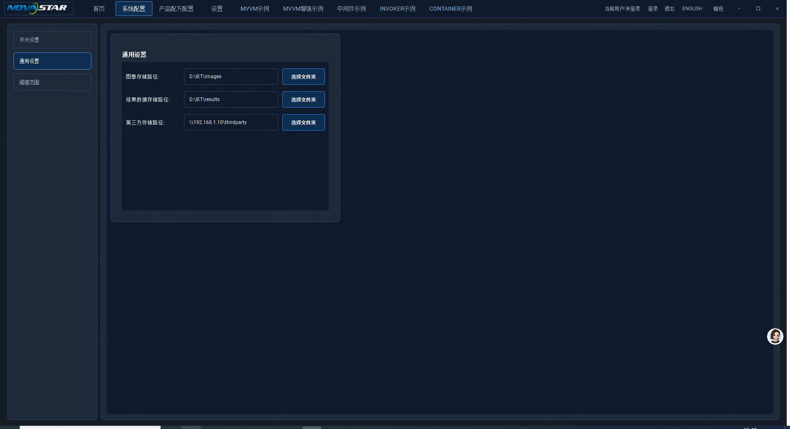

#### 核心功能详解

| 字段 | 说明 |
| --- | --- |
| **图像存储路径** | 检测图像保存位置 |
| **结果数据存储路径** | 检测结果数据保存位置 |
| **第三方存储路径** | 对外共享目录（可为网络路径） |
| **选择文件夹** | 浏览并选定目录 |
| **保存配置** | 页面底部按钮，保存全部系统配置 |

#### 详细操作步骤

1. 顶栏 **系统配置** → 左侧 **通用设置**。
2. 查看 **图像存储路径** 文本框当前路径。
3. 若需修改，单击该行 **选择文件夹**。
4. 在弹窗中选择目标文件夹，确认。
5. 对 **结果数据存储路径** 重复步骤 3～4。
6. 对 **第三方存储路径** 重复步骤 3～4（网络路径须现场已映射）。
7. 核对三路路径与工艺/IT 规范一致。
8. 单击页面底部 **保存配置**，确认提示为「配置已保存」。
9. 执行一次短测，确认新路径下能生成图像或结果文件。

#### 结果判定标准

- 三路路径显示正确，无红色报错。
- 试测后目标文件夹出现新文件。

#### 常见误区

1. 第三方路径写成单机路径导致联机失败。**正确**：按 IT 提供网络路径填写。
2. 路径指向无写权限目录。**正确**：FAE 须验证写权限。
3. 仅改路径不试存。**正确**：改后须 **保存配置** 并试测验证。

#### 异常处理

1. **选择文件夹后路径为空**
   - 立即动作：重新选择；勿继续生产。
   - 二级处理：检查磁盘是否掉线。
   - 升级条件：无法恢复有效路径。

2. **试测后文件夹无新文件**
   - 立即动作：停止批量，保留试测板。
   - 二级处理：检查路径权限与剩余空间。
   - 升级条件：当班无法落盘。

3. **网络路径无法浏览**
   - 立即动作：联系 IT 确认共享在线。
   - 二级处理：临时改备用路径并记录。
   - 升级条件：影响追溯且无法恢复。

#### 附：工程师参考

| 配置项 | 后台文件名（FAE） |
| --- | --- |
| 系统配置整体 | `param/aoi_system.json` |
| 操作手册表述 | 「单击 **保存配置** 后写入参数目录」 |

---

### 1.3 阈值范围

#### 页面目的

设置各缺陷类型数量下限、上限，以及缺陷总数上下限，用于 OK/NG 判定。

#### 适用角色

- **工艺 / FAE**（主）
- **操作员**（辅）：核对是否与工艺卡一致

#### 前置条件

1. 已登录；**检测项开关** 中对应项已开启（§1.1）。
2. 已明确工艺允许的缺陷数量范围。

#### 页面插图

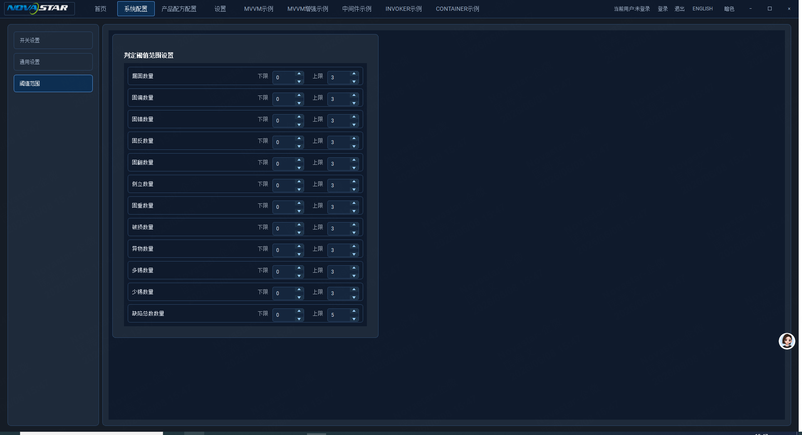

#### 核心功能详解

**判定阈值范围设置** 含 12 行参数，每行有 **下限**、**上限** 数值框（带上下箭头）：

| 参数项 | 示例值（插图） |
| --- | --- |
| 漏装数量 | 0 ～ 3 |
| 错装数量 | 0 ～ 3 |
| 极向数量 | 0 ～ 3 |
| 侧立数量 | 0 ～ 3 |
| 翻面数量 | 0 ～ 3 |
| 立碑数量 | 0 ～ 3 |
| 翘脚数量 | 0 ～ 3 |
| 破损数量 | 0 ～ 3 |
| 异物数量 | 0 ～ 3 |
| 多锡数量 | 0 ～ 3 |
| 少锡数量 | 0 ～ 3 |
| 缺陷总数数量 | 0 ～ 5 |

#### 详细操作步骤

1. **系统配置** → 左侧 **阈值范围**。
2. 阅读 **判定阈值范围设置** 标题下各参数当前值。
3. 对照工艺卡，从 **漏装数量** 开始逐项核对 **下限**、**上限**。
4. 若需修改，单击数值框或按上下箭头调整 **下限**。
5. 同样方式调整 **上限**。
6. 依次核对至 **缺陷总数数量**。
7. 确认 **下限 ≤ 上限**；否则判定逻辑异常。
8. 单击页面底部 **保存配置**，确认提示为「配置已保存」。
9. 通知班长/工艺确认新阈值，并做首件验证。

#### 结果判定标准

- 全部 12 项与工艺卡一致。
- 首件在阈值内判 OK，超上限判 NG（与现场一致）。

#### 常见误区

1. 只改单项不改 **缺陷总数数量**。**正确**：总数阈值须同步。
2. 下限大于上限。**正确**：须下限 ≤ 上限。
3. 阈值与开关设置检测项不一致。**正确**：关闭的项不应作为判定依据。

#### 异常处理

1. **调整后首件判定与预期相反**
   - 立即动作：停止批量，保留首件。
   - 二级处理：回查 §1.1 开关与阈值是否匹配。
   - 升级条件：连续 2 片误判。

2. **数值框无法输入**
   - 立即动作：确认已登录。
   - 二级处理：切换页面再进入；重启软件。
   - 升级条件：无法修改阈值。

3. **缺陷总数超限但单板观感正常**
   - 立即动作：保留板件与 **结果输出** 截图。
   - 二级处理：FAE 检查配方算法阈值（§2.4）。
   - 升级条件：批量误杀。

---

## 2. 产品配方配置

> 进入路径：顶栏 **产品配方配置**。

### 2.1 主界面与配方列表

#### 页面目的

管理配方列表，执行进料/出料/检测/条码识别，查看图像与结果汇总，保存配方。

#### 适用角色

- **操作员**（主）：日常检测、读图、看结果。
- **FAE / 工艺**（辅）：配方维护、工具栏调试。

#### 前置条件

1. 已登录；相机、运控就绪。
2. 目标配方已存在或待 **新增**。

#### 页面插图

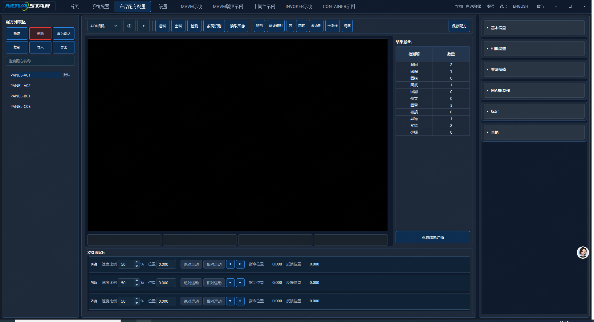

#### 核心功能详解

| 区域 | 控件 | 用途 |
| --- | --- | --- |
| 配方列表 | **新增** **删除** **设为默认** **复制** **导入** **导出** | 配方管理 |
| 配方列表 | 搜索框 **搜索配方名称** | 过滤列表 |
| 列表行 | 配方名 + **默认** 标签 | 识别当前默认配方 |
| 工具栏 | 相机下拉 **AOI相机** | 选择采集相机 |
| 工具栏 | 单次拍照图标（悬停提示 **单次拍照**） | 当前相机单帧采图 |
| 工具栏 | 实时预览图标（开启后变为暂停，提示 **暂停预览**） | 连续预览 / 停止预览 |
| 工具栏 | **进料** **出料** **检测** **条码识别** **读取图像** | 单机/调试动作 |
| 绘图工具 | 矩形、旋转矩形、圆、圆环、多边形、十字线、**清除**、**全图导航** | 在图像上标 ROI；**全图导航** 打开左下缩略图 |
| 工具栏右 | **保存配方** | 保存当前配方全部参数 |
| 中央 | 图像显示区 | 显示相机画面 |
| 图像左下（全图导航开启时） | 灯板缩略图 + 黄色视场框 | 总览灯板布局；视场框随相机位置移动；点击缩略图可跳转 |
| 图像下 | ROI 坐标（x/y/w/h） | 当前 ROI 区域数值 |
| 图像下 | 状态框 ×3 | 显示运行状态 |
| 结果输出 | 标题 **结果输出** | 结果区标题 |
| 结果输出 | 缺陷统计表（**检测项** / **数量**） | 11 类缺陷数量汇总 |
| 结果输出 | **查看结果详情** | 打开详细结果（强调按钮） |
| 右下折叠 | 基本信息～其它 | 展开进入各参数页（§2.2～2.7） |
| 底部 | X/Y/Z 轴调试 | 速度比例、位置、绝对/相对运动、点动箭头 |

#### 详细操作步骤

1. 顶栏单击 **产品配方配置**。
2. 在左侧列表确认当班配方；若无则单击 **新增** 并命名。
3. 选中配方后，若需换默认，单击 **设为默认**。
4. 工具栏确认相机为 **AOI相机**。
5. 需要单帧时单击 **单次拍照** 图标；需连续看画面时单击 **实时预览** 图标，结束预览单击 **暂停预览**。
6. 单击 **读取图像**，中央图像区应出现画面（亦可从文件 **读取图像**）。
7. 按工艺需要单击 **进料**（如有自动进料）。
8. 单击 **检测**（对当前图像区画面执行检测；实时预览中亦检测按下瞬间的画面），等待 **检测中** 提示结束，观察 **结果输出** 表变化。
9. 需要查看具体缺陷位置时，单击 **查看结果详情**；在明细表中选中一行，左侧冻结图像上会高亮对应区域。
10. 核对 **结果输出** 表中各 **检测项** 数量后单击 **保存配方**；需条码时先点 **条码识别**，鼠标附近出现 **条码识别中** 提示直至完成。
11. 需要快速查看整板位置时，单击 **全图导航**；左下角出现灯板缩略图，黄色框表示当前视场；在缩略图上单击目标位置，相机 XY 会移动过去（高度 Z 不变）。

#### 结果判定标准

- **读取图像** 或 **单次拍照** 后图像区非全黑（除非工艺要求）。
- **检测** 完成后 **结果输出** 各 **检测项** 列有数值或零；状态提示 **检测完成** 或 **检测完成，共 N 处缺陷**。
- **查看结果详情** 可打开明细；选中缺陷行时左侧图像出现高亮框。
- **条码识别** 完成后提示消失，状态框无失败信息。
- **保存配方** 无失败提示。

#### 常见误区

1. 改参数后未点 **保存配方** 就换型。**正确**：修改后必须保存。
2. 在错误配方上 **删除**。**正确**：删除前核对名称，默认配方慎删。
3. 未读图直接 **检测**。**正确**：先 **读取图像** 或 **单次拍照** 确认相机正常。
4. Mark 未完成就依赖 **全图导航** 跳转。**正确**：先在 **MARK制作** 完成双 Mark 标定，缩略图才可用。
5. **实时预览** 未关闭就换相机或保存。**正确**：先 **暂停预览** 再切换相机或保存。
6. 以为 **检测** 后主图像区会画出缺陷框。**正确**：缺陷框仅在 **查看结果详情** 弹窗内显示；主区预览可继续刷新。

#### 异常处理

1. **读取图像黑屏**
   - 立即动作：停止 **检测**；检查相机线缆与光源。
   - 二级处理：调整 §2.3 **光源亮度**；重启相机服务（联系 FAE）。
   - 升级条件：连续 3 次黑屏。

2. **检测无结果或状态框报错**
   - 立即动作：记录状态框文字。
   - 二级处理：检查 MARK、标定、配方是否保存。
   - 升级条件：首件无法完成检测。

3. **删除配方误操作**
   - 立即动作：勿继续操作列表。
   - 二级处理：使用 **导入** 恢复备份，或请 FAE 从参数目录恢复。
   - 升级条件：默认配方被删且无备份。

---

### 2.2 基本信息

#### 页面目的

设置配方名称、分辨率、点间距、芯片/焊盘尺寸、坐标系。

#### 适用角色

- **FAE / 工艺**（主）

#### 前置条件

1. 已在 **产品配方配置** 选中待编辑配方。
2. 工艺卡已提供基础物理参数。

#### 页面插图

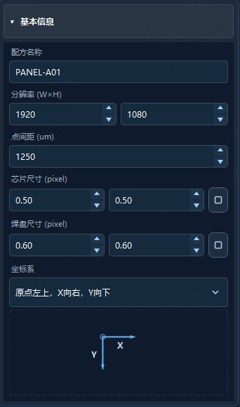

#### 核心功能详解

| 字段 | 说明（插图示例） |
| --- | --- |
| **配方名称** | 如 PANEL-A01 |
| **分辨率 (W×H)** | 1920 × 1080 |
| **点间距 (um)** | 1250 |
| **芯片尺寸 (pixel)** | 0.50 × 0.50，右侧链接图标可锁定比例 |
| **焊盘尺寸 (pixel)** | 0.60 × 0.60 |
| **坐标系** | 下拉，如「原点左上，X向右，Y向下」；下方有坐标示意图 |

#### 详细操作步骤

1. 在 **产品配方配置** 右侧展开 **基本信息**。
2. 在 **配方名称** 输入框核对或修改名称。
3. 设置 **分辨率** 宽、高数值框。
4. 设置 **点间距 (um)**。
5. 设置 **芯片尺寸** 宽、高；需等比时单击链接图标。
6. 设置 **焊盘尺寸** 宽、高。
7. 在 **坐标系** 下拉选择与工艺一致的选项，对照下方示意图。
8. 顶栏单击 **保存配方**。

#### 结果判定标准

- 各字段与工艺卡一致；坐标系示意图与下拉选项匹配。

#### 常见误区

1. 分辨率与相机实际不符导致算法异常。**正确**：按工艺与相机规格填写。
2. 坐标系选错导致偏位。**正确**：以示意图核对原点方向。
3. 改基本信息未保存。**正确**：必须 **保存配方**。

#### 异常处理

1. **保存后名称未变** — 确认是否选中正确配方；重新保存；联系 FAE。
2. **芯片/焊盘尺寸输入被拒绝** — 检查是否为合法正数；联系工艺确认单位。
3. **坐标系下拉无选项** — 截图联系 FAE 检查软件版本。

---

### 2.3 相机设置

#### 页面目的

调节光源亮度、曝光时间、拍照高度、采集精度。

#### 适用角色

- **FAE / 操作员**（调机时）

#### 前置条件

1. 已 **读取图像** 能看到画面。
2. 光源、相机已上电。

#### 页面插图

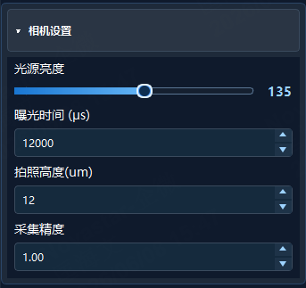

#### 核心功能详解

| 字段 | 插图示例 |
| --- | --- |
| **光源亮度** | 滑条，值 135 |
| **曝光时间 (μs)** | 12000 |
| **拍照高度(um)** | 12 |
| **采集精度** | 1.00 |

#### 详细操作步骤

1. 展开 **相机设置**。
2. 拖动 **光源亮度** 滑条至工艺起点。
3. 单击 **读取图像** 观察亮度。
4. 调整 **曝光时间 (μs)** 数值框至画面不过曝/欠曝。
5. 设置 **拍照高度(um)**。
6. 设置 **采集精度**。
7. 再次 **读取图像** 确认清晰度。
8. **保存配方**。

#### 结果判定标准

- 图像明暗适中，Mark 与焊点边缘可分辨。

#### 常见误区

1. 曝光过长导致过曝。**正确**：逐步增加，每次读图确认。
2. 只调亮度不调曝光。**正确**：两者配合调节。
3. 多个配方共用一套相机参数未区分。**正确**：每配方独立保存。

#### 异常处理

1. **调光后仍黑屏** — 查线缆与相机下拉是否为 **AOI相机**；联系 FAE。
2. **曝光调至极限仍模糊** — 查 **拍照高度** 与 Z 轴位置；联系工艺。
3. **保存后重开配方参数还原** — 确认点了 **保存配方**；查磁盘权限。

---

### 2.4 算法阈值

#### 页面目的

设置芯片/焊盘置信度、缺陷分类阈值、固偏 X/Y、角度偏移。

#### 适用角色

- **FAE / 工艺**（主）

#### 前置条件

1. 基本信息、相机设置已完成。
2. 已有标准 OK/NG 样件用于验证。

#### 页面插图

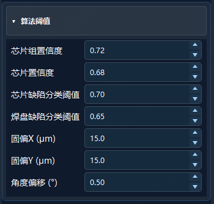

#### 核心功能详解

| 字段 | 插图示例 |
| --- | --- |
| **芯片组置信度** | 0.72 |
| **芯片置信度** | 0.68 |
| **芯片缺陷分类阈值** | 0.70 |
| **焊盘缺陷分类阈值** | 0.65 |
| **固偏X (μm)** | 15.0 |
| **固偏Y (μm)** | 15.0 |
| **角度偏移 (°)** | 0.50 |

#### 详细操作步骤

1. 展开 **算法阈值**。
2. 记录当前各值作为备份（截图或抄录）。
3. 按工艺调整 **芯片组置信度**、**芯片置信度**。
4. 调整 **芯片缺陷分类阈值**、**焊盘缺陷分类阈值**。
5. 设置 **固偏X**、**固偏Y**（μm）。
6. 设置 **角度偏移 (°)**。
7. 执行 **检测** 验证 OK 样件与 NG 样件。
8. **保存配方** 并请工艺确认。

#### 结果判定标准

- OK 样件判 OK；已知 NG 样件判 NG（按工艺）。

#### 常见误区

1. 置信度越低越灵敏导致误报增多。**正确**：调高置信度常减少误报但可能漏检。
2. 固偏过大掩盖真实偏位。**正确**：按工艺允许固偏设置。
3. 未用样件验证即上线。**正确**：必须样件验证。

#### 异常处理

1. **OK 样件判 NG（误杀）** — 略提高置信度或分类阈值；小步调整并复测；连续误杀升级工艺。
2. **NG 样件判 OK（漏检）** — 略降低阈值；检查相机设置；升级 FAE。
3. **数值框无法编辑** — 确认登录与配方非只读；联系 FAE。

---

### 2.5 MARK 制作

#### 页面目的

为各轨角制作/选择 Mark 模板，设置拍照位置，执行 **MARK计算** 获取偏移。

#### 适用角色

- **FAE / 工艺**（主）

#### 前置条件

1. 相机已读图正常。
2. 板件 Mark 点物理位置已知。

#### 页面插图

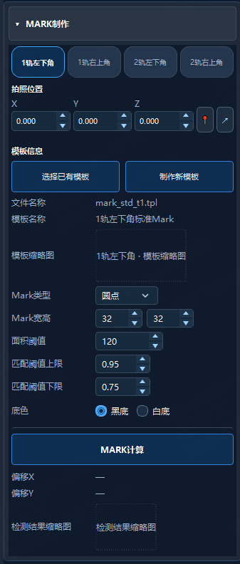

#### 核心功能详解

| 区域 | 控件 | 说明 |
| --- | --- | --- |
| 轨角选择 | **1轨左下角** **1轨右上角** **2轨左下角** **2轨右上角** | 切换当前编辑角 |
| 拍照位置 | X/Y/Z + 图钉/移动图标 | 设置或采集拍照坐标 |
| 模板信息 | **选择已有模板** **制作新模板** | 弹出模板表单窗口 |
| 模板信息 | 文件名称、模板名称、模板缩略图 | 当前模板展示 |
| 参数 | **Mark类型**、**Mark宽高**、**面积阈值**、匹配上下限、**底色** | 识别参数 |
| 执行 | **MARK计算** | 计算偏移 |
| 结果 | **偏移X** **偏移Y**、检测结果缩略图 | 计算结果 |

#### 详细操作步骤

1. 展开 **MARK制作**。
2. 单击目标轨角按钮（如 **1轨左下角**）。
3. 移动载台使 Mark 在视野内，用 X/Y/Z 框或图钉图标记录 **拍照位置**。
4. 若有现成模板，单击 **选择已有模板**，在弹出窗口中填写或浏览模板路径与名称后确认；否则单击 **制作新模板** 并按窗口提示完成。
5. 设置 **Mark类型**（如圆点）、**Mark宽高**、**面积阈值**、匹配上下限、**底色**。
6. 确认 **模板缩略图** 有图像。
7. 单击 **MARK计算**。
8. 查看 **偏移X**、**偏移Y** 及 **检测结果缩略图**，满意后 **保存配方**。

#### 结果判定标准

- **偏移X/Y** 显示数值（非「—」）。
- 检测结果缩略图 Mark 位置正确。

#### 常见误区

1. 未切换轨角就计算。**正确**：先选对 **1轨左下角** 等按钮。
2. 模板底色与实物相反。**正确**：黑底/白底须与实际 Mark 对比一致。
3. MARK 计算通过但未保存配方。**正确**：必须 **保存配方**。

#### 异常处理

1. **MARK计算后偏移为「—」**
   - 立即动作：检查模板缩略图是否为空。
   - 二级处理：调高匹配下限或重做模板。
   - 升级条件：四角均无法计算。

2. **制作新模板失败**
   - 立即动作：重新 **读取图像** 再制作。
   - 二级处理：调整 **Mark宽高** 与 **面积阈值**。
   - 升级条件：无可用模板且无法新建。

3. **偏移数值异常大**
   - 立即动作：勿用于批量。
   - 二级处理：重新取拍照位置并计算。
   - 升级条件：重复异常联系 FAE。

---

### 2.6 标定

#### 页面目的

配置机台灯板或 Gerber 标定、坐标对、Mark 坐标、FOV 规划与扫描路径。

#### 适用角色

- **FAE / 工艺**（主）

#### 前置条件

1. MARK 模板已就绪（§2.5）。
2. 板件尺寸与 Gerber/机台数据已知。

#### 页面插图

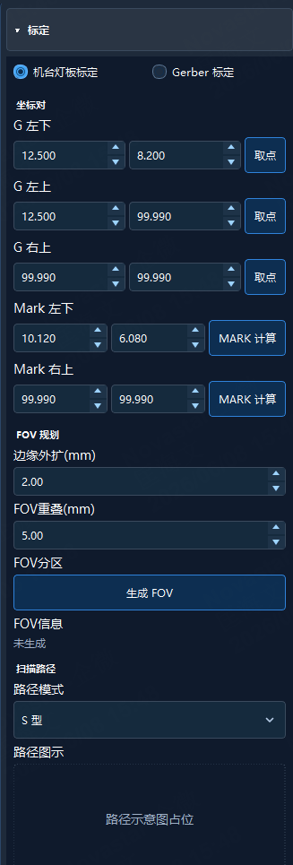

#### 核心功能详解

| 区域 | 控件 | 说明 |
| --- | --- | --- |
| 模式 | **机台灯板标定** / **Gerber标定** | 单选 |
| 坐标对 | G左下/左上/右上 + **取点** | 采集坐标 |
| Mark | Mark左下/右上 + **MARK计算** | Mark 坐标 |
| FOV规划 | **边缘外扩**、**FOV重叠**、**生成FOV** | FOV 生成 |
| FOV信息 | 状态如「未生成」 | 是否已生成 |
| 扫描路径 | **路径模式**（如 S型）、路径示意图 | 扫描轨迹 |

#### 详细操作步骤

1. 展开 **标定**。
2. 选择 **机台灯板标定** 或 **Gerber标定**。
3. 对 **G左下**、**G左上**、**G右上** 依次移动到位并点 **取点**。
4. 对 **Mark左下**、**Mark右上** 点 **MARK计算** 更新坐标。
5. 填写 **边缘外扩 (mm)**、**FOV重叠 (mm)**。
6. 单击 **生成FOV**，等待 **FOV信息** 变为已生成（非「未生成」）。
7. 在 **路径模式** 下拉选择（如 **S型**）。
8. **保存配方** 并试跑 **检测** 验证覆盖。

#### 结果判定标准

- **FOV信息** 显示已生成；路径示意图有内容（若工艺要求）。
- 试测无大面积漏扫。

#### 常见误区

1. 未取齐三个 G 点即生成 FOV。**正确**：三点须完成 **取点**。
2. FOV 重叠过小导致漏检。**正确**：按工艺设置 **FOV重叠**。
3. 标定模式与现场板型不符。**正确**：机台板用灯板标定，Gerber 板用 Gerber 标定。

#### 异常处理

1. **生成FOV失败或一直未生成**
   - 立即动作：检查 G 点坐标是否合理。
   - 二级处理：重新取点；联系 FAE。
   - 升级条件：无法生成 FOV 且当班需投产。

2. **试测漏扫区域**
   - 立即动作：停止批量。
   - 二级处理：增大 **边缘外扩** 或 **FOV重叠** 后重新生成。
   - 升级条件：调整后仍漏扫。

3. **路径示意图空白**
   - 立即动作：确认已 **生成FOV**。
   - 二级处理：换 **路径模式** 再生成。
   - 升级条件：示意图异常且检测轨迹错误。

---

### 2.7 其它设置

#### 页面目的

设置 **轨道位置** 与 **扫描起始位置** X/Y/Z。

#### 适用角色

- **FAE**（主）

#### 前置条件

1. 运控已复位，手动模式安全可用。
2. 工艺已提供轨道与起始坐标。

#### 页面插图

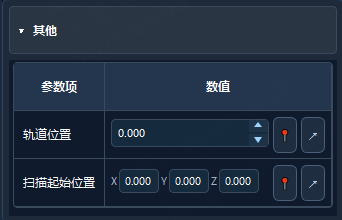

#### 核心功能详解

| 参数项 | 控件 | 说明 |
| --- | --- | --- |
| **轨道位置** | 数值框 + 图钉/移动图标 | 记录或移动到轨道位置 |
| **扫描起始位置** | X/Y/Z 数值框 + 图钉/移动图标 | 扫描起点坐标 |

#### 详细操作步骤

1. 展开 **其它**。
2. 将轨道移到工艺要求位置，点 **轨道位置** 行图钉图标写入当前值。
3. 或输入目标值后点移动图标试移到该位置。
4. 将相机/载台移到扫描起点，对 **扫描起始位置** X/Y/Z 点图钉写入。
5. 核对 X/Y/Z 与工艺卡一致。
6. 点移动图标试走至起始点，确认无干涉。
7. 执行 **读取图像** 确认起点视野正确。
8. **保存配方**。

#### 结果判定标准

- 轨道与起始坐标与工艺一致；试移动无报警。

#### 常见误区

1. 未试移动即上线。**正确**：须点移动图标验证。
2. 扫描起点 Z 过高撞机。**正确**：低速试移动，观察 Z 轴。
3. 只保存轨道不保存起始点。**正确**：两项须一并 **保存配方**。

#### 异常处理

1. **移动图标点击后轴不动**
   - 立即动作：停止；查运控报警。
   - 二级处理：复位运控后再试。
   - 升级条件：运控故障影响当班。

2. **起始点视野无 Mark/板边**
   - 立即动作：勿启动自动扫描。
   - 二级处理：重新取点并读图确认。
   - 升级条件：无法对准起点。

3. **图钉写入后数值跳变**
   - 立即动作：记录写入前后值。
   - 二级处理：重新复位再取点；联系 FAE。
   - 升级条件：坐标反复异常。

#### 附：工程师参考

| 配置项 | 后台说明（FAE） |
| --- | --- |
| 配方文件 | 保存在参数目录 `param/recipe/` 下，按配方编号分文件 |
| 操作手册表述 | 「保存配方后自动写入参数目录」 |

---

## 3. 首页

### 3.1 运行监控主界面

#### 页面目的

当班运行状态总览：设备控制入口、硬件连接、KPI、流程进度、运行日志、图像预览与当前板检测结果。

#### 适用角色

- **操作员**（主）：监视 KPI、日志、结果快照
- **FAE**（辅）：确认硬件连接、协助启停与复位

#### 前置条件

1. 已登录且顶栏可见 **首页** 菜单。
2. 运控与相机等设备已按班前检查就绪（见 §0.1）。

#### 页面插图

> **待补充项**：`UI截图/首页.png` 尚未入库；以下控件名称来自当前界面实现，入库后须与插图核对。

#### 核心功能详解

| 区域 | 主要控件 / 区块 |
| --- | --- |
| 左栏·设备控制 | **初始化**、**启动**、**停止**、**复位**、**继续**、**清除报警**、**清料**、**单次检测**（**清料** 须在暂停且复位成功、无急停/报警时可用） |
| 左栏·硬件连接状态 | 扫描枪、相机1、相机2、运动控制板、串口（含连接/待机/断开指示） |
| 顶行 KPI | 总数、OK、NG、RW、通过率、TT、运行模式、设备状态、当前配方 |
| 中区 | **灯板虚拟图**（当前为占位）、进料→检测→出料流程条、**运行日志** |
| 右区 | **图像预览**（Mark1、Mark2、当前 FOV）、**当前检测结果**（SN、总判 + 缺陷统计表） |

缺陷统计表列：**检测项**、R、G、B、总计、**结果**（11 行，与系统配置检测项一致）。

#### 详细操作步骤

> **待补充项**：缺 `首页.png` 时暂不写逐步截图操作；入库后须补全 ≥8 步并逐步核对控件名称。

1. 登录后单击顶栏 **首页**，进入运行监控主界面。
2. 查看顶行 KPI 是否与当班预期一致（总数、OK/NG、通过率等）。
3. 查看左栏 **硬件连接状态**，确认扫描枪、相机、运动控制板、串口为 **已连接**（或工艺允许的待机状态）。
4. 观察中区 **运行日志**，确认无持续报警类红色条目。
5. 查看右区 **当前检测结果** 中 SN 与总判（OK/NG）是否与最近一片板一致。
6. 需要查看 Mark 或 FOV 时，看右区 **图像预览** 三个小窗/大窗是否有图。
7. 需人工干预时，在左栏 **设备控制** 区操作（**停止**/**复位** 等须按班长或 FAE 口令）。
8. 换型或班后前，勿仅依赖本页 KPI；须回到 §0 完成换型/班后检查。

#### 结果判定标准

- KPI 与现场板结果趋势一致；硬件行无异常 **断开**（除非工艺允许待机）。
- 日志无未处理的持续报警；快照表 SN 与当前板对应。

#### 常见误区

1. 把本页当作唯一参数配置入口。**正确**：配方在 **产品配方配置**，阈值在 **系统配置**。
2. 未见图像即认为相机故障。**正确**：P0 可能为演示数据，联系 FAE 确认是否接实时采图。
3. 频繁点击 **停止**/**复位**。**正确**：须确认口令与工况，避免误停线。
4. 设备仍在运行或报警未清时强行点 **清料**。**正确**：先 **停止**，必要时 **复位** 或 **清除报警**，待 **清料** 可点后再操作。

#### 异常处理

1. **硬件连接状态显示断开**
   - 立即动作：停止自动运行（若已启动）；通知 FAE。
   - 二级处理：检查线缆与设备上电；重连后刷新页面。
   - 升级条件：多台设备同时断开或重连失败。

2. **KPI 长时间不更新**
   - 立即动作：看 **运行日志** 是否有报错。
   - 二级处理：联系 FAE 查后台调度与通讯。
   - 升级条件：影响当班产能统计。

3. **快照表与实物板明显不符**
   - 立即动作：暂停出料；记录 SN。
   - 二级处理：核对配方与检测项开关（§1.1）；联系 FAE。
   - 升级条件：连续多片同类型误判。

---

## 4. 检测结果

### 4.1 检测历史列表与详情

#### 页面目的

查询已保存的灯板检测记录，按条件筛选与统计；查看单条详情并在弹窗内完成复判确认；导出当前筛选结果为表格文件。

#### 适用角色

- **操作员**（主）：日常查询、导出、打开详情核对
- **FAE**（辅）：协助筛选异常批次、在详情弹窗内复判确认

#### 前置条件

1. 已登录且顶栏可见 **检测结果** 菜单（无权限时菜单不可见，请联系班长授权）。
2. 当班已完成至少一片板检测，或现场已有历史记录；**首次使用无数据属正常**。

#### 页面插图

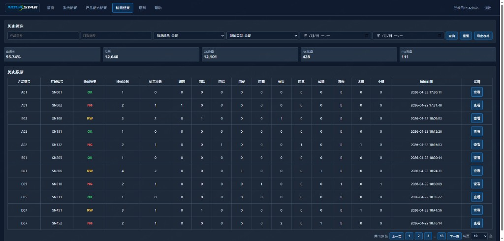

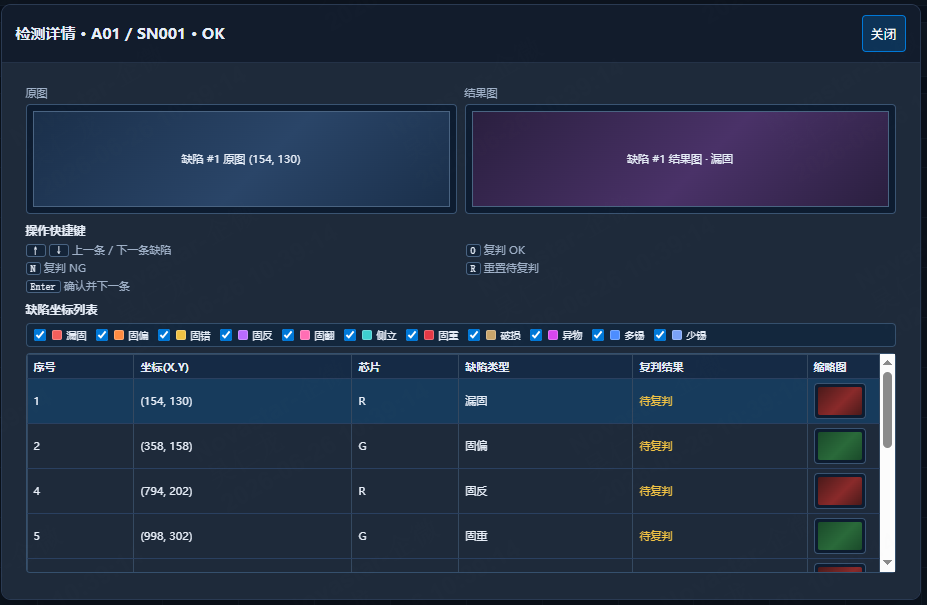

#### 核心功能详解

| 区域 | 主要控件 / 区块 |
| --- | --- |
| **历史筛选** | **产品型号**、**灯板编号** 输入框；**检测结果** 下拉（全部 / OK / NG / RW）；**缺陷类型** 下拉（全部 + 11 类）；**检测时间** 起止；**查询**、**重置**、**导出表格** |
| KPI 区 | **直通率**、**总数**、**OK数量**、**NG数量**、**RW数量**（随当前筛选全量汇总；OK/NG/RW 数值带颜色） |
| **历史数据** | 宽表：型号、灯板编号、检测结果、检测次数、返工次数、11 类缺陷计数、检测时间、**查看** |
| 分页 | 共 N 条、上一页 / 下一页、每页条数 |
| **检测详情** 弹窗 | 标题含型号 / 灯板编号 / 结果；内为复判 MAP 与缺陷列表；**确认** 保存并关闭 |

11 类缺陷列名与 **系统配置 → 开关设置** 检测项一致（漏固、固偏、固错、固反、固翻、立碑、叠料、破损、异物、多锡、少锡）。

#### 详细操作步骤

1. 单击顶栏 **检测结果**，进入检测历史页；页面默认按**当天**时间范围加载数据。
2. 在 **历史筛选** 区按需填写 **产品型号**、**灯板编号**（支持模糊匹配，留空表示不限）。
3. 在 **检测结果** 下拉选择 **全部** 或 **OK** / **NG** / **RW**；在 **缺陷类型** 下拉选择 **全部** 或某一类缺陷。
4. 调整 **检测时间** 起止（查历史批次时扩大范围）；确认后单击 **查询**。
5. 查看 KPI 区 **直通率**、**总数** 与 OK/NG/RW 数量是否与预期一致。
6. 在 **历史数据** 表格中横向滚动查看各缺陷计数列；无数据时表格内显示「暂无检测历史数据」。
7. 使用底部分页切换页码或修改每页条数；需要导出时单击 **导出表格**，选择保存路径（文件列与当前表格一致，可用 Excel 打开）。
8. 单击目标行末 **查看**，打开 **检测详情** 弹窗（默认最大化）。
9. 在弹窗内按复判流程核对 MAP 与缺陷列表，完成复判后单击 **确认**；列表自动刷新该行结果。
10. 单击弹窗 **关闭** 返回列表；需清空筛选时单击 **重置** 恢复默认（当天时间 + 全部结果/缺陷）。

#### 结果判定标准

- **查询** 后 KPI 与表格行数一致；筛选条件与表格内容匹配。
- **检测结果** 列 OK 为绿色、NG 为红色、RW 为黄色。
- 详情 **确认** 后，对应行检测结果与缺陷计数已更新。

#### 常见误区

1. 进入页面见 KPI 为 0 即认为软件故障。**正确**：可能尚无检测记录，须先完成首页检测流程。
2. 只改筛选条件不按 **查询**。**正确**：修改型号、时间等后须单击 **查询** 才刷新表格与 KPI。
3. 在详情弹窗 **确认** 后直接关软件。**正确**：**确认** 已保存；若未 **确认** 就 **关闭**，有未保存修改时会提示是否放弃。

#### 异常处理

1. **检测结果** 菜单不可见
   - 立即动作：确认已登录；换有权限账号。
   - 二级处理：联系 FAE 在权限管理中勾选 **检测结果** 导航。
   - 升级条件：当班无法查询历史。

2. **查询** 后始终无数据
   - 立即动作：将 **检测时间** 扩大到含当班时段；清空型号/SN 后再 **查询**。
   - 二级处理：确认首页已完成检测；联系 FAE 核对结果保存路径配置。
   - 升级条件：有检测但仍无历史超过 30 分钟。

3. **导出表格** 失败或 Excel 乱码
   - 立即动作：换有写权限的目录；用 Excel「数据 → 自文本」选 UTF-8 再试。
   - 二级处理：缩小时间范围后重新 **查询** 再导出。
   - 升级条件：反复失败影响班报。

4. 详情弹窗无图像、仅有 MAP 点
   - 立即动作：先根据 MAP 与列表完成可复判项。
   - 二级处理：联系 FAE 核对 **系统配置 → 通用设置** 中图像/结果存储路径。
   - 升级条件：必须看图复判却无法显示。

#### 附：工程师参考

| 配置项 | 说明（FAE） |
| --- | --- |
| 历史存储 | 检测完成后自动写入程序目录下 `data/record.db` |
| 导出格式 | CSV，UTF-8 BOM，列顺序与界面宽表一致 |
| 操作手册表述 | 「检测完成后自动保存历史」；不写库文件名 |

---

## 变更记录

| 日期 | 模块 | 变更摘要 | 操作人 |
| --- | --- | --- | --- |
| 2026-06-08 | 全书 | 初稿：封面/目录/§0 通用检查/§1.1 示例页面；插图与控件事实待补 | AI |
| 2026-06-08 | 全书 | 按页面插图全量刷新：§0 班前换型班后；§1 系统配置三子页；§2 产品配方配置主界面及六参数面板 | AI |
| 2026-06-10 | §2.1 / §2.5 / §3.1 | 配方主界面：单次拍照/实时预览图标、ROI 坐标栏、结果输出表列名与 **查看结果详情**；条码识别光标提示；MARK 模板弹窗操作表述；新增 **§3.1 首页运行监控**（缺首页插图处标待补充） | AI |
| 2026-06-18 | §2.1 | 中间区新增 **全图导航**：清屏后 toggle；左下缩略图拟合灯板布局并显示视场框；点击缩略图 XY 跳转（Z 不动） | AI |
| 2026-06-18 | §3.1 | **清料** 使能规则：暂停且复位成功、无急停/报警；侧栏启停已对接整机状态 | AI |
| 2026-06-25 | §2.1 | **检测** 虚拟调测：对当前图像区画面执行 AOI；**查看结果详情** 弹窗展示冻结帧与缺陷明细，选中行高亮 ROI | AI |
| 2026-06-26 | §4.1 | 新增 **检测结果** 页：历史筛选、KPI、宽表分页、**查看** 详情弹窗、**导出表格**（列与界面一致） | AI |
| 2026-07-25 | §0.1 | 软件名称修正：NOVASTAR → Aether | AI |

---

## 自检清单

| 序号 | 检查项 | 状态 |
| --- | --- | --- |
| 1 | 首行标题为 `# AOI 检测软件 软件操作SOP` | ☐ |
| 2 | 含封面、文档说明、目录，目录可跳转 | ☐ |
| 3 | 正文无 SOP 描述、设计方案等维护用语 | ☐ |
| 4 | 步骤为界面可见名称，无研发术语 | ☐ |
| 5 | 各 §1.x、§2.x 步骤 ≥8、误区 ≥3、异常 ≥3 | ☐ |
| 6 | 插图路径指向 `UI截图/` 且图注为页面名 | ☐ |
| 7 | 未写入插图未出现的功能页（如首页详操） | ☐ |
| 8 | 变更记录已追加本日全量刷新行 | ☐ |
| 9 | 操作员可不读代码完成当班操作 | ☐ |
| 10 | 控件名称与页面插图一致 | ☐ |

---

*文档版本 V1.2 · 生效日期 2026-06-10*
