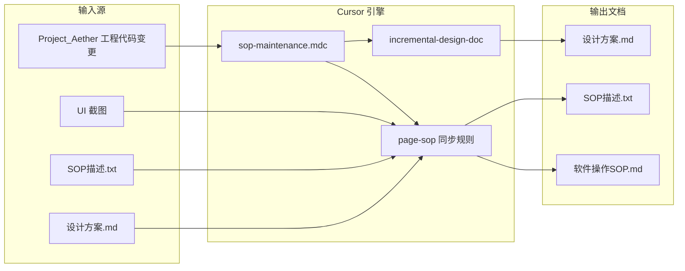
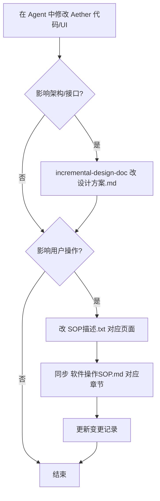

# AOI 检测软件 文档维护部署指南

> 适用项目：`Project_Aether` / `AOI 检测软件`  
> 文档版本：V1.0  
> 更新时间：2026-06-02

本文说明如何在 Cursor 中部署并运行「设计方案 + SOP 描述 + 软件操作 SOP」的增量维护体系。

---

## 1. 体系概览

### 1.1 三层文档职责

| 层级 | 文件 | 角色 | 谁维护 |
| --- | --- | --- | --- |
| 设计层 | `plugins/aoi/docs/AOI 检测软件 设计方案.md` | 架构、流程、接口、模块 | AI 改代码后增量更新 |
| SOP 输入层 | `plugins/aoi/docs/AOI 检测软件 SOP描述.txt` | 页面事实、业务规则、生成约束 | 人工 + AI 增量更新 |
| SOP 输出层 | `plugins/aoi/docs/AOI 检测软件 软件操作SOP.md` | 现场可执行操作手册 | 由上层输入同步生成 |

辅助输入：

- `plugins/aoi/docs/UI截图/` — 页面控件**最高优先级**事实依据
- `plugins/aoi/docs/AOI 检测软件 设计方案.md` — SOP 生成时的术语与背景参考

**冲突优先级**：UI 截图 > SOP描述.txt > 设计方案.md

### 1.2 Cursor 侧组件

| 组件 | 路径 | 作用 |
| --- | --- | --- |
| Project Rule | `.cursor/rules/sop-maintenance.mdc` | 每次 Agent 对话自动加载，规定何时、按何顺序更新文档 |
| Skill（增量设计） | `.cursor/skills/incremental-design-doc/` | 指导如何增量改 `设计方案.md` |
| Skill（增量 SOP） | `.cursor/skills/incremental-sop-doc/` | 增量改 `SOP描述.txt` 与 `软件操作SOP.md`（现场用语） |
| Skill（全量生成） | `.cursor/skills/code-to-template/` | 用户明确要求时，按外部模板从代码全量生成设计文档 |
| 操作 SOP 文风 | `.cursor/sop/templates/sop-writing-style.md` | 操作员/FAE 用语，禁止研发词写进步骤 |
| 操作手册成品约束 | `.cursor/sop/templates/sop-output-constraints.md` | 禁「UI截图」等维护字眼；多图同节；表格/Mermaid 等 |
| SOP 模块索引 | `plugins/aoi/docs/doc-index/sop-modules.md` | 页面模块 ↔ 三份文档章节映射（**随功能演化，在 docs**） |
| 设计章节索引 | `plugins/aoi/docs/doc-index/design-sections.md` | 代码路径 ↔ 设计方案章节（**随功能演化，在 docs**） |
| 模板库 | `.cursor/templates/`、`.cursor/sop/templates/` | 新建 rule / skill / 页面时的空白模板 |

文档维护**仅**由 `sop-maintenance.mdc`（alwaysApply）在 Agent 对话中触发；**不部署** Cursor `stop` Hook，也不在 `plugins/aoi/docs/plans/` 另存功能计划附件。

### 1.3 全链路数据流



### 1.4 两种工作模式

| 模式 | 触发方式 | 适用场景 |
| --- | --- | --- |
| **增量维护**（日常） | Agent 改代码 + Rule 自动生效 | 改一个功能、补一段流程 |
| **全量生成**（偶发） | 用户对 Agent 说「按设计方案模板重新生成」 | 大版本重构、文档从零对齐代码 |

---

## 2. 目录结构（部署完成后）

```
Project_Aether/
├── .cursor/
│   ├── rules/
│   │   └── sop-maintenance.mdc          # 工程规则（alwaysApply）
│   ├── skills/
│   │   ├── incremental-design-doc/      # 设计方案增量 skill（仅 SKILL.md）
│   │   ├── incremental-sop-doc/
│   │   └── code-to-template/
│   ├── sop/
│   │   └── templates/                   # 全书/单节模板、文风、输出约束
│   │       ├── sop-document-template.md # 全书：封面、目录、变更记录
│   │       ├── page-sop-template.md     # 单页章节模板
│   │       ├── sop-writing-style.md     # 现场用语
│   │       ├── revision-log-policy.md
│   │       └── design-section-template.md
│   └── templates/                       # 通用空白模板（新建时用）
│       ├── rule-template.mdc
│       ├── skill-template.md
│       └── sop-description-page-template.txt
└── plugins/aoi/docs/
    ├── AOI 检测软件 SOP描述.txt                     # SOP 真相源
    ├── AOI 检测软件 软件操作SOP.md                   # SOP 输出
    ├── AOI 检测软件 设计方案.md                   # 设计真相源
    ├── doc-index/            # 随功能演化的维护索引（非 .cursor）
    │   ├── sop-modules.md
    │   ├── design-sections.md
    │   └── README.md
    ├── UI截图/          # 页面截图
    ├── README.md                        # docs 总览
    └── guides/               # 维护手册（少改）
        ├── README.md
        ├── 文档维护部署指南.md
        ├── Agent提问示例.md
        └── 知识库使用指南.md
```

---

## 2.1 `.cursor/` 与 `plugins/aoi/docs/` 的分工

| 位置 | 放什么 | 功能演化时是否常改 |
| --- | --- | --- |
| `.cursor/rules/` | 维护协议 | 否 |
| `.cursor/skills/*/SKILL.md` | 增量步骤 | 否 |
| `.cursor/sop/templates/` | 模板、文风、输出约束 | 否 |
| `plugins/aoi/docs/` | 设计方案、SOP描述、操作手册、**doc-index**、截图 | **是** |

日常改页面/模块时，只改 `plugins/aoi/docs/` 下业务文档与 `doc-index/` 索引，**不必提交 `.cursor/` 变更**。

---

## 3. 如何定义 SOP 描述（SOP描述.txt）

### 3.1 文件定位

`plugins/aoi/docs/AOI 检测软件 SOP描述.txt` 不是给操作员看的，而是给 **AI 的结构化输入**，驱动生成/同步 `软件操作SOP.md`。

### 3.2 文件结构

```
【用途】                    ← 文件目的、目标输出路径
【输入源与优先级】          ← UI截图 / 本文件 / 设计方案 的优先级
【硬性输出约束】            ← 语言、风格、每页必含小节、全局章节要求
【页面清单与内容要求】      ← 按业务分组的各页面条目
【输出质量门槛】            ← 禁止空泛、必须可执行等
```

### 3.3 单个页面的写法

每个页面一条，格式如下（可复制 `.cursor/templates/sop-description-page-template.txt`）：

```
1）主页（截图：主页.png）
- 页面事实：
  - 设备控制：初始化、开始、停止、复位……
  - 运行日志、检测结果、数据预览
- 必须写清：
  - 每个控件用途、操作前提、操作后期望、失败处理
  - 一次完整流程中的使用顺序与节拍注意事项
- 规则事实：（可选）
  - 流程完成后刷新检测结果
  - 超阈值弹出复判页
```

**写作要点：**

- **页面事实** = 截图上能看到的控件与行为（客观描述）
- **必须写清** = AI 生成 SOP 时必须展开的操作细节
- **规则事实** = 触发逻辑、阈值、联动行为
- 截图文件名必须与 `plugins/aoi/docs/UI截图/` 中实际文件一致

### 3.4 新增页面时的操作清单

1. 在 `plugins/aoi/docs/UI截图/` 放入新页面截图
2. 在 `SOP描述.txt` 对应大类下追加编号条目
3. 在 `plugins/aoi/docs/doc-index/sop-modules.md` 增加一行映射（id、章节号、截图名）
4. 对 Agent 说：「按 SOP描述 同步新增页面到 软件操作SOP.md §X.X」

### 3.5 废弃页面

- 在 `SOP描述.txt` 对应条目前标注 `[已废弃]`
- 从 `doc-index/sop-modules.md` 删除或标注废弃
- 同步删除/标注 `软件操作SOP.md` 对应章节

---

## 4. 如何从 SOP 描述生成 / 同步软件操作 SOP

### 4.1 首次全量生成

在 Cursor Agent 中发送：

```
请根据 plugins/aoi/docs/AOI 检测软件 SOP描述.txt、plugins/aoi/docs/UI截图/、plugins/aoi/docs/AOI 检测软件 设计方案.md，
生成/刷新 plugins/aoi/docs/AOI 检测软件 软件操作SOP.md。
严格遵守 SOP描述.txt 中的【硬性输出约束】和【输出质量门槛】。
必遵 sop-output-constraints.md：正文中不写「UI截图」「SOP描述.txt」「设计方案.md」；插图路径可含 UI截图/；多图可同节。
步骤不少于 8 步。
```

Agent 会按 `SOP描述.txt` 的页面清单逐页生成完整 Markdown。

### 4.2 日常增量同步（推荐）

代码或页面变更后，Rule 会自动驱动以下顺序：

1. 读取 `.cursor/skills/incremental-sop-doc/SKILL.md`、`sop-writing-style.md`、`sop-output-constraints.md`
2. 先改 `SOP描述.txt` 中对应【页面】段落（只改相关条目）
3. 再改 `软件操作SOP.md` 中对应 §X.X 章节（**现场用语**，只改相关小节）
4. 变更记录见 `revision-log-policy.md`：**先比最后一行日期，跨自然日必须追加新行**；同日小改才合并最后一行

**页面章节必含小节**（不得缺失）：

- 页面目的、适用角色、前置条件
- 核心功能详解（逐控件/逐区域）
- 详细操作步骤（≥ 8 步）
- 结果判定标准
- 常见误区（≥ 3 条）
- 异常处理与恢复（≥ 3 条）
- 页面插图：``（路径可含目录名；图注勿写「UI截图」；多图可同节）

参考：`page-sop-template.md`、`sop-output-constraints.md`

### 4.3 定位章节

打开 `plugins/aoi/docs/doc-index/sop-modules.md`，按 `id` 或页面名查找：

| 字段 | 含义 |
| --- | --- |
| SOP描述.txt | 如「一、1）主页」 |
| SOP.md | 如「§4.1」 |
| 设计方案.md | 如「§8 MES 对接」 |
| 截图 | 文件名 |

### 4.4 变更记录格式

策略全文：`.cursor/sop/templates/revision-log-policy.md`

在 `软件操作SOP.md` 文末 `## 变更记录` 维护：

```
日期 | 模块 | 变更摘要 | 操作人(AI)
2026-06-02 | 主页 §1.1 | 初始化弹窗文案；开始未就绪日志；按钮置灰 | AI
```

**跨自然日**：`todayDate ≠ lastDate` → **必须末尾追加新行**（禁止改旧行日期、禁止合并进旧行）。  
**同日**：小改动 → 只扩写最后一行摘要（`；` 连接），不新增行。  
**跳过**：正文未改的内部修复。

---

## 5. 如何定义 Rules（.cursor/rules/）

### 5.1 是什么

Rules 是 Cursor **工程级持久指令**，放在 `.cursor/rules/*.mdc`，带 YAML frontmatter。

- `alwaysApply: true` → 每次 Agent 对话都加载
- `globs: **/*.qml` + `alwaysApply: false` → 仅编辑匹配文件时加载

### 5.2 本项目的 Rule

文件：`.cursor/rules/sop-maintenance.mdc`

核心内容：

1. 三份文档的职责与优先级
2. 什么变更触发更新、什么跳过
3. 更新顺序：设计方案 → SOP描述 → 软件操作SOP → 变更记录
4. 任务结束前自检清单

### 5.3 新建 Rule 的步骤

1. 复制 `.cursor/templates/rule-template.mdc` 为 `.cursor/rules/{名称}.mdc`
2. 填写 frontmatter 的 `description`
3. 选择 `alwaysApply` 或 `globs`
4. 保存后在 **Cursor Settings → Rules → Project Rules** 确认已识别
5. 新开 Agent 对话验证

### 5.4 Rule 写作原则

- 单条规则 **≤ 50 行** 为佳，复杂细节放到 Skill
- 一条规则只管一类事（SOP 维护、编码规范等分开）
- 写清「顺序」和「禁止全量重写」

---

## 6. 如何定义 Skills（.cursor/skills/）

### 6.1 是什么

Skills 是 **可复用的任务执行手册**，Agent 在特定场景下读取并遵循。  
本项目 Skills 放在 `.cursor/skills/{skill-name}/SKILL.md`（工程内共享）。

### 6.2 本项目文档维护 Skill

| Skill | 路径 | 何时用 |
| --- | --- | --- |
| incremental-design-doc | `.cursor/skills/incremental-design-doc/` | 改代码后增量维护设计方案 |
| incremental-sop-doc | `.cursor/skills/incremental-sop-doc/` | 用户可见变更后增量维护 SOP 与操作手册 |
| code-to-template | `.cursor/skills/code-to-template/` | 用户要求按外部模板全量生成文档 |

### 6.3 新建 Skill 的步骤

1. 创建目录 `.cursor/skills/{skill-name}/`
2. 复制 `.cursor/templates/skill-template.md` 为 `SKILL.md`
3. 填写 frontmatter：
   - `name`：小写+连字符，≤ 64 字符
   - `description`：第三人称，含 **做什么 + 何时触发**（Agent 靠此发现 skill）
4. 维护 `doc-index/design-sections.md` 等索引（在 docs，不在 skill 目录）
5. 在 Rule 中引用 skill 路径

### 6.4 Skill 与 Rule 的分工

| | Rule | Skill |
| --- | --- | --- |
| 作用 | 规定「要不要做、顺序是什么」 | 规定「具体怎么做」 |
| 加载 | 自动（alwaysApply） | Agent 按需 Read |
| 篇幅 | 短 | 可详，建议 < 500 行 |

---

## 7. 如何维护设计方案（增量）

### 7.0 首次从代码创建（尚无设计文档时）

**读代码起点**：本工程「`Project_Aether`」**工作区根目录**（Cursor Open Folder 打开的文件夹）。

> ⚠️ **不要**用 `plugins/aoi/docs/../` 推断源码根。例如文档在 `plugins/aoi/docs` 时，`../` 只到 `plugins/aoi/`，会漏掉与 `plugins/aoi/` 同级的 `plugins/lighten` 等目录。

在 Agent 中发送（详见 `guides/Agent提问示例.md` §1 或 §2）：

```
请阅读本工程「Project_Aether」工作区根目录下的主要源码（{{列举目录}}），
编写 plugins/aoi/docs/AOI 检测软件 设计方案.md 初稿……
```

全量按外部模板生成时，代码源同样写「`Project_Aether` 根目录下的 …」，见 `guides/Agent提问示例.md` §1。

### 7.1 触发条件

- 模块/Handler/工艺/Controller/Action 变更
- 业务流程、状态机、消息命令、配置 schema、MES 链路变化

### 7.2 操作步骤

1. Agent 读取 `.cursor/skills/incremental-design-doc/SKILL.md`
2. 查 `plugins/aoi/docs/doc-index/design-sections.md` 定位设计方案章节
3. 只改受影响 `##` / `###` 段落
4. 按 `.cursor/sop/templates/revision-log-policy.md` 更新 `# **修订记录**`（**先比日期，跨日必追加**；同日小改才合并最后一行）

新增设计章节模板：`.cursor/sop/templates/design-section-template.md`

### 7.3 全量重新生成（慎用）

仅当用户明确说「按设计方案模板从代码重新生成」时，使用：

`.cursor/skills/code-to-template/SKILL.md`

模板文件默认在 `D:/Downloads/模板/` 下查找 `*设计方案*模板.md`。

---

## 8. 文档维护如何触发

本套件**不部署** Cursor `stop` Hook（已移除 `sop-reminder` 兜底策略）。

| 机制 | 说明 |
| --- | --- |
| **sop-maintenance.mdc** | `alwaysApply: true`，每次 Agent 对话加载；按 Rule 内「触发条件」决定是否更新文档 |
| **增量 Skill** | `incremental-design-doc`、`incremental-sop-doc` 执行具体改写 |
| **不另存 plans** | 功能设计写入 `AOI 检测软件 设计方案.md`；勿在 `plugins/aoi/docs/plans/` 建独立附件 |

改代码后若文档未同步，在对话中明确要求：「请按文档维护协议更新设计方案与 SOP。」

---

## 9. 完整部署步骤（从零复制到新项目）

### 步骤 1：复制 `.cursor/` 目录

将本项目的 `.cursor/` 整体复制到新工程根目录，或按需裁剪。

### 步骤 2：准备 `plugins/aoi/docs/` 文档

| 文件 | 动作 |
| --- | --- |
| `AOI 检测软件 SOP描述.txt` | 按第 3 节编写或从范例复制后改 |
| `UI截图/` | 放入各页面 PNG |
| `AOI 检测软件 设计方案.md` | 已有则保留；没有则 Agent 从「Project_Aether」根目录读代码生成（见 §7.0） |
| `AOI 检测软件 软件操作SOP.md` | 首次按第 4.1 节生成 |

### 步骤 3：定制索引

- 改 `plugins/aoi/docs/doc-index/sop-modules.md` 中的模块表
- 改 `plugins/aoi/docs/doc-index/design-sections.md` 中的代码路径映射

### 步骤 4：定制 Rule

- 改 `.cursor/rules/sop-maintenance.mdc` 中的文件路径、项目名

### 步骤 5：打开 Cursor 工作区

**File → Open Folder → 工程根目录**（必须根目录，不能只开 plugins/aoi 子目录）。

### 步骤 6：确认 Rules 生效

**Settings → Rules → Project Rules** 中应看到 `sop-maintenance`。

### 步骤 7：提交 Git

```powershell
cd <工程根目录，即 Project_Aether 所在路径>
git add .cursor/ plugins/aoi/docs/guides/
git commit -m "添加 Cursor 文档增量维护体系"
```

### 步骤 8：验证

对 Agent 说：

```
我在主页新增「暂停」按钮，请改代码并按文档维护协议更新全部相关文档。
```

预期：设计方案（若涉及 Action）→ SOP描述.txt → 软件操作SOP.md 均被增量更新。

---

## 10. 日常维护工作流



**人工只需关注：**

1. 新页面：补截图 + SOP描述条目 + 索引行
2. PR Review 时重点看 `SOP描述.txt`、`软件操作SOP.md`、`设计方案.md`  diff
3. 大版本：可选触发 `code-to-template` 全量对齐

---

## 11. 模板文件速查

| 模板 | 路径 | 用途 |
| --- | --- | --- |
| Rule 空白模板 | `.cursor/templates/rule-template.mdc` | 新建工程规则 |
| Skill 空白模板 | `.cursor/templates/skill-template.md` | 新建 skill |
| SOP 描述页模板 | `.cursor/templates/sop-description-page-template.txt` | 在 SOP描述.txt 中新增页面 |
| 软件操作SOP 页模板 | `.cursor/sop/templates/page-sop-template.md` | 单页参考结构（非机械一页一图） |
| 操作手册成品约束 | `.cursor/sop/templates/sop-output-constraints.md` | 生成 AOI 检测软件 软件操作SOP.md 时禁维护用语、富版式 |
| 设计方案章节模板 | `.cursor/sop/templates/design-section-template.md` | 设计方案新增模块节 |

---

## 12. 常见问题

### Q1：我手改代码，文档会自动更新吗？

不会。体系依赖 **Cursor Agent** 改代码并遵循 Rule。手改后需对 Agent 说：「请按文档维护协议同步相关文档。」

### Q2：Rule 没生效？

- 确认工作区根目录是本工程「Project_Aether」文件夹（与 setup 填写的工程名称一致）
- Settings → Rules 中 Project Rules 是否启用
- 新开对话（旧对话可能未加载新 rule）

### Q3：SOP描述 和 软件操作SOP 哪个是真相源？

**SOP描述.txt** 是真相源；**软件操作SOP.md** 是面向现场的输出。不要只改 SOP.md 而不改 SOP描述.txt。

### Q4：会话结束没有自动提醒更新文档？

正常。本体系已取消 `stop` Hook；请在同一对话结束前让 Agent 按 Rule 自检，或新开对话说明「请按文档维护协议补文档」。

### Q5：其他项目如何复用？

复制 `.cursor/`，改写 Rule 中的路径、索引表、SOP描述.txt 结构即可；Skills 逻辑可复用。

---

## 13. 相关联文档

| 文档 | 路径 |
| --- | --- |
| 工程维护 Rule | `.cursor/rules/sop-maintenance.mdc` |
| 设计方案增量 Skill | `.cursor/skills/incremental-design-doc/SKILL.md` |
| 全量生成 Skill | `.cursor/skills/code-to-template/SKILL.md` |
| SOP 模块索引 | `plugins/aoi/docs/doc-index/sop-modules.md` |
| 设计章节索引 | `plugins/aoi/docs/doc-index/design-sections.md` |
| SOP 真相源 | `plugins/aoi/docs/AOI 检测软件 SOP描述.txt` |
| 操作手册 | `plugins/aoi/docs/AOI 检测软件 软件操作SOP.md` |
| 设计文档 | `plugins/aoi/docs/AOI 检测软件 设计方案.md` |

---

## 14. 自检清单（部署验收）

- [ ] `.cursor/rules/sop-maintenance.mdc` 存在且 `alwaysApply: true`
- [ ] `.cursor/skills/incremental-design-doc/`、`incremental-sop-doc/` 与 `code-to-template/` 存在
- [ ] `.cursor/sop/templates/sop-writing-style.md` 与 `sop-output-constraints.md` 存在
- [ ] `doc-index/sop-modules.md` 模块表与 SOP描述.txt 一致
- [ ] 未部署 doc-maintenance 用 `.cursor/hooks.json`（若曾手动添加旧版 sop-reminder，请自行删除）
- [ ] `plugins/aoi/docs/AOI 检测软件 SOP描述.txt` 页面清单完整
- [ ] `plugins/aoi/docs/UI截图/` 与 SOP描述 中文件名一致
- [ ] Cursor 以工程根目录打开，Project Rules 可见
- [ ] Agent 试跑一次增量更新验证通过
